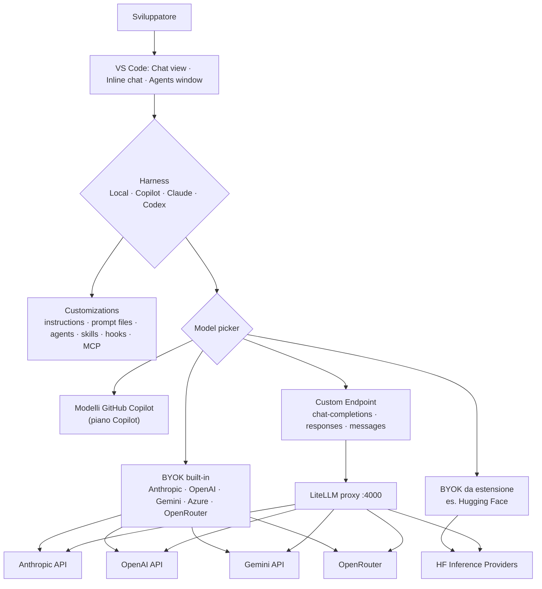
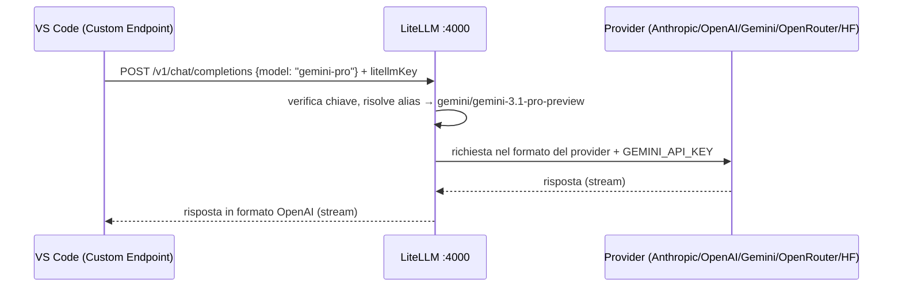

# 02 — Configurazione di GitHub Copilot in Visual Studio Code con LLM via API

Questo documento descrive come GitHub Copilot in VS Code usa modelli di provider esterni.
Confronta due percorsi: **configurazione nativa** (BYOK diretto verso ogni provider) e **gateway LiteLLM** (un solo endpoint locale verso tutti i provider).

Prerequisiti: [01-Installazione.md](01-Installazione.md). Decisioni di riferimento: [D-003](Decisions.md#d-003), [D-007](Decisions.md#d-007), [D-008](Decisions.md#d-008), [D-013](Decisions.md#d-013), [D-015](Decisions.md#d-015)…[D-021](Decisions.md#d-021).

La review con Perplexity (P-01…P-08) ha corretto questa versione: vedi il registro in [Review-Perplexity.md](Review-Perplexity.md#registro-degli-esiti).

## Indice

1. [Uso di GitHub Copilot in VS Code](#1-uso-di-github-copilot-in-vs-code)
2. [Architettura del client ed elementi configurabili](#2-architettura-del-client-ed-elementi-configurabili)
3. [Configurazione nativa verso i provider](#3-configurazione-nativa-verso-i-provider)
4. [GitHub Copilot con LiteLLM come gateway](#4-github-copilot-con-litellm-come-gateway)
5. [Appendice A — GitHub Spec Kit con Copilot](#appendice-a--github-spec-kit-con-copilot)

---

## 1. Uso di GitHub Copilot in VS Code

GitHub Copilot in VS Code offre queste funzioni:

| Funzione | Descrizione | Modelli BYOK |
|----------|-------------|--------------|
| **Inline suggestions, Next Edit Suggestions (NES)** | Suggerimenti di codice durante la scrittura | No: richiedono account GitHub e piano Copilot ([S-001](Sources.md#s-001), [S-070](Sources.md#s-070)) |
| **Chat view** | Conversazione con il modello nella barra laterale | Sì |
| **Inline chat** | Chat nell'editor, sul codice selezionato (`inlineChat.defaultModel`) | Sì |
| **Agents** | Un agente esegue un'attività con strumenti (file, terminale, MCP). Chat view e *Agents window* eseguono agenti ([S-008](Sources.md#s-008)) | Sì, solo modelli con *tool calling* |
| **Utility tasks** | Titoli, sommari, messaggi di commit, descrizioni di PR | Sì, con `chat.utilityModel` / `chat.utilitySmallModel` |
| **Semantic search, embeddings** | Indicizzazione e ricerca nel workspace | No ([S-001](Sources.md#s-001)) |

**Harness.** Un *harness* è il motore che esegue l'agente. Il cambio di modello non cambia l'harness ([S-068](Sources.md#s-068)).

| Harness | Dove esegue | Accesso ai modelli | BYOK |
|---------|-------------|--------------------|------|
| **Copilot** | Copilot SDK nell'Agent Host; la sessione continua anche dopo la chiusura della finestra; Chat view e Agents window | GitHub Copilot | Sperimentale: `chat.agentHost.byokModels.enabled` |
| **Local** | Harness integrato, nell'extension host; la sessione si ferma con la finestra; solo Chat view | Provider configurati | Sì, anche senza account GitHub e senza piano Copilot |
| **Claude** | Claude Agent SDK, nel workspace o in un worktree | Credenziali Anthropic o modelli instradati da Copilot | Credenziali proprie dell'harness |
| **Codex** | Estensione OpenAI Codex o integrazione sperimentale con l'Agent Host | Abbonamento Copilot (Pro+) o account ChatGPT | No |

Fonti: [S-001](Sources.md#s-001), [S-068](Sources.md#s-068). **Cloud** non è un harness: è una destinazione di esecuzione (sperimentale) dell'harness Copilot ([S-068](Sources.md#s-068)).

**La demo usa l'harness Local** per i modelli BYOK: è il percorso completo e non sperimentale. Un modello BYOK **non** configura gli harness Claude e Codex ([S-001](Sources.md#s-001), [D-003](Decisions.md#d-003)).

**Messaggio chiave del talk.** Il BYOK cambia il *modello*. Non cambia l'esperienza: chat, agenti, strumenti, istruzioni e skill restano gli stessi.

---

## 2. Architettura del client ed elementi configurabili

### 2.1 Livelli



Il modello è un elemento **indipendente** dalle customizations. Un'istruzione o una skill funziona con ogni modello che supporta gli strumenti richiesti.

### 2.2 Tipi di modello (model picker)

Il **Language Models editor** gestisce i modelli. Aprilo con l'icona a ingranaggio nel model picker, o con il comando **Chat: Manage Language Models** ([S-001](Sources.md#s-001)).

| Tipo | Come si aggiunge | Uso nel talk |
|------|------------------|--------------|
| **Built-in provider** | *Add Models* → provider (Anthropic, Azure, Gemini, OpenAI, OpenRouter) → chiave ([S-070](Sources.md#s-070)) | Claude, Codex, Gemini, OpenRouter nativi |
| **Extension provider** | *Install Model Providers*, o ricerca `@tag:language-models` nella vista Extensions | Hugging Face nativo |
| **Custom Endpoint** | *Add Models* → **Custom Endpoint**; dettagli in `chatLanguageModels.json`. In Stable dalla versione 1.122 ([S-070](Sources.md#s-070)) | HF senza estensione, LiteLLM |

> Il provider *Custom Endpoint* sostituisce il provider *OpenAI Compatible* e l'impostazione `github.copilot.chat.customOAIModels`, ora deprecati ([S-001](Sources.md#s-001), [D-007](Decisions.md#d-007)).
> Il provider built-in Ollama è deprecato: usa l'estensione ufficiale Ollama ([S-001](Sources.md#s-001)).

### 2.3 Elementi configurabili e posizione nel filesystem

La posizione dei file dipende dall'**harness** ([S-068](Sources.md#s-068), [S-069](Sources.md#s-069)). La tabella mostra gli harness Copilot e Local.

| Elemento | Workspace (repo) | Utente — harness Copilot | Utente — harness Local | Note | Fonte |
|----------|------------------|--------------------------|------------------------|------|-------|
| Project instructions | `.github/copilot-instructions.md`, `AGENTS.md`; `CLAUDE.md` solo Local e Claude | `~/.copilot/copilot-instructions.md` | profilo utente VS Code (Agent Customizations editor) | L'harness Copilot non legge `CLAUDE.md` | [S-069](Sources.md#s-069) |
| Targeted instructions | `.github/instructions/**/*.instructions.md` (frontmatter `applyTo`, `description`) | `~/.copilot/instructions/**/*.instructions.md` | profilo utente VS Code | `description` per la scelta del task solo in Local | [S-003](Sources.md#s-003), [S-069](Sources.md#s-069) |
| Prompt files | `.github/prompts/*.prompt.md` | non supportati | profilo utente VS Code | Solo harness Local, Chat view | [S-002](Sources.md#s-002), P-03 |
| Custom agents | `.github/agents/*.agent.md` (anche `*.md`) | `~/.copilot/agents/` | profilo utente VS Code | `handoffs` solo in Local | [S-007](Sources.md#s-007), [S-072](Sources.md#s-072) |
| Agent skills | `.github/skills/<nome>/SKILL.md` (anche `.claude/skills/`, `.agents/skills/`) | `~/.copilot/skills/` | `~/.copilot/skills/`, `~/.claude/skills/`, `~/.agents/skills/` | Local legge tutte e sei le cartelle | [S-004](Sources.md#s-004) |
| Hooks | `.github/hooks/*.json`; `hooks` in `.github/copilot/settings.json` | `~/.copilot/hooks/` (o `$COPILOT_HOME/hooks/`), `~/.copilot/settings.json` | — | Seguono l'harness selezionato | [S-006](Sources.md#s-006), [S-073](Sources.md#s-073) |
| MCP servers | Copilot: `.mcp.json` nella radice, chiave `mcpServers` (sperimentale: `chat.mcp.workspaceRootConfig.enabled`). Local: `.vscode/mcp.json`, chiave `servers` (deprecato, compatibilità) | `~/.copilot/mcp-config.json` | `mcp.json` del profilo (deprecato) | I due formati non sono intercambiabili | [S-005](Sources.md#s-005), P-03 |
| Language models (BYOK) | — | — | `chatLanguageModels.json` nella cartella `User` del profilo (vedi sotto) | Non ereditato dai profili non default | [S-001](Sources.md#s-001), [S-074](Sources.md#s-074) |
| Settings | `.vscode/settings.json` | `settings.json` utente | `settings.json` utente | — | [S-001](Sources.md#s-001) |

**Percorso di `chatLanguageModels.json`** (VS Code Stable; la documentazione ufficiale non lo indica) ⚠️:

| Sistema | Percorso | Fonte |
|---------|----------|-------|
| Windows | `%APPDATA%\Code\User\chatLanguageModels.json` | [S-074](Sources.md#s-074) |
| macOS | `~/Library/Application Support/Code/User/chatLanguageModels.json` | P-01 (fonti di terze parti) |
| Linux | `~/.config/Code/User/chatLanguageModels.json` | P-01 (fonti di terze parti) |
| Profilo non default | `User/profiles/<profileId>/chatLanguageModels.json` | [S-074](Sources.md#s-074) |

> Usa l'**Agent Customizations editor** per creare file utente: l'editor sceglie il percorso corretto per l'harness.

**Esempio di struttura del repo con customizations:**

```text
.
├── AGENTS.md
├── .github/
│   ├── copilot-instructions.md
│   ├── instructions/
│   │   └── python.instructions.md      # applyTo: '**/*.py'
│   ├── prompts/
│   │   └── review.prompt.md
│   ├── agents/
│   │   └── reviewer.agent.md
│   ├── skills/
│   │   └── webapp-testing/
│   │       └── SKILL.md
│   └── hooks/
│       └── audit.json
└── .vscode/
    ├── mcp.json
    └── settings.json
```

**Esempio — skill** (`.github/skills/webapp-testing/SKILL.md`) ([S-004](Sources.md#s-004)):

```markdown
---
name: webapp-testing
description: Test the web app login flow with Playwright. Use when the user asks to test UI flows.
argument-hint: "[page or flow]"
---
Run the Playwright tests in `tests/e2e`. Use the template in [test template](./test-template.js).
```

Il campo `name` deve corrispondere al nome della cartella (minuscole, numeri, trattini, massimo 64 caratteri). Se il nome è errato, la skill non si carica e VS Code non mostra errori ([S-004](Sources.md#s-004), P-03). `context: fork` è sperimentale e richiede `github.copilot.chat.skillTool.enabled`.

**Esempio — hook** (`.github/hooks/audit.json`) ([S-006](Sources.md#s-006)). Eventi: `sessionStart`, `userPromptSubmitted`, `preToolUse`, `postToolUse`, `preCompact`, `subagentStart`, `subagentStop`, `agentStop`, `sessionEnd`, `errorOccurred` ([S-073](Sources.md#s-073)):

```json
{
  "version": 1,
  "hooks": {
    "preToolUse": [
      { "type": "command", "command": "node .github/hooks/log-tool-use.cjs", "timeoutSec": 10 }
    ]
  }
}
```

### 2.4 Impostazioni per BYOK

| Impostazione | Funzione |
|--------------|----------|
| `chat.utilityModel` | Modello per titoli, sommari, settings search, Git review. Valore in formato `vendor/id` ⚠️ ([S-075](Sources.md#s-075)) |
| `chat.utilitySmallModel` | Modello per messaggi di commit, descrizioni di PR, suggerimenti di nomi, intent detection. Formato `vendor/id` |
| `chat.byokUtilityModelDefault` | Default per le utility: `none`, `mainAgent`, `copilot` (nella UI: None, Main Agent Model, GitHub Copilot) |
| `chat.agentHost.byokModels.enabled` | (Sperimentale) modelli BYOK nell'harness Copilot |
| `inlineChat.defaultModel` | Modello di default dell'inline chat |

Fonte: [S-001](Sources.md#s-001). Senza accesso GitHub i modelli di utilità built-in non sono disponibili: imposta `chat.utilityModel` e `chat.utilitySmallModel` su un modello BYOK. Scegli il modello dalla UI delle impostazioni: il valore scritto nel file è generato da VS Code.

```jsonc
// .vscode/settings.json — esempio. ⚠️ Formato vendor/id da confermare in prova (issue aperta S-075)
{
  "chat.utilitySmallModel": "customendpoint/codex",
  "chat.byokUtilityModelDefault": "mainAgent"
}
```

> L'issue [S-075](Sources.md#s-075) propone di unificare questi setting in `chat.featureModels`: i nomi possono cambiare.

### 2.5 Policy per Copilot Business ed Enterprise

| Meccanismo | Dove si configura | Effetto | Fonte |
|------------|-------------------|---------|-------|
| **BYOK configurato dall'utente** (local BYOK) | Policy *Bring Your Own Language Model Key in VS Code*. **Attiva di default**: l'amministratore la può disattivare | Le chiavi restano sul client; le richieste vanno direttamente al provider | [S-018](Sources.md#s-018), [S-015](Sources.md#s-015) |
| **BYOK configurato da enterprise/organizzazione** (public preview) | Enterprise: **AI controls → Copilot → Configure custom models → Add API key**. Delega alle organizzazioni con la policy *Enable custom models*; organizzazione: **Settings → Copilot → Models → Custom models** | Chiavi lato server; i modelli passano dalla Copilot API a tutti gli utenti con licenza | [S-015](Sources.md#s-015), [S-019](Sources.md#s-019), [S-101](Sources.md#s-101) |

> ⚠️ **Fonti non coerenti.** Il changelog GitHub dice che la policy è "enabled by default" ([S-018](Sources.md#s-018)). La FAQ di VS Code dice ancora che l'amministratore "must enable" la policy ([S-071](Sources.md#s-071)). Se il model picker non mostra **Manage Language Models**, chiedi all'amministratore di controllare la policy ([D-013](Decisions.md#d-013)).

**Fatturazione.** Il BYOK locale non consuma crediti Copilot: il provider fattura le chiamate ([S-018](Sources.md#s-018)). Dal 2026-06-01 Copilot usa i GitHub AI Credits al posto delle premium requests ([S-100](Sources.md#s-100)).

**Piani individuali (Free, Pro, Pro+, Max, Student).** Nessuna policy: il BYOK locale è disponibile nel Language Models editor. Il BYOK funziona anche senza piano Copilot, nell'harness Local ([S-001](Sources.md#s-001), P-02).

**Altri client con BYOK locale:** JetBrains, Xcode, Copilot CLI, GitHub Copilot app, Copilot SDK ([S-015](Sources.md#s-015)). La policy IDE non controlla il BYOK di Copilot CLI (P-02).

---

## 3. Configurazione nativa verso i provider

### 3.0 Procedura comune

- [ ] Apri il Language Models editor: **Chat: Manage Language Models**.
- [ ] Seleziona **Add Models**.
- [ ] Seleziona il provider (built-in, da estensione, o **Custom Endpoint**).
- [ ] Inserisci un nome di gruppo.
- [ ] Inserisci la chiave API o i dettagli dell'endpoint.
- [ ] Se VS Code apre `chatLanguageModels.json`, completa i dettagli del modello.
- [ ] Seleziona il modello nel model picker della Chat view.
- [ ] Se il modello non è visibile, riavvia VS Code.

Fonte: [S-001](Sources.md#s-001).

> **Chiavi nei comandi.** Negli esempi `curl` la chiave passa da stdin (`printf … | curl -H @-`): non compare negli argomenti del processo ([01 §7](01-Installazione.md#7-verifica-finale)).
> **Chiavi API.** Nei file JSON usa sempre una variabile di input (`"${input:nome}"`), non la chiave in chiaro ([S-001](Sources.md#s-001)).
> **Header di autenticazione.** Con `apiType: messages` VS Code invia `x-api-key`; con URL Azure OpenAI invia `api-key`; negli altri casi `Authorization: Bearer <apiKey>`. Con `requestHeaders` puoi aggiungere header; il token `${apiKey}` diventa la chiave configurata ([S-071](Sources.md#s-071)).
> **Agenti.** Solo i modelli con *tool calling* sono visibili per gli agenti ([S-001](Sources.md#s-001)).
> **Token.** La somma di `maxInputTokens` e `maxOutputTokens` non deve superare la finestra di contesto del modello ([S-001](Sources.md#s-001)).

### 3.1 Claude.AI (Anthropic API)

| Voce | Valore |
|------|--------|
| Provider | **Anthropic** (built-in) |
| Chiave | `ANTHROPIC_API_KEY` dalla Claude Console |
| Modelli esempio | `claude-opus-5-5`, `claude-sonnet-5-5`, `claude-haiku-5-5` ([S-040](Sources.md#s-040)) |
| Endpoint | `https://api.anthropic.com/v1/messages` ([S-040](Sources.md#s-040)) |

- [ ] Esegui la procedura comune con il provider **Anthropic**.
- [ ] Verifica la chiave fuori da VS Code ([S-040](Sources.md#s-040)):

```bash
printf 'x-api-key: %s\n' "$ANTHROPIC_API_KEY" \
  | curl https://api.anthropic.com/v1/messages -H @- \
  -H "anthropic-version: 2026-10-21" \
  -H "content-type: application/json" \
  -d '{"model": "claude-sonnet-5-5", "max_tokens": 64, "messages": [{"role": "user", "content": "Hello"}]}'
```

> `2026-10-21` è la versione API raccomandata. Rimuove `temperature`, `top_p` e `top_k`: se li invii, l'API restituisce 400 ([S-116](Sources.md#s-116), [D-021](Decisions.md#d-021)).

> Il livello di *thinking* si imposta dal model picker. L'impostazione `github.copilot.chat.anthropic.thinking.effort` è deprecata ([S-001](Sources.md#s-001)).

### 3.2 Codex (OpenAI API)

| Voce | Valore |
|------|--------|
| Provider | **OpenAI** (built-in) |
| Chiave | `OPENAI_API_KEY` |
| Modelli esempio | `gpt-6.1-sol` (anche `gpt-6-astra`) ([S-042](Sources.md#s-042), [D-015](Decisions.md#d-015)) |
| API | Responses API ([S-042](Sources.md#s-042), [S-043](Sources.md#s-043)) |

> **Nessun modello "Codex" attivo via API.** I modelli con "codex" nel nome sono *Shut down*; `gpt-5.3-codex` è *Deprecated* ([S-102](Sources.md#s-102)). Nel talk "Codex" indica il modello raccomandato per Codex: `gpt-6.1-sol`.

- [ ] Esegui la procedura comune con il provider **OpenAI**.
- [ ] Verifica la chiave:

```bash
printf 'Authorization: Bearer %s\n' "$OPENAI_API_KEY" \
  | curl https://api.openai.com/v1/responses -H @- \
  -H "Content-Type: application/json" \
  -d '{"model": "gpt-6.1-sol", "input": "Hello"}'
```

> La disponibilità di un modello con chiave API dipende dall'organizzazione e dal progetto OpenAI ([S-042](Sources.md#s-042)). Verifica gli ID nel catalogo modelli prima del talk.
> **Codex harness ≠ modello OpenAI BYOK.** L'harness Codex di VS Code ha credenziali proprie ([S-001](Sources.md#s-001)).

### 3.3 Gemini Pro (Google AI Studio)

| Voce | Valore |
|------|--------|
| Provider | **Gemini** (built-in) |
| Chiave | `GEMINI_API_KEY` da Google AI Studio |
| Modelli esempio | `gemini-4-argon` (punta, stabile, tier a pagamento); `gemini-3.1-pro-preview` (unico Pro, preview); `gemini-3.8-flash` (Flash, stabile) ([S-044](Sources.md#s-044), [S-103](Sources.md#s-103), [D-016](Decisions.md#d-016)) |
| Endpoint OpenAI-compatible | `https://generativelanguage.googleapis.com/v1beta/openai/` ([S-045](Sources.md#s-045)) |

- [ ] Esegui la procedura comune con il provider **Gemini**.
- [ ] Verifica la chiave con l'endpoint OpenAI-compatible:

```bash
printf 'Authorization: Bearer %s\n' "$GEMINI_API_KEY" \
  | curl https://generativelanguage.googleapis.com/v1beta/openai/chat/completions -H @- \
  -H "Content-Type: application/json" \
  -d '{"model": "gemini-4-argon", "messages": [{"role": "user", "content": "Hello"}]}'
```

> `gemini-2.5-pro` è deprecato (review P-05). Non usarlo negli esempi.

### 3.4 OpenRouter (provider built-in o Custom Endpoint)

| Voce | Valore |
|------|--------|
| Provider | **OpenRouter** (built-in dalla versione 1.122) ([S-070](Sources.md#s-070)) |
| Chiave | `OPENROUTER_API_KEY` |
| Base URL | `https://openrouter.ai/api/v1` ([S-046](Sources.md#s-046)) |
| Modello esempio | `openai/gpt-oss-120b` (P-05) |

- [ ] Esegui la procedura comune con il provider **OpenRouter**.

**Alternativa — Custom Endpoint** (blocco in [`examples/vscode/chatLanguageModels.native.json`](../examples/vscode/chatLanguageModels.native.json)). Gli header `HTTP-Referer` e `X-OpenRouter-Title` sono opzionali: servono per l'attribuzione dell'app nelle classifiche OpenRouter. `X-Title` è solo per compatibilità ([S-121](Sources.md#s-121)).

```json
{
  "name": "OpenRouter (Custom Endpoint, alternativa al provider built-in)",
  "vendor": "customendpoint",
  "apiKey": "${input:openrouterApiKey}",
  "apiType": "chat-completions",
  "models": [
    {
      "id": "openai/gpt-oss-120b",
      "name": "OpenRouter · gpt-oss-120b",
      "url": "https://openrouter.ai/api/v1/chat/completions",
      "toolCalling": true,
      "vision": false,
      "maxInputTokens": 112000,
      "maxOutputTokens": 16000,
      "requestHeaders": {
        "HTTP-Referer": "https://github.com/giulianolatini/WPC2026",
        "X-OpenRouter-Title": "WPC2026 demo"
      }
    }
  ]
}
```

- [ ] Elenca gli ID disponibili:

```bash
curl -s https://openrouter.ai/api/v1/models | head -c 600
```

### 3.5 Hugging Face (estensione ufficiale o Custom Endpoint)

**Percorso principale — estensione** ([S-048](Sources.md#s-048), [D-008](Decisions.md#d-008)):

- [ ] Crea un token *fine-grained* con il permesso **Make calls to Inference Providers** ([S-047](Sources.md#s-047)).
- [ ] Installa l'estensione *Hugging Face Provider for GitHub Copilot Chat* (VS Code ≥ 1.104.0) ([S-048](Sources.md#s-048), [S-049](Sources.md#s-049)).
- [ ] Apri il model picker → **Manage Models…** → **Hugging Face**.
- [ ] Inserisci il token.
- [ ] Seleziona i modelli da aggiungere al model picker.

> Se il provider Hugging Face non è visibile, aggiorna VS Code e ricarica la finestra ([S-048](Sources.md#s-048)).

**Percorso alternativo — Custom Endpoint** verso il router OpenAI-compatible `https://router.huggingface.co/v1` ([S-047](Sources.md#s-047)):

```json
{
  "name": "Hugging Face Router",
  "vendor": "customendpoint",
  "apiKey": "${input:hfToken}",
  "apiType": "chat-completions",
  "models": [
    {
      "id": "openai/gpt-oss-120b:groq",
      "name": "HF · gpt-oss-120b (groq)",
      "url": "https://router.huggingface.co/v1/chat/completions",
      "toolCalling": true,
      "vision": false,
      "maxInputTokens": 112000,
      "maxOutputTokens": 16000
    }
  ]
}
```

Il suffisso dell'ID sceglie il provider di inferenza: `:fastest` (default), `:cheapest`, `:preferred`, oppure `:<provider>` (es. `:groq`) ([S-047](Sources.md#s-047)). L'esempio fissa `:groq`: così sai quale provider tratta i dati ([04 AZ-06](04-Security-Review-OWASP-ISO27001.md#9-azioni)).

### 3.6 Riepilogo della configurazione nativa

| Provider | Tipo di provider in VS Code | Formato API | Chiavi da gestire sul client |
|----------|-----------------------------|-------------|------------------------------|
| Claude.AI | Built-in Anthropic | Messages | 1 |
| Codex | Built-in OpenAI | Responses | 1 |
| Gemini | Built-in Gemini | Gemini / OpenAI-compatible | 1 |
| OpenRouter | Built-in OpenRouter (o Custom Endpoint) | Chat Completions | 1 |
| Hugging Face | Estensione HF o Custom Endpoint | Chat Completions | 1 |
| **Totale** | 4–5 configurazioni | 3 formati | **5 chiavi su ogni client** |

---

## 4. GitHub Copilot con LiteLLM come gateway

### 4.1 Quando usare un gateway

LiteLLM proxy espone un solo endpoint locale. Traduce le richieste nei formati dei provider ([S-022](Sources.md#s-022)). La scelta tra nativo e gateway dipende dal contesto ([D-017](Decisions.md#d-017)).

**Criteri di scelta**

| Contesto | Raccomandazione |
|----------|-----------------|
| Singolo sviluppatore, pochi provider | **Nativo.** Nessun componente in più, nessun punto singolo di guasto |
| Team con chiavi condivise, budget, allowlist di modelli, log centralizzati | **Gateway**, con hardening (sotto) |
| Organizzazione su Copilot Business/Enterprise | Valuta prima l'**Enterprise BYOK** di GitHub (§4.6) |
| Uso di thinking Anthropic con tool | Nativo, o gateway con `apiType: messages` ([D-019](Decisions.md#d-019)) |

**Confronto**

| Aspetto | Nativo | LiteLLM |
|---------|--------|---------|
| Chiavi dei provider | Su ogni client VS Code (secret storage) | Solo sul gateway (`.env` o DB) |
| Chiave sul client | 5 | 1 (virtual key) |
| Impatto di una compromissione | Una chiave di uno sviluppatore | Tutte le chiavi di tutti i provider ([S-104](Sources.md#s-104)) |
| Nomi dei modelli | ID del vendor | Alias stabili (`model_name`) |
| Formato API verso VS Code | Nativo del provider | `chat-completions`, `responses`, `messages` tradotti ([S-028](Sources.md#s-028), [S-029](Sources.md#s-029)) |
| Thinking Anthropic con tool | Preservato | A rischio con `chat-completions` ([S-110](Sources.md#s-110)) |
| Cambio di modello | Riconfigura ogni client | Modifica `config.yaml` e riavvia |
| Budget, spend log, chiavi per utente | No | Sì, profilo esteso con PostgreSQL ([S-020](Sources.md#s-020)) |
| Latenza aggiunta | — | Pochi ms dichiarati dal vendor; trascurabile (P-08) |
| Componenti da gestire | Nessuno | Servizio, aggiornamenti di sicurezza, DB (profilo esteso) |
| Punto singolo di guasto | No | Sì, compensato in parte da fallback e routing |

**Rischi del gateway (2026)**

- **Supply chain:** release compromesse `1.82.7`, `1.82.8` (marzo) e `1.107.0` (ottobre), con tag mobili Docker compromessi ([S-104](Sources.md#s-104), [S-105](Sources.md#s-105)).
- **Vulnerabilità:** CVE critiche nel proxy, tra cui CVE-2026-114612 (CVSS 9.9, escalation da utente interno) ([S-106](Sources.md#s-106), [S-107](Sources.md#s-107)).
- **Traduzione dei formati:** bug aperti su reasoning e tool call tra Responses, Messages e Chat Completions (P-08).
- **Integrazione con VS Code:** la discovery dei modelli fallisce ("Invalid response format") ([S-111](Sources.md#s-111)); il cambio Plan→Agent con `customendpoint` ha un'issue aperta ([S-076](Sources.md#s-076)); i modelli BYOK custom endpoint possono non essere disponibili in WSL, SSH e Dev Container (riguarda tutto il BYOK) ([S-077](Sources.md#s-077)).

**Hardening minimo** ([D-018](Decisions.md#d-018), [S-108](Sources.md#s-108))

- [ ] Versione fissata (`1.108.2`); mai `latest`, `main-latest`, `main-stable`; digest e firma cosign in team.
- [ ] Bind su `127.0.0.1` (il default è `0.0.0.0`) ([S-118](Sources.md#s-118)). In rete: TLS e rete privata.
- [ ] Agli sviluppatori solo virtual keys con scope e budget, mai la master key.
- [ ] `general_settings.disable_env_credential_login: true`; SSO per l'Admin UI.
- [ ] Ruota le chiavi se hai eseguito una versione compromessa.

### 4.2 Configurazione del gateway (`config.yaml`)

File completo: [`examples/litellm/config.yaml`](../examples/litellm/config.yaml). Estratto senza le impostazioni di hardening (`extra_body.provider`, `turn_off_message_logging`, `max_request_size_mb`, `allowed_file_extensions`), descritte in [04 §9](04-Security-Review-OWASP-ISO27001.md#9-azioni):

```yaml
model_list:
  - model_name: claude-sonnet               # alias usato da VS Code
    litellm_params:
      model: anthropic/claude-sonnet-5-5    # prefisso provider / ID vendor
      api_key: os.environ/ANTHROPIC_API_KEY
  - model_name: codex
    litellm_params:
      model: openai/responses/gpt-6.1-sol   # Responses API (D-015)
      api_key: os.environ/OPENAI_API_KEY
  - model_name: gemini                      # default stabile (D-016)
    litellm_params:
      model: gemini/gemini-4-argon          # gemini/ = AI Studio; senza prefisso = Vertex AI
      api_key: os.environ/GEMINI_API_KEY
  - model_name: gemini-pro                  # preview
    litellm_params:
      model: gemini/gemini-3.1-pro-preview
      api_key: os.environ/GEMINI_API_KEY
  - model_name: openrouter-gpt-oss
    litellm_params:
      model: openrouter/openai/gpt-oss-120b
      api_key: os.environ/OPENROUTER_API_KEY
  - model_name: hf-gpt-oss
    litellm_params:
      model: huggingface/groq/openai/gpt-oss-120b   # huggingface/<provider>/<org>/<model>
      api_key: os.environ/HF_TOKEN

litellm_settings:
  drop_params: true

general_settings:
  master_key: os.environ/LITELLM_MASTER_KEY
  disable_env_credential_login: true
```

| Prefisso | Provider | Variabile | Fonte |
|----------|----------|-----------|-------|
| `anthropic/` | Anthropic API | `ANTHROPIC_API_KEY` | [S-024](Sources.md#s-024) |
| `openai/` | OpenAI API, Chat Completions | `OPENAI_API_KEY` | [S-020](Sources.md#s-020) |
| `openai/responses/` | OpenAI API, Responses API | `OPENAI_API_KEY` | [S-120](Sources.md#s-120) |
| `gemini/` | Google AI Studio | `GEMINI_API_KEY` | [S-025](Sources.md#s-025) |
| `openrouter/` | OpenRouter | `OPENROUTER_API_KEY` | [S-026](Sources.md#s-026) |
| `huggingface/` | HF Inference Providers | `HF_TOKEN` | [S-027](Sources.md#s-027) |

- [ ] Avvia il proxy (profilo minimo): [01-Installazione.md §5.1](01-Installazione.md#51-profilo-minimo-senza-database) o [§6](01-Installazione.md#6-litellm-come-servizio-locale-con-uv).
- [ ] Verifica gli alias (la chiave passa da stdin, non dagli argomenti di `curl`):

```bash
printf 'Authorization: Bearer %s\n' "$LITELLM_MASTER_KEY" | curl -s http://localhost:4000/v1/models -H @-
```

### 4.3 Configurazione di VS Code verso LiteLLM

- [ ] Esegui la procedura comune (§3.0) con **Custom Endpoint**.
- [ ] Inserisci in `chatLanguageModels.json` il contenuto di [`examples/vscode/chatLanguageModels.litellm.json`](../examples/vscode/chatLanguageModels.litellm.json).
- [ ] Alla prima richiesta, inserisci nel prompt `litellmKey` la master key (profilo minimo) o una virtual key (profilo esteso).

**Gruppo in formato OpenAI** (`apiType: chat-completions`) per Codex, Gemini, OpenRouter, Hugging Face. Estratto: il file completo contiene anche `openrouter-gpt-oss` e `hf-gpt-oss`:

```json
{
  "name": "LiteLLM (OpenAI format)",
  "vendor": "customendpoint",
  "apiKey": "${input:litellmKey}",
  "apiType": "chat-completions",
  "models": [
    { "id": "codex",      "name": "LiteLLM · Codex (gpt-6.1-sol)",      "url": "http://localhost:4000/v1/chat/completions", "toolCalling": true, "vision": true, "maxInputTokens": 112000, "maxOutputTokens": 16000 },
    { "id": "gemini",     "name": "LiteLLM · Gemini 4 Argon",           "url": "http://localhost:4000/v1/chat/completions", "toolCalling": true, "vision": true, "maxInputTokens": 112000, "maxOutputTokens": 16000 },
    { "id": "gemini-pro", "name": "LiteLLM · Gemini 3.1 Pro (preview)", "url": "http://localhost:4000/v1/chat/completions", "toolCalling": true, "vision": true, "maxInputTokens": 112000, "maxOutputTokens": 16000 }
  ]
}
```

**Gruppo in formato Anthropic** (`apiType: messages`) per Claude. Estratto: il file completo contiene anche `claude-opus`. Il formato Messages evita la perdita dei `thinking_blocks` con tool ([D-019](Decisions.md#d-019), [S-110](Sources.md#s-110)):

```json
{
  "name": "LiteLLM (Anthropic format)",
  "vendor": "customendpoint",
  "apiKey": "${input:litellmKey}",
  "apiType": "messages",
  "models": [
    {
      "id": "claude-sonnet",
      "name": "LiteLLM · Claude Sonnet (messages)",
      "url": "http://localhost:4000/v1/messages",
      "toolCalling": true, "vision": true,
      "maxInputTokens": 112000, "maxOutputTokens": 16000,
      "requestHeaders": { "Authorization": "Bearer ${apiKey}" }
    }
  ]
}
```

> **Autenticazione con Messages.** VS Code invia `x-api-key` ([S-071](Sources.md#s-071)). LiteLLM su `/v1/messages` documenta `Authorization: Bearer` e `x-litellm-api-key` (P-04); l'esempio LiteLLM usa `x-api-key` ([S-028](Sources.md#s-028)). L'header `Authorization: Bearer ${apiKey}` copre i due casi. ⚠️ Non attivare `forward_llm_provider_auth_headers`: con questa opzione LiteLLM inoltra `x-api-key` al provider (P-04).
>
> **Discovery.** Non impostare `url` a livello di provider: la discovery dei modelli LiteLLM fallisce ([S-111](Sources.md#s-111)). Usa un `url` esplicito per ogni modello ([D-019](Decisions.md#d-019)).
>
> **Token.** I valori di `maxInputTokens`/`maxOutputTokens` sono prudenziali: adattali alla finestra di contesto reale. La somma non deve superare la finestra.

**Gruppo in formato Responses** (opzionale): usa `"apiType": "responses"` e `"url": "http://localhost:4000/v1/responses"`. LiteLLM traduce Responses → Chat Completions per Anthropic e Gemini ([S-029](Sources.md#s-029)).

### 4.4 Profilo esteso: virtual keys per utente

Con PostgreSQL ([01-Installazione.md §5.2](01-Installazione.md#52-profilo-esteso-postgresql--admin-ui--virtual-keys)) il gateway genera chiavi per utente con budget ([S-020](Sources.md#s-020), [S-031](Sources.md#s-031)).

- [ ] Genera una virtual key ⚠️ (parametri da verificare in [S-031](Sources.md#s-031)):

```bash
printf 'Authorization: Bearer %s\n' "$LITELLM_MASTER_KEY" \
  | curl -s http://localhost:4000/key/generate -H @- \
  -H "Content-Type: application/json" \
  -d '{"models": ["claude-sonnet", "gemini-pro"], "max_budget": 5, "metadata": {"user": "demo-wpc"}}'
```

- [ ] Usa il valore `key` della risposta nel prompt `litellmKey` di VS Code.
- [ ] Controlla la spesa nell'Admin UI: `http://localhost:4000/ui`.

### 4.5 Sequenza di una richiesta



### 4.6 Alternative a LiteLLM

| Opzione | Formati esposti | Deployment | Nota | Fonte |
|---------|-----------------|------------|------|-------|
| **Enterprise BYOK di GitHub** | Modelli serviti dalla Copilot API | GitHub (lato server) | Public preview; richiede licenza Copilot Business/Enterprise | [S-015](Sources.md#s-015) |
| **Portkey** | Chat, Responses, Messages | Gateway open source o SaaS | Non tutti i provider supportano tutti gli endpoint | [S-112](Sources.md#s-112) |
| **Cloudflare AI Gateway** | `/chat/completions`, `/responses`, `/messages` | Solo SaaS | Il traffico passa da Cloudflare | [S-113](Sources.md#s-113) |
| **Azure APIM + Foundry** | `/chat/completions`, `/responses` | Azure, managed identity | Copre solo modelli su Foundry; chiavi per organizzazione | [S-114](Sources.md#s-114) |
| **OpenRouter come gateway** | Chat Completions | SaaS | Budget, allowlist, ZDR; LiteLLM davanti a OpenRouter aggiunge un doppio salto | [S-115](Sources.md#s-115) |

---

## Appendice A — GitHub Spec Kit con Copilot

Spec Kit implementa lo *spec-driven development*: la specifica guida l'agente nelle fasi constitution → specify → plan → tasks → implement ([S-080](Sources.md#s-080)).

### A.1 Requisiti

- Python 3.11+, `uv`, un agente supportato (GitHub Copilot), su Linux, macOS o Windows ([S-080](Sources.md#s-080)).

### A.2 Installazione della CLI `specify`

- [ ] Installa la CLI ([S-081](Sources.md#s-081)):

```bash
uv tool install specify-cli
```

- [ ] (Raccomandato per il talk) Fissa una release. Ultima release: `v1.3.2` (2026-11-06) ([S-085](Sources.md#s-085)):

```bash
uv tool install specify-cli --from git+https://github.com/github/spec-kit.git@v1.3.2
# oppure da PyPI
uv tool install specify-cli==1.3.2
```

- [ ] Verifica: `specify version`. Controlla gli aggiornamenti: `specify self check` ([S-081](Sources.md#s-081)).
- [ ] Controlla i tool degli agenti installati: `specify check` ([S-084](Sources.md#s-084)).
- [ ] Aggiorna, se necessario: `uv tool install --force specify-cli` ([S-081](Sources.md#s-081)).

### A.3 Integrazione con GitHub Copilot

- [ ] Crea un nuovo progetto con l'integrazione Copilot ([S-080](Sources.md#s-080), [S-081](Sources.md#s-081)):

```bash
specify init my-project --integration copilot
cd my-project
code .
```

- [ ] Oppure inizializza la cartella corrente (repository esistente):

```bash
specify init --here --force --integration copilot
```

| Opzione | Funzione |
|---------|----------|
| `--integration copilot` | Genera i comandi per GitHub Copilot |
| `--script sh` \| `ps` \| `py` | Tipo di script; default `ps` su Windows, `sh` sugli altri sistemi |
| `--here` | Usa la cartella corrente |
| `--force` | Conferma il merge in una cartella non vuota |
| `--non-interactive` | Nessun selettore interattivo (CI); senza `--integration` il default è Copilot |
| `--integration-options="--commands"` | Layout a comandi (agents + prompt files) al posto delle skill |

> L'opzione `--ai` non esiste più: è stata rimossa nella 0.10.0. Usa `--integration` ([S-084](Sources.md#s-084), P-07).

- [ ] Prima del primo commit, controlla i file generati ([04 AZ-10](04-Security-Review-OWASP-ISO27001.md#9-azioni)). Gli script in `.specify/scripts/` e le skill sono eseguiti dall'agente:

```bash
git status --short
git diff --stat
```

Gli script vanno in `.specify/scripts/bash/`, `.specify/scripts/powershell/` o `.specify/scripts/python/` ([S-081](Sources.md#s-081)).
**File generati per Copilot** ([S-083](Sources.md#s-083)):

| Layout | File | Invocazione |
|--------|------|-------------|
| Skills (default) | `.github/skills/speckit-<comando>/SKILL.md` | `/speckit-<comando>` |
| Commands (`--integration-options="--commands"`) | `.github/agents/speckit.<comando>.agent.md`, `.github/prompts/speckit.<comando>.prompt.md`, merge di `.vscode/settings.json` | agente `speckit.<comando>` |

Le skill funzionano negli harness Copilot e Local (§2.3). Il layout a comandi usa prompt files: solo harness Local.

### A.4 Flusso di lavoro in Copilot Chat

I comandi si eseguono nella chat dell'agente, non nel terminale ([S-080](Sources.md#s-080)):

| Passo | Comando | Risultato |
|-------|---------|-----------|
| 1 | `/speckit-constitution` | Principi del progetto |
| 2 | `/speckit-specify` | Cosa e perché (requisiti) |
| 3 | `/speckit-clarify` | Chiarimento dei punti ambigui |
| 4 | `/speckit-plan` | Come (piano tecnico) |
| 5 | `/speckit-tasks` | Elenco di task |
| 6 | `/speckit-analyze` | Controllo di coerenza tra gli artefatti |
| 7 | `/speckit-implement` | Implementazione dei task |
| — | `/speckit-checklist`, `/speckit-converge` | Checklist di qualità; riallineamento ([S-081](Sources.md#s-081)) |

> Dalla v1.3.0 `/speckit.taskstoissues` non esiste più: usa l'estensione `github` (P-07).

**Esempio di sessione:**

```text
/speckit-constitution Il codice usa Python 3.12, test con pytest, nessuna dipendenza non necessaria.
/speckit-specify Una CLI che legge un config.yaml di LiteLLM e verifica che ogni alias risponda a /v1/chat/completions.
/speckit-plan Usa httpx e PyYAML. Output in tabella Markdown.
/speckit-tasks
/speckit-implement
```

### A.5 Spec Kit con modelli BYOK e LiteLLM

- [ ] Seleziona nel model picker un modello BYOK con *tool calling* (nativo o `LiteLLM · …`).
- [ ] Esegui i comandi `/speckit-*` come in A.4.

Spec Kit non dipende dal modello: i comandi sono customizations di Copilot (§2.3). Così la demo mostra lo stesso flusso con Claude, Codex e Gemini attraverso LiteLLM.
