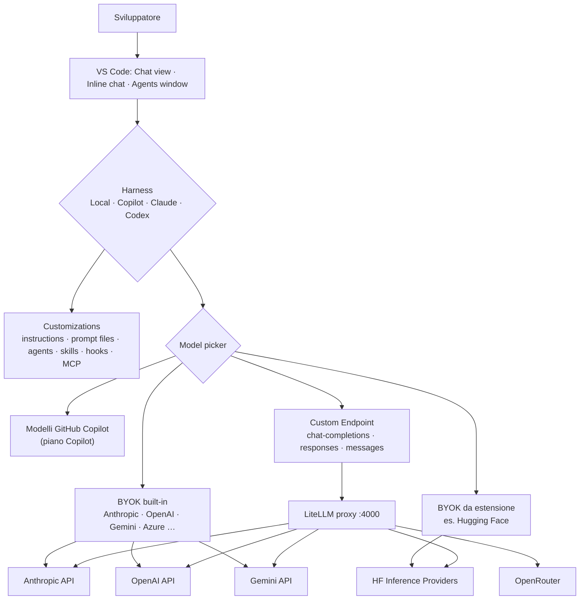
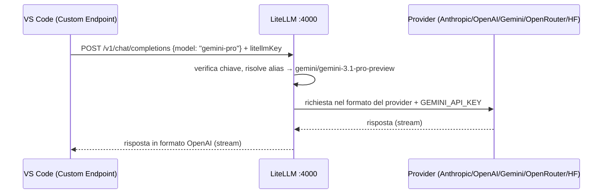

# 02 — Configurazione di GitHub Copilot in Visual Studio Code con LLM via API

Questo documento descrive come GitHub Copilot in VS Code usa modelli di provider esterni.
Confronta due percorsi: **configurazione nativa** (BYOK diretto verso ogni provider) e **gateway LiteLLM** (un solo endpoint locale verso tutti i provider).

Prerequisiti: [01-Installazione.md](01-Installazione.md). Decisioni di riferimento: [D-003](Decisions.md#d-003), [D-004](Decisions.md#d-004), [D-007](Decisions.md#d-007), [D-008](Decisions.md#d-008).

## Indice

1. [Uso di GitHub Copilot in VS Code](#1-uso-di-github-copilot-in-vs-code)
2. [Architettura del client ed elementi configurabili](#2-architettura-del-client-ed-elementi-configurabili)
3. [Configurazione nativa verso i provider](#3-configurazione-nativa-verso-i-provider)
4. [GitHub Copilot con LiteLLM come gateway](#4-github-copilot-con-litellm-come-gateway)
5. [Appendice A — GitHub Spec Kit con Copilot](#appendice-a--github-spec-kit-con-copilot)

---

## 1. Uso di GitHub Copilot in VS Code

GitHub Copilot in VS Code offre queste funzioni:

| Funzione | Descrizione | Modelli BYOK |
|----------|-------------|--------------|
| **Inline suggestions** | Suggerimenti di codice durante la scrittura | No ([S-001](Sources.md#s-001)) |
| **Chat view** | Conversazione con il modello nella barra laterale | Sì |
| **Inline chat** | Chat nell'editor, sul codice selezionato (`inlineChat.defaultModel`) | Sì |
| **Agents** | Un agente esegue un'attività con strumenti (file, terminale, MCP). Chat view e *Agents window* eseguono agenti ([S-008](Sources.md#s-008)) | Sì, solo modelli con *tool calling* |
| **Utility tasks** | Titoli, sommari, messaggi di commit, descrizioni di PR | Sì, con `chat.utilityModel` / `chat.utilitySmallModel` |
| **Semantic search, embeddings** | Indicizzazione e ricerca nel workspace | No ([S-001](Sources.md#s-001)) |

**Harness.** Un *harness* è il motore che esegue l'agente. VS Code offre tre harness: **Copilot**, **Claude** e **Codex** ([S-008](Sources.md#s-008)). La documentazione cita anche le sessioni **Local** ([S-001](Sources.md#s-001)).

- Nelle sessioni *Local* i modelli BYOK funzionano anche senza accesso GitHub e senza piano Copilot ([S-001](Sources.md#s-001)).
- Nelle sessioni dell'harness Copilot i modelli BYOK richiedono l'impostazione sperimentale `chat.agentHost.byokModels.enabled` ([S-001](Sources.md#s-001)).
- Gli harness Claude e Codex hanno credenziali proprie. Un modello BYOK **non** configura questi harness ([S-001](Sources.md#s-001)). Questo documento non li tratta ([D-003](Decisions.md#d-003)).

**Messaggio chiave del talk.** Il BYOK cambia il *modello*. Non cambia l'esperienza: chat, agenti, strumenti, istruzioni e skill restano gli stessi.

---

## 2. Architettura del client ed elementi configurabili

### 2.1 Livelli



Il modello è un elemento **indipendente** dalle customizations. Un'istruzione o una skill funziona con ogni modello che supporta gli strumenti richiesti.

### 2.2 Tipi di modello (model picker)

Il **Language Models editor** gestisce i modelli. Aprilo con l'icona a ingranaggio nel model picker, o con il comando **Chat: Manage Language Models** ([S-001](Sources.md#s-001)).

| Tipo | Come si aggiunge | Uso nel talk |
|------|------------------|--------------|
| **Built-in provider** | *Add Models* → provider (Anthropic, OpenAI, Gemini, Azure, …) → chiave | Claude, Codex, Gemini nativi |
| **Extension provider** | *Install Model Providers*, o ricerca `@tag:language-models` nella vista Extensions | Hugging Face nativo |
| **Custom Endpoint** | *Add Models* → **Custom Endpoint**; dettagli in `chatLanguageModels.json` | OpenRouter, HF senza estensione, LiteLLM |

> Il provider *Custom Endpoint* sostituisce il provider *OpenAI Compatible* e l'impostazione `github.copilot.chat.customOAIModels`, ora deprecati ([S-001](Sources.md#s-001), [D-007](Decisions.md#d-007)).
> Il provider built-in Ollama è deprecato: usa l'estensione ufficiale Ollama ([S-001](Sources.md#s-001)).

### 2.3 Elementi configurabili e posizione nel filesystem

| Elemento | Scopo | Workspace (repo) | Utente | Fonte |
|----------|-------|------------------|--------|-------|
| Always-on instructions | Regole per ogni richiesta | `.github/copilot-instructions.md`, `AGENTS.md`, `CLAUDE.md` | posizione supportata dall'harness ⚠️ | [S-002](Sources.md#s-002), [S-003](Sources.md#s-003) |
| File-based instructions | Regole per file che corrispondono a un glob (`applyTo`) | `.github/instructions/<nome>.instructions.md` | ⚠️ | [S-003](Sources.md#s-003) |
| Prompt files | Prompt riusabili, invocati con `/` | `.github/prompts/<nome>.prompt.md` | ⚠️ | [S-002](Sources.md#s-002) |
| Custom agents | Persona con strumenti e handoff | `.github/agents/<nome>.agent.md` | Agent Customizations editor ⚠️ | [S-007](Sources.md#s-007) |
| Agent skills | Cartella con `SKILL.md` e risorse | `.github/skills/`, `.claude/skills/`, `.agents/skills/` | `~/.copilot/skills/`, `~/.claude/skills/`, `~/.agents/skills/` | [S-004](Sources.md#s-004) |
| Hooks | Comandi su eventi dell'agente | `.github/hooks/*.json`, `.github/copilot/settings.json` | `~/.copilot/hooks/`, `~/.copilot/settings.json` | [S-006](Sources.md#s-006) |
| MCP servers | Strumenti esterni per l'agente | `.vscode/mcp.json` (chiave `servers`) | `mcp.json` del profilo ⚠️ | [S-005](Sources.md#s-005) |
| Language models | Modelli BYOK | — | `chatLanguageModels.json` del profilo (percorso non documentato ⚠️) | [S-001](Sources.md#s-001) |
| Settings | Comportamento del client | `.vscode/settings.json` | `settings.json` utente | [S-001](Sources.md#s-001) |

> ⚠️ La documentazione attuale indica per lo scope utente "una posizione supportata dall'harness", senza un percorso unico ([S-002](Sources.md#s-002), [S-003](Sources.md#s-003)). Usa l'**Agent Customizations editor** per creare file utente: l'editor sceglie il percorso corretto.

**Esempio di struttura del repo con customizations:**

```text
.
├── AGENTS.md
├── .github/
│   ├── copilot-instructions.md
│   ├── instructions/
│   │   └── python.instructions.md      # applyTo: '**/*.py'
│   ├── prompts/
│   │   └── review.prompt.md
│   ├── agents/
│   │   └── reviewer.agent.md
│   ├── skills/
│   │   └── webapp-testing/
│   │       └── SKILL.md
│   └── hooks/
│       └── audit.json
└── .vscode/
    ├── mcp.json
    └── settings.json
```

**Esempio — skill** (`.github/skills/webapp-testing/SKILL.md`) ([S-004](Sources.md#s-004)):

```markdown
---
name: webapp-testing
description: Test the web app login flow with Playwright. Use when the user asks to test UI flows.
argument-hint: "[page or flow]"
---
Run the Playwright tests in `tests/e2e`. Use the template in [test template](./test-template.js).
```

Il campo `name` deve corrispondere al nome della cartella (minuscole, numeri, trattini, massimo 64 caratteri) ([S-004](Sources.md#s-004)).

**Esempio — hook** (`.github/hooks/audit.json`) ([S-006](Sources.md#s-006)):

```json
{
  "version": 1,
  "hooks": {
    "preToolUse": [
      { "type": "command", "command": "node .github/hooks/log-tool-use.cjs", "timeoutSec": 10 }
    ]
  }
}
```

### 2.4 Impostazioni per BYOK

| Impostazione | Funzione |
|--------------|----------|
| `chat.utilityModel` | Modello per titoli, sommari, settings search, Git review |
| `chat.utilitySmallModel` | Modello per messaggi di commit, descrizioni di PR, suggerimenti di nomi, intent detection |
| `chat.byokUtilityModelDefault` | Default per le utility: `None`, `Main Agent Model`, `GitHub Copilot` |
| `chat.agentHost.byokModels.enabled` | (Sperimentale) modelli BYOK nell'harness Copilot |
| `inlineChat.defaultModel` | Modello di default dell'inline chat |

Fonte: [S-001](Sources.md#s-001). Senza accesso GitHub i modelli di utilità built-in non sono disponibili: imposta `chat.utilityModel` e `chat.utilitySmallModel` su un modello BYOK.

### 2.5 Policy per Copilot Business ed Enterprise

| Meccanismo | Dove si configura | Effetto | Fonte |
|------------|-------------------|---------|-------|
| **BYOK locale** | Policy *Bring Your Own Language Model Key in VS Code* nelle Copilot policy di GitHub.com (organizzazione/enterprise) | Abilita o disabilita il BYOK nell'IDE per gli utenti Business/Enterprise. Le chiavi restano sul client | [S-001](Sources.md#s-001), [S-015](Sources.md#s-015) |
| **Enterprise BYOK** (public preview) | Impostazioni enterprise; delega alle organizzazioni con la policy *Enable custom models* | Le chiavi sono lato server. I modelli sono serviti dalla Copilot API a tutti gli utenti con licenza | [S-015](Sources.md#s-015) |

Percorso nelle impostazioni dell'organizzazione: **Settings → Code, planning, and automation → Copilot** ([S-016](Sources.md#s-016)). ⚠️ La posizione esatta della policy BYOK in questa pagina non è verificata.

**Piani individuali (Free, Pro, Pro+).** Non c'è una policy da abilitare: il BYOK locale è disponibile nel Language Models editor ([S-001](Sources.md#s-001)).

---

## 3. Configurazione nativa verso i provider

### 3.0 Procedura comune

- [ ] Apri il Language Models editor: **Chat: Manage Language Models**.
- [ ] Seleziona **Add Models**.
- [ ] Seleziona il provider (built-in, da estensione, o **Custom Endpoint**).
- [ ] Inserisci un nome di gruppo.
- [ ] Inserisci la chiave API o i dettagli dell'endpoint.
- [ ] Se VS Code apre `chatLanguageModels.json`, completa i dettagli del modello.
- [ ] Seleziona il modello nel model picker della Chat view.
- [ ] Se il modello non è visibile, riavvia VS Code.

Fonte: [S-001](Sources.md#s-001).

> **Chiavi API.** Nei file JSON usa sempre una variabile di input (`"${input:nome}"`), non la chiave in chiaro ([S-001](Sources.md#s-001)).
> **Agenti.** Solo i modelli con *tool calling* sono visibili per gli agenti ([S-001](Sources.md#s-001)).
> **Token.** La somma di `maxInputTokens` e `maxOutputTokens` non deve superare la finestra di contesto del modello ([S-001](Sources.md#s-001)).

### 3.1 Claude.AI (Anthropic API)

| Voce | Valore |
|------|--------|
| Provider | **Anthropic** (built-in) |
| Chiave | `ANTHROPIC_API_KEY` dalla Claude Console |
| Modelli esempio | `claude-opus-5-5`, `claude-sonnet-5-5`, `claude-haiku-5-5` ([S-040](Sources.md#s-040)) |
| Endpoint | `https://api.anthropic.com/v1/messages` ([S-040](Sources.md#s-040)) |

- [ ] Esegui la procedura comune con il provider **Anthropic**.
- [ ] Verifica la chiave fuori da VS Code ([S-040](Sources.md#s-040)):

```bash
curl https://api.anthropic.com/v1/messages \
  -H "x-api-key: $ANTHROPIC_API_KEY" \
  -H "anthropic-version: 2023-06-01" \
  -H "content-type: application/json" \
  -d '{"model": "claude-sonnet-5-5", "max_tokens": 64, "messages": [{"role": "user", "content": "Hello"}]}'
```

> Il livello di *thinking* si imposta dal model picker. L'impostazione `github.copilot.chat.anthropic.thinking.effort` è deprecata ([S-001](Sources.md#s-001)).

### 3.2 Codex (OpenAI API)

| Voce | Valore |
|------|--------|
| Provider | **OpenAI** (built-in) |
| Chiave | `OPENAI_API_KEY` |
| Modelli esempio | `gpt-6.1-sol` ⚠️ ([S-042](Sources.md#s-042)) |
| API | Responses API ([S-042](Sources.md#s-042), [S-043](Sources.md#s-043)) |

- [ ] Esegui la procedura comune con il provider **OpenAI**.
- [ ] Verifica la chiave:

```bash
curl https://api.openai.com/v1/responses \
  -H "Authorization: Bearer $OPENAI_API_KEY" \
  -H "Content-Type: application/json" \
  -d '{"model": "gpt-6.1-sol", "input": "Hello"}'
```

> ⚠️ La disponibilità di un modello con chiave API dipende dall'organizzazione e dal progetto OpenAI ([S-042](Sources.md#s-042)). Verifica gli ID nel catalogo modelli prima del talk.
> **Codex harness ≠ modello OpenAI BYOK.** L'harness Codex di VS Code ha credenziali proprie ([S-001](Sources.md#s-001)).

### 3.3 Gemini Pro (Google AI Studio)

| Voce | Valore |
|------|--------|
| Provider | **Gemini** (built-in) |
| Chiave | `GEMINI_API_KEY` da Google AI Studio |
| Modelli esempio | `gemini-3.1-pro-preview` (Pro), `gemini-3.8-flash` (Flash, stabile) ([S-044](Sources.md#s-044)) |
| Endpoint OpenAI-compatible | `https://generativelanguage.googleapis.com/v1beta/openai/` ([S-045](Sources.md#s-045)) |

- [ ] Esegui la procedura comune con il provider **Gemini**.
- [ ] Verifica la chiave con l'endpoint OpenAI-compatible:

```bash
curl https://generativelanguage.googleapis.com/v1beta/openai/chat/completions \
  -H "Authorization: Bearer $GEMINI_API_KEY" \
  -H "Content-Type: application/json" \
  -d '{"model": "gemini-3.1-pro-preview", "messages": [{"role": "user", "content": "Hello"}]}'
```

### 3.4 OpenRouter (Custom Endpoint)

OpenRouter espone un'API OpenAI-compatible su `https://openrouter.ai/api/v1` ([S-026](Sources.md#s-026), [S-046](Sources.md#s-046)).
⚠️ Se la tua versione di VS Code mostra un provider built-in **OpenRouter**, puoi usarlo: la documentazione elenca "Azure, Anthropic, Gemini, OpenAI, and others" ([S-001](Sources.md#s-001)).

- [ ] Esegui la procedura comune con **Custom Endpoint**.
- [ ] Inserisci in `chatLanguageModels.json` il blocco OpenRouter di [`examples/vscode/chatLanguageModels.native.json`](../examples/vscode/chatLanguageModels.native.json):

```json
{
  "name": "OpenRouter",
  "vendor": "customendpoint",
  "apiKey": "${input:openrouterApiKey}",
  "apiType": "chat-completions",
  "models": [
    {
      "id": "openai/gpt-oss-120b",
      "name": "OpenRouter · gpt-oss-120b",
      "url": "https://openrouter.ai/api/v1/chat/completions",
      "toolCalling": true,
      "vision": false,
      "maxInputTokens": 112000,
      "maxOutputTokens": 16000
    }
  ]
}
```

- [ ] Elenca gli ID disponibili ⚠️ ([S-046](Sources.md#s-046)):

```bash
curl -s https://openrouter.ai/api/v1/models | head -c 600
```

### 3.5 Hugging Face (estensione ufficiale o Custom Endpoint)

**Percorso principale — estensione** ([S-048](Sources.md#s-048), [D-008](Decisions.md#d-008)):

- [ ] Crea un token *fine-grained* con il permesso **Make calls to Inference Providers** ([S-047](Sources.md#s-047)).
- [ ] Installa l'estensione *Hugging Face Provider for GitHub Copilot Chat* (VS Code ≥ 1.104.0) ([S-048](Sources.md#s-048), [S-049](Sources.md#s-049)).
- [ ] Apri il model picker → **Manage Models…** → **Hugging Face**.
- [ ] Inserisci il token.
- [ ] Seleziona i modelli da aggiungere al model picker.

> Se il provider Hugging Face non è visibile, aggiorna VS Code e ricarica la finestra ([S-048](Sources.md#s-048)).

**Percorso alternativo — Custom Endpoint** verso il router OpenAI-compatible `https://router.huggingface.co/v1` ([S-047](Sources.md#s-047)):

```json
{
  "name": "Hugging Face Router",
  "vendor": "customendpoint",
  "apiKey": "${input:hfToken}",
  "apiType": "chat-completions",
  "models": [
    {
      "id": "openai/gpt-oss-120b:fastest",
      "name": "HF · gpt-oss-120b (fastest)",
      "url": "https://router.huggingface.co/v1/chat/completions",
      "toolCalling": true,
      "vision": false,
      "maxInputTokens": 112000,
      "maxOutputTokens": 16000
    }
  ]
}
```

Il suffisso dell'ID sceglie il provider di inferenza: `:fastest` (default), `:cheapest`, `:preferred`, oppure `:<provider>` (es. `:groq`) ([S-047](Sources.md#s-047)).

### 3.6 Riepilogo della configurazione nativa

| Provider | Tipo di provider in VS Code | Formato API | Chiavi da gestire sul client |
|----------|-----------------------------|-------------|------------------------------|
| Claude.AI | Built-in Anthropic | Messages | 1 |
| Codex | Built-in OpenAI | Responses | 1 |
| Gemini Pro | Built-in Gemini | Gemini / OpenAI-compatible | 1 |
| OpenRouter | Custom Endpoint | Chat Completions | 1 |
| Hugging Face | Estensione HF o Custom Endpoint | Chat Completions | 1 |
| **Totale** | 4–5 configurazioni | 3 formati | **5 chiavi su ogni client** |

---

## 4. GitHub Copilot con LiteLLM come gateway

### 4.1 Perché un gateway

LiteLLM proxy espone un solo endpoint locale. Traduce le richieste nei formati dei provider ([S-022](Sources.md#s-022)).

| Aspetto | Nativo | LiteLLM |
|---------|--------|---------|
| Chiavi dei provider | Su ogni client VS Code | Solo sul gateway (`.env`) |
| Chiave sul client | 5 | 1 (master key o virtual key) |
| Nomi dei modelli | ID del vendor | Alias stabili (`model_name`) |
| Formato API verso VS Code | Dipende dal provider | A scelta: `chat-completions`, `responses`, `messages` ([S-028](Sources.md#s-028), [S-029](Sources.md#s-029)) |
| Cambio di modello | Riconfigura ogni client | Modifica `config.yaml` e riavvia il proxy |
| Budget, spend log, chiavi per utente | No | Sì, profilo esteso con PostgreSQL ([S-020](Sources.md#s-020)) |
| Componenti da gestire | Nessuno | Un servizio (Docker o `uv`) |
| Punto singolo di guasto | No | Sì: se il proxy è fermo, tutti i modelli BYOK sono fermi |

### 4.2 Configurazione del gateway (`config.yaml`)

File completo: [`examples/litellm/config.yaml`](../examples/litellm/config.yaml). Estratto:

```yaml
model_list:
  - model_name: claude-sonnet               # alias usato da VS Code
    litellm_params:
      model: anthropic/claude-sonnet-5-5    # prefisso provider / ID vendor
      api_key: os.environ/ANTHROPIC_API_KEY
  - model_name: codex
    litellm_params:
      model: openai/gpt-6.1-sol
      api_key: os.environ/OPENAI_API_KEY
  - model_name: gemini-pro
    litellm_params:
      model: gemini/gemini-3.1-pro-preview  # gemini/ = AI Studio; senza prefisso = Vertex AI
      api_key: os.environ/GEMINI_API_KEY
  - model_name: openrouter-gpt-oss
    litellm_params:
      model: openrouter/openai/gpt-oss-120b
      api_key: os.environ/OPENROUTER_API_KEY
  - model_name: hf-gpt-oss
    litellm_params:
      model: huggingface/groq/openai/gpt-oss-120b   # huggingface/<provider>/<org>/<model>
      api_key: os.environ/HF_TOKEN

litellm_settings:
  drop_params: true

general_settings:
  master_key: os.environ/LITELLM_MASTER_KEY
```

| Prefisso | Provider | Variabile | Fonte |
|----------|----------|-----------|-------|
| `anthropic/` | Anthropic API | `ANTHROPIC_API_KEY` | [S-024](Sources.md#s-024) |
| `openai/` | OpenAI API | `OPENAI_API_KEY` | [S-020](Sources.md#s-020) |
| `gemini/` | Google AI Studio | `GEMINI_API_KEY` | [S-025](Sources.md#s-025) |
| `openrouter/` | OpenRouter | `OPENROUTER_API_KEY` | [S-026](Sources.md#s-026) |
| `huggingface/` | HF Inference Providers | `HF_TOKEN` | [S-027](Sources.md#s-027) |

- [ ] Avvia il proxy (profilo minimo): [01-Installazione.md §5.1](01-Installazione.md#51-profilo-minimo-senza-database) o [§6](01-Installazione.md#6-litellm-come-servizio-locale-con-uv).
- [ ] Verifica gli alias: `curl -s http://localhost:4000/v1/models -H "Authorization: Bearer $LITELLM_MASTER_KEY"`.

### 4.3 Configurazione di VS Code verso LiteLLM

- [ ] Esegui la procedura comune (§3.0) con **Custom Endpoint**.
- [ ] Inserisci in `chatLanguageModels.json` il contenuto di [`examples/vscode/chatLanguageModels.litellm.json`](../examples/vscode/chatLanguageModels.litellm.json).
- [ ] Alla prima richiesta, inserisci nel prompt `litellmKey` la master key (profilo minimo) o una virtual key (profilo esteso).

**Gruppo in formato OpenAI** (tutti i provider con una sola configurazione):

```json
{
  "name": "LiteLLM (OpenAI format)",
  "vendor": "customendpoint",
  "apiKey": "${input:litellmKey}",
  "apiType": "chat-completions",
  "models": [
    { "id": "claude-sonnet", "name": "LiteLLM · Claude Sonnet", "url": "http://localhost:4000/v1/chat/completions", "toolCalling": true, "vision": true, "maxInputTokens": 112000, "maxOutputTokens": 16000 },
    { "id": "codex",         "name": "LiteLLM · Codex",         "url": "http://localhost:4000/v1/chat/completions", "toolCalling": true, "vision": true, "maxInputTokens": 112000, "maxOutputTokens": 16000 },
    { "id": "gemini-pro",    "name": "LiteLLM · Gemini Pro",    "url": "http://localhost:4000/v1/chat/completions", "toolCalling": true, "vision": true, "maxInputTokens": 112000, "maxOutputTokens": 16000 }
  ]
}
```

**Gruppo in formato Anthropic** (`apiType: messages`). LiteLLM accetta il formato Messages anche per modelli non Anthropic ([S-028](Sources.md#s-028)):

```json
{
  "name": "LiteLLM (Anthropic format)",
  "vendor": "customendpoint",
  "apiKey": "${input:litellmKey}",
  "apiType": "messages",
  "models": [
    { "id": "claude-opus", "name": "LiteLLM · Claude Opus (messages)", "url": "http://localhost:4000/v1/messages", "toolCalling": true, "vision": true, "maxInputTokens": 112000, "maxOutputTokens": 16000 },
    { "id": "gemini-pro",  "name": "LiteLLM · Gemini Pro (messages)",  "url": "http://localhost:4000/v1/messages", "toolCalling": true, "vision": true, "maxInputTokens": 112000, "maxOutputTokens": 16000 }
  ]
}
```

> ⚠️ **Da verificare in prova.** (1) L'header che VS Code usa per `apiKey` con `apiType: messages` (`x-api-key` o `Authorization: Bearer`). LiteLLM documenta `x-api-key` per `/v1/messages` ([S-028](Sources.md#s-028)). (2) I valori di `maxInputTokens`/`maxOutputTokens` sono prudenziali: adattali alla finestra di contesto reale del modello. (3) Il campo `url` a livello di provider attiva la scoperta automatica dei modelli ([S-001](Sources.md#s-001)): il comportamento con `/v1/models` di LiteLLM non è verificato.

**Gruppo in formato Responses** (opzionale): usa `"apiType": "responses"` e `"url": "http://localhost:4000/v1/responses"`. LiteLLM traduce Responses → Chat Completions per Anthropic e Gemini ([S-029](Sources.md#s-029)).

### 4.4 Profilo esteso: virtual keys per utente

Con PostgreSQL ([01-Installazione.md §5.2](01-Installazione.md#52-profilo-esteso-postgresql--admin-ui--virtual-keys)) il gateway genera chiavi per utente con budget ([S-020](Sources.md#s-020), [S-031](Sources.md#s-031)).

- [ ] Genera una virtual key ⚠️ (parametri da verificare in [S-031](Sources.md#s-031)):

```bash
curl -s http://localhost:4000/key/generate \
  -H "Authorization: Bearer $LITELLM_MASTER_KEY" \
  -H "Content-Type: application/json" \
  -d '{"models": ["claude-sonnet", "gemini-pro"], "max_budget": 5, "metadata": {"user": "demo-wpc"}}'
```

- [ ] Usa il valore `key` della risposta nel prompt `litellmKey` di VS Code.
- [ ] Controlla la spesa nell'Admin UI: `http://localhost:4000/ui`.

### 4.5 Sequenza di una richiesta



---

## Appendice A — GitHub Spec Kit con Copilot

Spec Kit implementa lo *spec-driven development*: la specifica guida l'agente nelle fasi constitution → specify → plan → tasks → implement ([S-080](Sources.md#s-080)).

### A.1 Requisiti

- Python 3.11+, `uv`, un agente supportato (GitHub Copilot), su Linux, macOS o Windows ([S-080](Sources.md#s-080)).

### A.2 Installazione della CLI `specify`

- [ ] Installa la CLI ([S-081](Sources.md#s-081)):

```bash
uv tool install specify-cli
```

- [ ] (Raccomandato per il talk) Fissa una release. Sostituisci `vX.Y.Z` con il tag ([S-081](Sources.md#s-081)):

```bash
uv tool install specify-cli --from git+https://github.com/github/spec-kit.git@vX.Y.Z
```

- [ ] Verifica: `specify version`. Controlla gli aggiornamenti: `specify self check` ([S-081](Sources.md#s-081)).
- [ ] Aggiorna, se necessario: `uv tool install --force specify-cli` ([S-081](Sources.md#s-081)).

### A.3 Integrazione con GitHub Copilot

- [ ] Crea un nuovo progetto con l'integrazione Copilot ([S-080](Sources.md#s-080), [S-081](Sources.md#s-081)):

```bash
specify init my-project --integration copilot
cd my-project
code .
```

- [ ] Oppure inizializza la cartella corrente (repository esistente):

```bash
specify init --here --force --integration copilot
```

| Opzione | Funzione |
|---------|----------|
| `--integration copilot` | Genera i comandi per GitHub Copilot |
| `--script sh` \| `ps` \| `py` | Tipo di script; default `ps` su Windows, `sh` sugli altri sistemi |
| `--here` | Usa la cartella corrente |
| `--force` | Conferma il merge in una cartella non vuota |
| `--non-interactive` | Nessun selettore interattivo (CI) |

Gli script vanno in `.specify/scripts/bash/`, `.specify/scripts/powershell/` o `.specify/scripts/python/` ([S-081](Sources.md#s-081)).
⚠️ La posizione dei file generati per Copilot (skill in `.github/skills/` o prompt in `.github/prompts/`) non è descritta nella pagina d'installazione: verifica dopo `specify init` con `git status`.

### A.4 Flusso di lavoro in Copilot Chat

I comandi si eseguono nella chat dell'agente, non nel terminale ([S-080](Sources.md#s-080)):

| Passo | Comando | Risultato |
|-------|---------|-----------|
| 1 | `/speckit-constitution` | Principi del progetto |
| 2 | `/speckit-specify` | Cosa e perché (requisiti) |
| 3 | `/speckit-clarify` | Chiarimento dei punti ambigui |
| 4 | `/speckit-plan` | Come (piano tecnico) |
| 5 | `/speckit-tasks` | Elenco di task |
| 6 | `/speckit-analyze` | Controllo di coerenza tra gli artefatti |
| 7 | `/speckit-implement` | Implementazione dei task |
| — | `/speckit-checklist`, `/speckit-converge` | Checklist di qualità; riallineamento ([S-081](Sources.md#s-081)) |

**Esempio di sessione:**

```text
/speckit-constitution Il codice usa Python 3.12, test con pytest, nessuna dipendenza non necessaria.
/speckit-specify Una CLI che legge un config.yaml di LiteLLM e verifica che ogni alias risponda a /v1/chat/completions.
/speckit-plan Usa httpx e PyYAML. Output in tabella Markdown.
/speckit-tasks
/speckit-implement
```

### A.5 Spec Kit con modelli BYOK e LiteLLM

- [ ] Seleziona nel model picker un modello BYOK con *tool calling* (nativo o `LiteLLM · …`).
- [ ] Esegui i comandi `/speckit-*` come in A.4.

Spec Kit non dipende dal modello: i comandi sono customizations di Copilot (§2.3). Così la demo mostra lo stesso flusso con Claude, Codex e Gemini attraverso LiteLLM.
