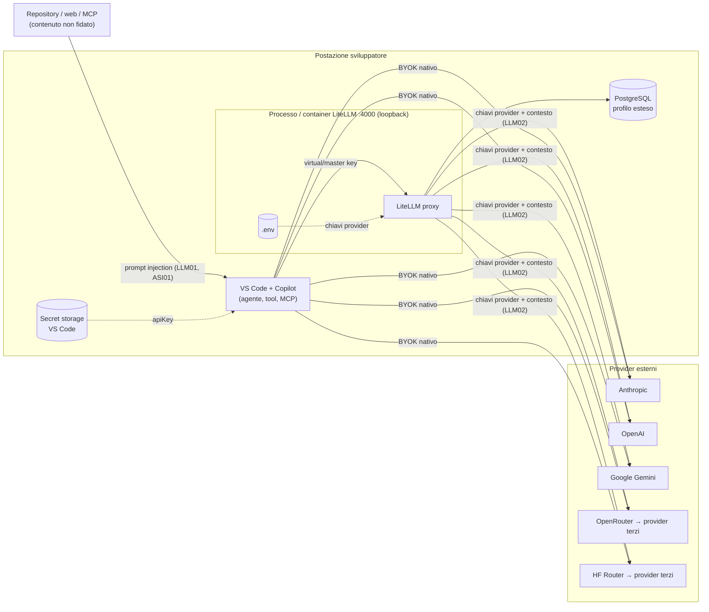

# 04 — Security review delle configurazioni di esempio (OWASP, ISO/IEC 27001)

Questo documento analizza le configurazioni di esempio del repository dal punto di vista della sicurezza ([D-023](Decisions.md#d-023)).

**Riferimenti**

- OWASP Top 10 for LLM Applications **2026** (`LLM01:2026`…`LLM10:2026`, pubblicata il 2026-08-03) ([S-146](Sources.md#s-146), [S-147](Sources.md#s-147), [D-024](Decisions.md#d-024)). L'edizione 2025 ([S-137](Sources.md#s-137)) ha un ordine diverso: vedi la corrispondenza in §4.
- OWASP Top 10 for Agentic Applications 2026 (`ASI01`…`ASI10`) ([S-138](Sources.md#s-138)).
- ISO/IEC 27001:2022 con Amd 1:2024, Annex A e clausole 4–10 ([S-140](Sources.md#s-140), [S-141](Sources.md#s-141)). Il documento cita solo numero e titolo dei controlli. Il testo della norma non è riprodotto. Riferimento opzionale: ISO/IEC 42001:2023 ([S-149](Sources.md#s-149)).

**Revisione.** v2 del 2026-11-07: integra la review P-09/P-10 e applica le azioni AZ-01…AZ-10 approvate dal PO ([D-025](Decisions.md#d-025)).

Le best practice di riferimento sono in [03-Security-Best-Practices.md](03-Security-Best-Practices.md).

## Indice

1. [Ambito e metodo](#1-ambito-e-metodo)
2. [Contesto: asset, confini di fiducia, flussi](#2-contesto-asset-confini-di-fiducia-flussi)
3. [Rilievi sulle configurazioni](#3-rilievi-sulle-configurazioni)
4. [Matrice OWASP LLM Top 10 2026](#4-matrice-owasp-llm-top-10-2026)
5. [Matrice OWASP Agentic Top 10 2026](#5-matrice-owasp-agentic-top-10-2026)
6. [Mappatura ISO/IEC 27001:2022 Annex A](#6-mappatura-isoiec-270012022-annex-a)
7. [ISO/IEC 27001:2022 clausole 4–10](#7-isoiec-270012022-clausole-410)
8. [Registro dei rischi](#8-registro-dei-rischi)
9. [Azioni](#9-azioni)
10. [Rischi residui](#10-rischi-residui)

---

## 1. Ambito e metodo

**File analizzati**

| File | Componente |
|------|-----------|
| [`examples/litellm/config.yaml`](../examples/litellm/config.yaml) | Route LiteLLM, master key |
| [`examples/litellm/.env.example`](../examples/litellm/.env.example) | Segreti |
| [`examples/litellm/compose.minimal.yaml`](../examples/litellm/compose.minimal.yaml) | Container senza DB |
| [`examples/litellm/compose.extended.yaml`](../examples/litellm/compose.extended.yaml) | Container + PostgreSQL |
| [`examples/litellm/service/*`](../examples/litellm/service/) | systemd, launchd, Task Scheduler |
| [`examples/vscode/chatLanguageModels.*.json`](../examples/vscode/) | Modelli BYOK |
| [`examples/vscode/settings.secure.jsonc`](../examples/vscode/settings.secure.jsonc) | Baseline VS Code |
| Procedure di [01-Installazione.md](01-Installazione.md) e [02-Configurazione-Copilot.md](02-Configurazione-Copilot.md) | Installazione, Spec Kit |

**Metodo**

1. Identifica asset, confini di fiducia e flussi (§2).
2. Per ogni file, registra i rilievi (§3) con categoria OWASP e controllo ISO.
3. Valuta la gravità: **Alta** (compromissione di credenziali o esecuzione di codice), **Media** (esposizione di dati o costi senza limite), **Bassa** (miglioramento di robustezza).
4. Indica lo stato: **Mitigato** (l'esempio applica il controllo; `AZ-NN` indica l'azione che lo ha introdotto), **Residuo** (accettato e documentato in §10).

> Questa review analizza documentazione ed esempi. Non è un penetration test. Non sostituisce il risk assessment dell'organizzazione che adotta gli esempi (§7, clausola 6.1.2).

---

## 2. Contesto: asset, confini di fiducia, flussi

**Asset**

| ID | Asset | Classificazione proposta |
|----|-------|--------------------------|
| A1 | Chiavi API dei provider (Anthropic, OpenAI, Gemini, OpenRouter, HF) | Riservato — impatto economico diretto |
| A2 | `LITELLM_MASTER_KEY`, `LITELLM_SALT_KEY`, virtual keys | Riservato |
| A3 | Codice sorgente e contesto inviato ai modelli | Secondo la classificazione del progetto |
| A4 | Postazione dello sviluppatore (VS Code, terminale, file) | Interno |
| A5 | Database PostgreSQL di LiteLLM (chiavi cifrate, spend log) | Riservato |
| A6 | Configurazione dell'agente (permessi, istruzioni, skill, hook, MCP) | Interno — integrità critica |
| A7 | Fornitori: provider LLM, vendor degli strumenti (GitHub, LiteLLM, Spec Kit) | Fornitori distinti (A.5.19) |

**Confini di fiducia e flussi**

- **TB1:** la postazione. L'agente esegue tool e comandi con i privilegi dell'utente.
- **TB2:** il gateway. Contiene tutte le chiavi dei provider: un solo punto di compromissione ([S-104](Sources.md#s-104)).
- **TB3:** i provider. OpenRouter e il router HF possono instradare il contesto verso altri provider (subprocessor).

---

## 3. Rilievi sulle configurazioni

Codici OWASP: `LLMxx` = LLM Top 10 2026; `ASIxx` = Agentic Top 10 2026.

| ID | File | Rilievo | OWASP | ISO 27001 Annex A | Gravità | Stato |
|----|------|---------|-------|-------------------|---------|-------|
| F-01 | `config.yaml` | Le chiavi sono lette da variabili d'ambiente (`os.environ/...`), non scritte nel file | LLM02, LLM04 | A.5.17, A.8.24 | — | **Mitigato** |
| F-02 | `.env` | Chiavi in chiaro su disco | LLM02 | A.5.17, A.8.3, A.8.12, A.8.24 | Alta | **Mitigato** (AZ-01: `chmod 600`/`Protect-EnvFile.ps1`, verifica dei permessi negli script). Residuo in team: secret store (R-07) |
| F-03 | `.gitignore` | `.env` e `*.env` esclusi dal commit | LLM02 | A.5.17, A.8.4, A.8.12 | — | **Mitigato** |
| F-04 | `compose.*.yaml` | Immagine LiteLLM fissata per tag, non per digest; firma non verificata | LLM04, ASI04 | A.5.21, A.8.9, A.8.19, A.8.32 | Alta | **Mitigato** (AZ-02: `scripts/pin-images.sh`, digest in `.env`) |
| F-05 | `compose.*.yaml` | Immagine con utente root | ASI05 | A.8.2, A.8.9 | Media | **Mitigato** (AZ-03: `litellm-non_root`, `no-new-privileges`, `cap_drop: ALL`) ⚠️ tag da verificare |
| F-06 | `compose.extended.yaml` | `postgres:16` con tag mobile | LLM04 | A.5.21, A.8.19 | Media | **Mitigato** (AZ-02: `POSTGRES_IMAGE` per digest) |
| F-07 | `compose.*.yaml` | Porta solo su `127.0.0.1`; PostgreSQL non pubblicato | ASI02 | A.8.20, A.8.22 | — | **Mitigato** |
| F-08 | `config.yaml` | `disable_env_credential_login: true` senza `proxy_admin` blocca l'Admin UI | — | A.5.16, A.5.18 | Media | **Mitigato** (AZ-04: `scripts/bootstrap-admin.sh`, procedura in [01 §5.2](01-Installazione.md#52-profilo-esteso-postgresql--admin-ui--virtual-keys)) |
| F-09 | `.env.example` | Documentazione API attiva | LLM06 | A.8.9 | Bassa | **Mitigato** (AZ-05: `NO_DOCS`, `NO_REDOC`, `NO_OPENAPI`) |
| F-10 | `config.yaml` | Nessun limite di richiesta e upload | LLM06 | A.8.6, A.8.9 | Media | **Mitigato** (AZ-05: `max_request_size_mb: 20`, `allowed_file_extensions: []`) |
| F-11 | Profilo minimo | Nessun budget né rate limit senza DB | LLM06, ASI08 | A.8.6, A.8.16, A.5.22 | Media | **Residuo** (R-03) |
| F-12 | Profilo minimo | La master key va al client: nessuna attribuzione per utente | ASI03 | A.5.15, A.5.16, A.8.2 | Alta in team | **Residuo** per uso personale; in team profilo esteso con virtual keys |
| F-13 | `config.yaml` | `drop_params: true` scarta parametri in silenzio | LLM07 | A.8.9 | Bassa | **Residuo** (R-05) |
| F-14 | `config.yaml`, `chatLanguageModels.native.json` | OpenRouter e router HF instradano il contesto verso provider terzi | LLM02 | A.5.12, A.5.14, A.5.19, A.5.20, A.5.21, A.5.23, A.5.34 | Media | **Mitigato** (AZ-06: HF fissato su `groq`; OpenRouter `data_collection: deny`, `allow_fallbacks: false` ⚠️) |
| F-15 | `chatLanguageModels.*.json` | `apiKey` con `${input:...}`: chiave nel secret storage | LLM02 | A.5.17 | — | **Mitigato** |
| F-16 | `chatLanguageModels.litellm.json` | HTTP in chiaro verso `localhost:4000` | LLM02 | A.8.20, A.8.24 | Bassa | **Residuo** (R-04) |
| F-17 | `chatLanguageModels.native.json` | `HTTP-Referer` rivela l'URL del repo a OpenRouter | LLM02 | A.5.14 | Bassa | **Residuo** (header opzionale) |
| F-18 | `service/litellm.service` | Unit systemd senza hardening | ASI05 | A.8.2, A.8.9 | Media | **Mitigato** (AZ-07: `NoNewPrivileges`, `ProtectSystem=strict`, `UMask=0077`, …) |
| F-19 | Script di avvio | `.env` eseguito come script shell | ASI05 | A.8.3, A.8.9 | Media | **Mitigato** (AZ-08: `service/load-env.sh` legge solo `CHIAVE=valore`; testato con una riga `$(…)`) |
| F-20 | `com.wpc2026.litellm.plist`, `config.yaml` | Log con possibili dati delle richieste | LLM02, LLM08 | A.8.10, A.8.11, A.8.15, A.5.33 | Bassa | **Mitigato** (AZ-09: log in `~/Library/Logs`, `Umask`, `turn_off_message_logging` ⚠️) |
| F-21 | `uv tool install` | Versione fissata, nessuna verifica di hash | LLM04, ASI04 | A.5.21, A.8.19 | Media | **Residuo** (R-01) |
| F-22 | Spec Kit | Script e skill eseguiti dall'agente | ASI04, ASI05, LLM04 | A.8.19, A.8.25, A.8.28, A.8.32 | Media | **Mitigato** (AZ-10: versione `v1.3.2`, `git diff` prima del commit) |
| F-23 | Demo Copilot | *Allow all* o *Autopilot* eliminano le conferme | LLM03, ASI02, ASI09 | A.5.3, A.5.15, A.8.2, A.8.18 | Alta | **Mitigato** ([03 §3.1](03-Security-Best-Practices.md#31-approvazione-di-tool-e-modifiche)) |
| F-24 | Workspace del pubblico | `.mcp.json`, hook o istruzioni ostili in un repo clonato | LLM01, ASI01, ASI04, ASI06 | A.8.7, A.8.19, A.8.26 | Alta | **Mitigato** (Workspace Trust, [03 §2.1](03-Security-Best-Practices.md#21-workspace-trust)) |
| F-25 | Gateway LiteLLM | Concentrazione delle credenziali; compromissioni 2026 | LLM04, ASI03, ASI04 | A.5.21, A.5.24, A.8.8 | Alta | **Residuo** (R-02) con D-018 |
| F-26 | `settings.secure.jsonc` | Sandbox dell'agente `off` di default | ASI05, LLM03 | A.8.9, A.8.18 | Alta | **Mitigato** (baseline: `chat.agent.sandbox.enabled: "on"`, rete bloccata) ([S-145](Sources.md#s-145)) |
| F-27 | BYOK in harness Local | Content exclusion non garantita senza login GitHub | LLM02 | A.8.12, A.5.12 | Media | **Residuo** (R-06) |
| F-28 | `scripts/bootstrap-admin.sh` | Uso della master key da riga di comando | ASI03 | A.5.17 | Bassa | **Mitigato** (header in file temporaneo `0600`, password da stdin) |

---

## 4. Matrice OWASP LLM Top 10 2026

| ID 2026 | Rischio | ID 2025 | Applicabile | Rilievi | Controlli nel progetto |
|---------|---------|---------|-------------|---------|------------------------|
| LLM01 | Prompt Injection | LLM01 | Sì | F-24 | Workspace Trust, approvazione fetch, review |
| LLM02 | Sensitive Information Disclosure | LLM02 | Sì | F-02, F-14, F-16, F-17, F-20, F-27 | Segreti fuori dal workspace, provider fissati |
| LLM03 | Excessive Agency | LLM06 | Sì | F-23, F-26 | Manual permissions, sandbox attivata, policy |
| LLM04 | Supply Chain | LLM03 | Sì | F-04, F-06, F-21, F-22, F-25 | Digest, cosign, D-018 |
| LLM05 | Data and Model Poisoning | LLM04 | Limitata | — | Modelli dei provider: fuori controllo |
| LLM06 | Unbounded Consumption | LLM10 | Sì | F-09, F-10, F-11 | Limiti di richiesta, budget, console dei provider |
| LLM07 | Misinformation | LLM09 | Sì | F-13 | Review umana; ID modello e pacchetti verificati |
| LLM08 | Hidden Context Exposure | LLM07 | Sì | F-20 | Nessun segreto in istruzioni e skill; log senza contenuto |
| LLM09 | Vector and Embedding Weaknesses | LLM08 | No | — | Il BYOK non usa embeddings ([S-001](Sources.md#s-001)) |
| LLM10 | Improper Output Handling | LLM05 | Sì | F-23 | Diff editor, approvazione dei comandi |

Fonti: [S-146](Sources.md#s-146), [S-147](Sources.md#s-147).

---

## 5. Matrice OWASP Agentic Top 10 2026

| ID | Rischio | Applicabile | Rilievi | Controlli nel progetto |
|----|---------|-------------|---------|------------------------|
| ASI01 | Agent Goal Hijack | Sì | F-24 | Restricted Mode, contenuto trattato come dato |
| ASI02 | Tool Misuse and Exploitation | Sì | F-07, F-23 | Approvazioni per sessione, regole terminale precise |
| ASI03 | Identity and Privilege Abuse | Sì | F-12, F-25, F-28 | Virtual keys con scope, RBAC minimo |
| ASI04 | Agentic Supply Chain Vulnerabilities | Sì | F-04, F-21, F-22, F-24 | MCP da fonti verificate, pin di Spec Kit e LiteLLM |
| ASI05 | Unexpected Code Execution (RCE) | Sì | F-05, F-18, F-19, F-22, F-26 | Sandbox, non-root, hardening dei servizi, `.env` non eseguito |
| ASI06 | Memory & Context Poisoning | Sì | F-24 | File di regole e skill del repo sotto review in PR |
| ASI07 | Insecure Inter-Agent Communication | Limitata | — | Subagent dello stesso harness |
| ASI08 | Cascading Failures | Sì | F-11, F-25 | Fallback al BYOK nativo; budget |
| ASI09 | Human-Agent Trust Exploitation | Sì | F-23 | Review umana prima di commit e merge; attenzione alla *approval fatigue* |
| ASI10 | Rogue Agents | Limitata | — | Sessioni brevi, nessun Autopilot nella demo |

Fonte: [S-138](Sources.md#s-138) (titoli confermati sul PDF ufficiale, P-10). Principio guida dell'OWASP: *least agency*.

---

## 6. Mappatura ISO/IEC 27001:2022 Annex A

| Controllo | Titolo | Evidenza nel repository | Rilievi |
|-----------|--------|-------------------------|---------|
| A.5.1 | Policies for information security | [03](03-Security-Best-Practices.md) come base di una policy d'uso degli assistenti AI | — |
| A.5.3 | Segregation of duties | L'agente non approva le proprie PR: review di PO e reviewer | F-23 |
| A.5.9 | Inventory of information and other associated assets | §2 (asset A1…A7) | — |
| A.5.12 | Classification of information | §2; repository ammessi verso provider esterni | F-14, F-27 |
| A.5.14 | Information transfer | Flussi in §2 | F-14, F-17 |
| A.5.15 | Access control | Approvazioni dell'agente, virtual keys | F-12, F-23 |
| A.5.16 | Identity management | Utenti LiteLLM, agente come identità non umana | F-08, F-12 |
| A.5.17 | Authentication information | `${input:...}`, `.env` `0600`, secret store | F-01, F-02, F-03, F-15, F-28 |
| A.5.18 | Access rights | RBAC, `proxy_admin` minimi, rotazione e revoca delle chiavi | F-08 |
| A.5.19 | Information security in supplier relationships | Provider LLM e vendor degli strumenti | F-14 |
| A.5.20 | Addressing information security within supplier agreements | DPA, zero data retention, nessun training sui dati | F-14 |
| A.5.21 | Managing information security in the ICT supply chain | Digest, cosign, D-018 | F-04, F-06, F-21, F-25 |
| A.5.22 | Monitoring, review and change management of supplier services | Deprecazioni dei modelli (es. Codex, `gemini-2.5-pro`), cambi di termini | F-11 |
| A.5.23 | Information security for use of cloud services | Provider SaaS, OpenRouter, HF Router | F-14 |
| A.5.24 | Information security incident management planning and preparation | Rotazione dopo versioni compromesse ([01 §5.0](01-Installazione.md#50-sicurezza-della-supply-chain)) | F-25 |
| A.5.28 | Collection of evidence | Output di `pin-images.sh` (data, digest), storia Git | F-04 |
| A.5.30 | ICT readiness for business continuity | Fallback al BYOK nativo | F-25 |
| A.5.31 | Legal, statutory, regulatory and contractual requirements | GDPR (art. 28), trasferimenti extra-UE, EU AI Act ⚠️ | F-14 |
| A.5.32 | Intellectual property rights | Codice inviato ai provider | F-14 |
| A.5.33 | Protection of records | Log e spend log | F-20 |
| A.5.34 | Privacy and protection of PII | Scelta del provider, ZDR | F-14 |
| A.5.37 | Documented operating procedures | [01](01-Installazione.md), [02](02-Configurazione-Copilot.md) | — |
| A.6.3 | Information security awareness, education and training | Il talk, [03](03-Security-Best-Practices.md) | — |
| A.8.1 | User end point devices | Workspace Trust, sandbox | F-24, F-26 |
| A.8.2 | Privileged access rights | Non-root, permessi dell'agente | F-05, F-12, F-18, F-23 |
| A.8.3 | Information access restriction | Permessi di `.env` | F-02, F-19 |
| A.8.4 | Access to source code | `.gitignore`, content exclusion | F-03 |
| A.8.6 | Capacity management | Limiti di richiesta, budget | F-10, F-11 |
| A.8.7 | Protection against malware | Restricted Mode, estensioni fidate, firma immagini | F-24 |
| A.8.8 | Management of technical vulnerabilities | Advisory LiteLLM, aggiornamento LTS | F-25 |
| A.8.9 | Configuration management | Baseline, `config.yaml`, Compose versionati | F-04, F-05, F-09, F-10, F-13, F-18, F-19, F-26 |
| A.8.10 | Information deletion | Conservazione dei log con codice | F-20 |
| A.8.11 | Data masking | Guardrail PII opzionali | F-20 |
| A.8.12 | Data leakage prevention | `.gitignore`, content exclusion, `edits.autoApprove` | F-02, F-03, F-27 |
| A.8.14 | Redundancy of information processing facilities | Fallback, più provider | F-25 |
| A.8.15 | Logging | Audit log LiteLLM, log del servizio | F-20 |
| A.8.16 | Monitoring activities | Health check, spend log, anomalie di costo | F-11 |
| A.8.17 | Clock synchronization | Timestamp coerenti nei log ⚠️ (non configurato negli esempi) | — |
| A.8.18 | Use of privileged utility programs | Shell e terminale dell'agente | F-23, F-26 |
| A.8.19 | Installation of software on operational systems | Package manager, versioni fissate | F-04, F-06, F-21, F-22, F-24 |
| A.8.20 | Networks security | Bind loopback | F-07, F-16 |
| A.8.22 | Segregation of networks | Rete Compose interna | F-07 |
| A.8.24 | Use of cryptography | TLS in rete, `LITELLM_SALT_KEY`, secret store | F-01, F-02, F-16 |
| A.8.25 | Secure development life cycle | GitHub Flow, PR, review codex/agy | F-22 |
| A.8.26 | Application security requirements | Contenuto non fidato, approvazione umana | F-24 |
| A.8.28 | Secure coding | Review del codice generato | F-22 |
| A.8.31 | Separation of development, test and production environments | Chiavi distinte per demo, sviluppo, produzione | — |
| A.8.32 | Change management | `Decisions.md`, PR con rebase merge | F-04, F-22 |

Fonti: [S-140](Sources.md#s-140), [S-141](Sources.md#s-141). I titoli dei controlli sono verificati su fonti secondarie (P-10); il testo della norma non è libero.

---

## 7. ISO/IEC 27001:2022 clausole 4–10

Il repository non è un SGSI: fornisce input ed evidenze per l'organizzazione che adotta gli esempi.

| Clausola | Tema | Contributo del repository | Azione dell'organizzazione |
|----------|------|---------------------------|----------------------------|
| 4.1, 4.2 | Contesto e parti interessate; Amd 1:2024 aggiunge la valutazione della rilevanza del cambiamento climatico | §2: asset e fornitori | Documenta la valutazione, anche "non rilevante" con motivazione; spunti: disponibilità delle region del provider (A.5.30), requisiti ESG dei clienti ([S-141](Sources.md#s-141), P-10) |
| 4.3 | Campo di applicazione | §1 | Decidi se assistenti AI e gateway sono nel perimetro |
| 5.1, 5.2 | Leadership, politica | [03](03-Security-Best-Practices.md) | Approva una politica d'uso degli assistenti AI |
| 5.3 | Ruoli e responsabilità | `proxy_admin`, PO, reviewer | Assegna un owner a gateway, chiavi e configurazione dell'agente |
| 6.1.2 | Valutazione del rischio | §8 | Applica la tua metodologia; un owner per rischio |
| 6.1.3 | Trattamento, Statement of Applicability | §6, §9 | Nel SoA: controlli necessari, giustificazione, stato di attuazione, giustificazione delle esclusioni. Le mitigazioni OWASP (sandbox, approvazione umana, least agency) entrano come controlli aggiuntivi collegati all'Annex A (P-10) |
| 6.2 | Obiettivi | — | Obiettivi misurabili (es. 100% delle chiavi in secret store) |
| 6.3 | Pianificazione delle modifiche | `Decisions.md` | Collega gli ADR al processo di change |
| 7.2, 7.3 | Competenza, consapevolezza | Il talk, i documenti | Formazione per gli sviluppatori |
| 7.5 | Informazioni documentate | `docs/`, Git, PR | Conservazione e controllo delle versioni |
| 8.1 | Controllo operativo | Procedure con checklist, baseline | Rendi obbligatoria la baseline |
| 8.2, 8.3 | Valutazione e trattamento eseguiti | §8, §9 | Ripeti a ogni nuova release del gateway |
| 9.1 | Monitoraggio | Health check, audit log, spend log | Metriche e revisioni periodiche |
| 9.2 | Audit interno | Review PR (codex, agy, PO) | Includi gateway e BYOK nel programma di audit |
| 9.3 | Riesame della direzione | [Review-Perplexity.md](Review-Perplexity.md) | Porta i rischi residui (§10) al riesame |
| 10.1 | Miglioramento continuo | ADR *Superseded* (D-013, D-014, D-024) | — |
| 10.2 | Non conformità e azioni correttive | §9 (AZ-01…AZ-10 chiuse) | Registra e chiudi le azioni con evidenza |

**ISO/IEC 42001:2023.** Vale anche per chi *usa* sistemi AI. Non è richiesta dalla 27001; si integra con la stessa struttura e aggiunge l'AI system impact assessment. Citala come riferimento se l'AI non è il core business ([S-149](Sources.md#s-149), P-10).

---

## 8. Registro dei rischi

Scala: Probabilità (P) e Impatto (I) da 1 a 3; Rischio = P × I. I valori sono dopo le azioni AZ-01…AZ-10.

| ID | Rischio | Asset | OWASP | Annex A | P | I | Rischio | Trattamento | Rilievi |
|----|---------|-------|-------|---------|---|---|---------|-------------|---------|
| RK-01 | Furto delle chiavi dal gateway | A1, A2 | ASI03, LLM02 | A.5.17, A.8.24, A.8.2, A.8.16 | 1 | 3 | 3 | Ridurre: digest, cosign, non-root, virtual keys, rotazione | F-04, F-25 |
| RK-02 | Prompt injection che fa eseguire comandi o esfiltrare dati | A3, A4, A6 | ASI01, LLM01 | A.8.26, A.8.28, A.8.7 | 2 | 3 | 6 | Ridurre: Workspace Trust, approvazioni, sandbox | F-23, F-24, F-26 |
| RK-03 | Lettura di `.env` da parte dell'agente o di altri utenti | A1, A2 | ASI02, ASI03, LLM02 | A.8.3, A.8.12, A.5.17 | 1 | 3 | 3 | Ridurre: `0600`, `edits.autoApprove`, segreti fuori dal workspace | F-02, F-19 |
| RK-04 | Costi non controllati | A1 | LLM06, ASI08 | A.8.6, A.8.16, A.5.22 | 2 | 2 | 4 | Ridurre: budget, rate limit, limiti nelle console | F-10, F-11 |
| RK-05 | Codice trattato da provider terzi non scelti | A3, A7 | LLM02, ASI04 | A.5.19–A.5.23, A.5.32, A.5.34, A.5.12 | 1 | 2 | 2 | Ridurre: provider fissati, DPA, ZDR, classificazione dei repo | F-14 |
| RK-06 | Script non verificati (installer, MCP, Spec Kit) | A4, A6 | ASI04, ASI05 | A.5.21, A.8.19, A.8.7, A.8.32 | 1 | 3 | 3 | Ridurre: pin, review dei file generati, sandbox | F-22 |
| RK-07 | Indisponibilità del gateway | A3 | ASI08 | A.8.14, A.5.30, A.8.6 | 2 | 1 | 2 | Accettare: fallback al BYOK nativo | F-25 |
| RK-08 | Avvelenamento di istruzioni, skill e regole del repo | A6 | ASI06 | A.8.32, A.8.25 | 1 | 2 | 2 | Ridurre: review in PR dei file `.github/` | F-24 |
| RK-09 | *Approval fatigue*: l'utente approva senza leggere | A4 | ASI09 | A.6.3, A.8.18 | 2 | 2 | 4 | Ridurre: regole precise, sessioni brevi, formazione | F-23 |
| RK-10 | Pacchetti o API inventati dal modello | A3 | LLM07 | A.8.28, A.8.19 | 2 | 2 | 4 | Ridurre: review, lockfile, verifica delle dipendenze | — |

---

## 9. Azioni

Approvate dal PO e applicate il 2026-11-07 ([D-025](Decisions.md#d-025)).

| ID | Azione | File modificati | Stato |
|----|--------|-----------------|-------|
| AZ-01 | Permessi di `.env` (`chmod 600`, `Protect-EnvFile.ps1`); verifica negli script (Windows: confronto per SID, uscita con errore) | `.env.example`, `service/load-env.sh`, `Start-LiteLLM.ps1`, `Protect-EnvFile.ps1`, [01 §4](01-Installazione.md#4-chiavi-api-e-file-env) | ✅ Applicata |
| AZ-02 | Digest e firma cosign per LiteLLM e PostgreSQL | `scripts/pin-images.sh`, `compose.*.yaml`, `.env.example` | ✅ Applicata |
| AZ-03 | Immagine `litellm-non_root`, `no-new-privileges`, `cap_drop: ALL` | `compose.*.yaml`, [01 §5.1](01-Installazione.md#51-profilo-minimo-senza-database) | ✅ Applicata ⚠️ tag da verificare |
| AZ-04 | Primo `proxy_admin` prima del blocco del login da ambiente | `scripts/bootstrap-admin.sh`, `config.yaml`, [01 §5.2](01-Installazione.md#52-profilo-esteso-postgresql--admin-ui--virtual-keys) | ✅ Applicata |
| AZ-05 | `NO_DOCS`/`NO_REDOC`/`NO_OPENAPI`, `max_request_size_mb`, `allowed_file_extensions` | `.env.example`, `config.yaml` | ✅ Applicata |
| AZ-06 | Provider fissati: HF `groq`; OpenRouter `data_collection: deny`, `allow_fallbacks: false` | `config.yaml`, `chatLanguageModels.native.json` | ✅ Applicata ⚠️ campi OpenRouter da verificare |
| AZ-07 | Hardening della unit systemd | `service/litellm.service` | ✅ Applicata |
| AZ-08 | `.env` letto come dati, mai eseguito | `service/load-env.sh`, `start-litellm.sh` | ✅ Applicata, testata |
| AZ-09 | Log in `~/Library/Logs`, `Umask`, `turn_off_message_logging` | `com.wpc2026.litellm.plist`, `start-litellm.sh`, `config.yaml` | ✅ Applicata ⚠️ opzione LiteLLM da verificare |
| AZ-10 | Spec Kit fissato e controllo dei file generati | [02 §A.3](02-Configurazione-Copilot.md#a3-integrazione-con-github-copilot) | ✅ Applicata |

---

## 10. Rischi residui

| ID | Rischio residuo | Motivo dell'accettazione | Rilievi |
|----|-----------------|--------------------------|---------|
| R-01 | `uv tool install` senza verifica di hash | Versione fissata; nessuna procedura ufficiale di hash per `uv tool` ⚠️ | F-21 |
| R-02 | Concentrazione delle credenziali nel gateway | Intrinseco al modello gateway; mitigato da D-018 | F-25 |
| R-03 | Nessun budget nel profilo minimo | Uso personale e demo; limiti nelle console dei provider | F-11 |
| R-04 | HTTP in chiaro su loopback | Il traffico non lascia la postazione | F-16 |
| R-05 | `drop_params` modifica le richieste in silenzio | Necessario per la compatibilità multi-provider | F-13 |
| R-06 | Content exclusion non garantita con BYOK senza login | Comportamento non documentato; compensato da `edits.autoApprove` e permessi del sistema operativo | F-27 |
| R-07 | Chiavi in un file su disco (anche con `0600`) | Accettabile per la demo; in team usa un secret store (A.8.24) | F-02 |
