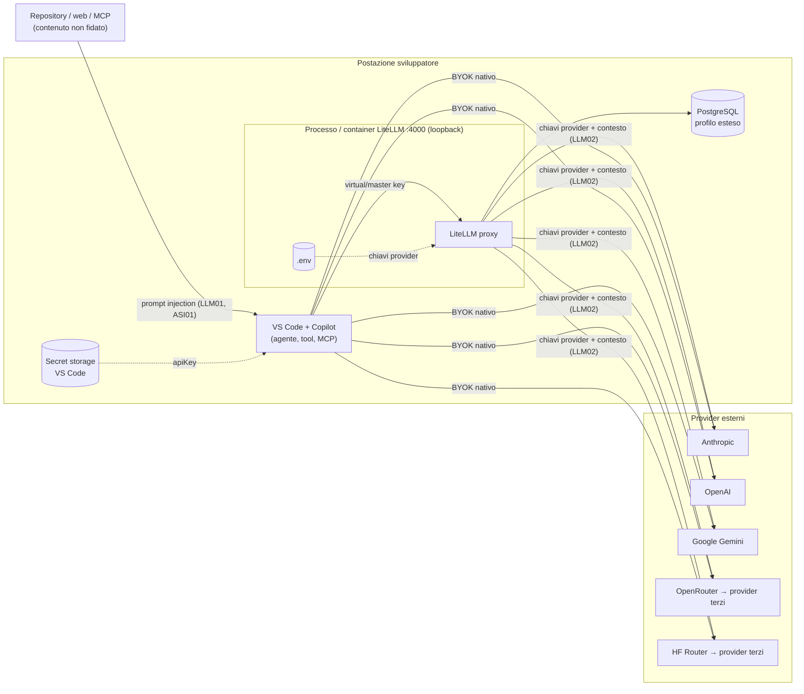

# 04 — Security review delle configurazioni di esempio (OWASP, ISO/IEC 27001)

Questo documento analizza le configurazioni di esempio del repository dal punto di vista della sicurezza ([D-023](Decisions.md#d-023)).

**Riferimenti**

- OWASP Top 10 for LLM Applications 2025 (`LLM01`…`LLM10`) ([S-137](Sources.md#s-137)).
- OWASP Top 10 for Agentic Applications 2026 (`ASI01`…`ASI10`) ([S-138](Sources.md#s-138)).
- ISO/IEC 27001:2022, Annex A e clausole 4–10 ([S-140](Sources.md#s-140), [S-141](Sources.md#s-141)). Il documento cita solo numero e titolo dei controlli. Il testo della norma non è riprodotto.

Le best practice di riferimento sono in [03-Security-Best-Practices.md](03-Security-Best-Practices.md).

## Indice

1. [Ambito e metodo](#1-ambito-e-metodo)
2. [Contesto: asset, confini di fiducia, flussi](#2-contesto-asset-confini-di-fiducia-flussi)
3. [Rilievi sulle configurazioni](#3-rilievi-sulle-configurazioni)
4. [Matrice OWASP LLM Top 10 2025](#4-matrice-owasp-llm-top-10-2025)
5. [Matrice OWASP Agentic Top 10 2026](#5-matrice-owasp-agentic-top-10-2026)
6. [Mappatura ISO/IEC 27001:2022 Annex A](#6-mappatura-isoiec-270012022-annex-a)
7. [ISO/IEC 27001:2022 clausole 4–10](#7-isoiec-270012022-clausole-410)
8. [Registro dei rischi](#8-registro-dei-rischi)
9. [Azioni proposte](#9-azioni-proposte)
10. [Rischi residui](#10-rischi-residui)

---

## 1. Ambito e metodo

**File analizzati**

| File | Componente |
|------|-----------|
| [`examples/litellm/config.yaml`](../examples/litellm/config.yaml) | Route LiteLLM, master key |
| [`examples/litellm/.env.example`](../examples/litellm/.env.example) | Segreti |
| [`examples/litellm/compose.minimal.yaml`](../examples/litellm/compose.minimal.yaml) | Container senza DB |
| [`examples/litellm/compose.extended.yaml`](../examples/litellm/compose.extended.yaml) | Container + PostgreSQL |
| [`examples/litellm/service/*`](../examples/litellm/service/) | systemd, launchd, Task Scheduler |
| [`examples/vscode/chatLanguageModels.*.json`](../examples/vscode/) | Modelli BYOK |
| [`examples/vscode/settings.secure.jsonc`](../examples/vscode/settings.secure.jsonc) | Baseline VS Code |
| Procedure di [01-Installazione.md](01-Installazione.md) e [02-Configurazione-Copilot.md](02-Configurazione-Copilot.md) | Installazione, Spec Kit |

**Metodo**

1. Identifica asset, confini di fiducia e flussi (§2).
2. Per ogni file, registra i rilievi (§3) con categoria OWASP e controllo ISO.
3. Valuta la gravità: **Alta** (compromissione di credenziali o esecuzione di codice), **Media** (esposizione di dati o costi senza limite), **Bassa** (miglioramento di robustezza).
4. Indica lo stato: **Mitigato** (l'esempio applica già il controllo), **Azione** (proposta in §9), **Residuo** (accettato e documentato in §10).

> Questa review analizza documentazione ed esempi. Non è un penetration test. Non sostituisce il risk assessment dell'organizzazione che adotta gli esempi (§7, clausola 6.1.2).

---

## 2. Contesto: asset, confini di fiducia, flussi

**Asset**

| ID | Asset | Classificazione proposta |
|----|-------|--------------------------|
| A1 | Chiavi API dei provider (Anthropic, OpenAI, Gemini, OpenRouter, HF) | Riservato — impatto economico diretto |
| A2 | `LITELLM_MASTER_KEY`, `LITELLM_SALT_KEY`, virtual keys | Riservato |
| A3 | Codice sorgente e contesto inviato ai modelli | Secondo la classificazione del progetto |
| A4 | Postazione dello sviluppatore (VS Code, terminale, file) | Interno |
| A5 | Database PostgreSQL di LiteLLM (chiavi cifrate, spend log) | Riservato |

**Confini di fiducia e flussi**

- **TB1:** la postazione. L'agente esegue tool e comandi con i privilegi dell'utente.
- **TB2:** il gateway. Contiene tutte le chiavi dei provider: un solo punto di compromissione ([S-104](Sources.md#s-104)).
- **TB3:** i provider. OpenRouter e il router HF possono instradare il contesto verso altri provider (subprocessor).

---

## 3. Rilievi sulle configurazioni

| ID | File | Rilievo | OWASP | ISO 27001 Annex A | Gravità | Stato |
|----|------|---------|-------|-------------------|---------|-------|
| F-01 | `config.yaml` | Le chiavi sono lette da variabili d'ambiente (`os.environ/...`), non scritte nel file | LLM02, LLM03 | A.5.17, A.8.24 | — | **Mitigato** |
| F-02 | `.env.example`, `.env` | Le chiavi stanno in chiaro in `.env` sul disco. Nessuna indicazione sui permessi del file | LLM02 | A.5.17, A.8.3 | Alta | **Azione** (AZ-01) |
| F-03 | `.gitignore` | `.env` e `*.env` sono esclusi dal commit | LLM02 | A.5.17, A.8.12 | — | **Mitigato** |
| F-04 | `compose.*.yaml` | Immagine LiteLLM fissata per tag (`v1.108.2`), non per digest; firma non verificata nel flusso | LLM03, ASI04 | A.5.21, A.8.8, A.8.19 | Alta | **Azione** (AZ-02) |
| F-05 | `compose.*.yaml` | Immagine standard (root) invece di `litellm-non_root` | ASI05 | A.8.2, A.8.9 | Media | **Azione** (AZ-03) |
| F-06 | `compose.extended.yaml` | `postgres:16` è un tag mobile, senza digest | LLM03 | A.5.21, A.8.19 | Media | **Azione** (AZ-02) |
| F-07 | `compose.*.yaml` | Porta pubblicata solo su `127.0.0.1`; PostgreSQL non pubblicato | ASI02 | A.8.20, A.8.22 | — | **Mitigato** |
| F-08 | `config.yaml` | `disable_env_credential_login: true`. Nel profilo esteso, senza un `proxy_admin` o SSO creati prima, l'Admin UI non è accessibile ([S-108](Sources.md#s-108)) | — | A.5.16, A.5.18 | Media (disponibilità) | **Azione** (AZ-04) |
| F-09 | `config.yaml`, `.env.example` | Documentazione API (`/docs`, `/redoc`, `/openapi.json`) attiva | LLM10 | A.8.9 | Bassa | **Azione** (AZ-05) |
| F-10 | `config.yaml` | Nessun limite di dimensione della richiesta né di upload | LLM10 | A.8.9 | Media | **Azione** (AZ-05) |
| F-11 | Profilo minimo | Nessun budget né rate limit: senza DB i budget non sono applicati ([S-020](Sources.md#s-020)) | LLM10 | A.8.16 | Media | **Residuo** (R-03) + limiti nelle console dei provider |
| F-12 | Profilo minimo | La master key va al client VS Code: un solo segreto per tutti, nessuna attribuzione per utente | ASI03 | A.5.15, A.5.16, A.8.2 | Alta in team, Bassa per uso personale | **Residuo** per uso personale; in team usa il profilo esteso con virtual keys |
| F-13 | `config.yaml` | `drop_params: true` scarta in silenzio i parametri non supportati; il comportamento effettivo può differire da quello richiesto | LLM09 | A.8.9 | Bassa | **Residuo** (R-05) |
| F-14 | `config.yaml` (HF, OpenRouter) | `openrouter/...` e il router HF instradano il contesto a provider terzi non fissati | LLM02 | A.5.19, A.5.21, A.5.23, A.5.34 | Media | **Azione** (AZ-06) |
| F-15 | `chatLanguageModels.*.json` | `apiKey` con `${input:...}`: la chiave resta nel secret storage di VS Code | LLM02 | A.5.17 | — | **Mitigato** |
| F-16 | `chatLanguageModels.litellm.json` | Traffico HTTP non cifrato verso `localhost:4000` | LLM02 | A.8.24, A.8.20 | Bassa (loopback) | **Residuo** (R-04); in rete: TLS obbligatorio |
| F-17 | `chatLanguageModels.native.json` | `HTTP-Referer` rivela l'URL del repository a OpenRouter | LLM02 | A.5.14 | Bassa | **Residuo** (header opzionale) |
| F-18 | `service/litellm.service` | Unit systemd senza direttive di hardening (`NoNewPrivileges`, `ProtectSystem`, `PrivateTmp`, …) | ASI05 | A.8.9, A.8.2 | Media | **Azione** (AZ-07) |
| F-19 | `service/start-litellm.sh`, `Start-LiteLLM.ps1` | `.env` viene eseguito come script shell (`. ./.env`): un `.env` modificato esegue codice | ASI05 | A.8.3, A.8.9 | Media | **Azione** (AZ-01, AZ-08) |
| F-20 | `service/com.wpc2026.litellm.plist` | Il log può contenere dati delle richieste; nessuna rotazione né permessi | LLM02 | A.8.15, A.8.11 | Bassa | **Azione** (AZ-09) |
| F-21 | Procedure `uv tool install` | Versione fissata (`1.108.2`) ma senza verifica di hash | LLM03, ASI04 | A.5.21, A.8.19 | Media | **Residuo** (R-01) |
| F-22 | Spec Kit (`specify init`) | Installa script in `.specify/scripts/` e skill che l'agente esegue | ASI05, ASI04, LLM03 | A.8.19, A.8.25, A.8.28 | Media | **Azione** (AZ-10) |
| F-23 | Demo Copilot | Permessi dell'agente: con *Allow all* o *Autopilot* l'agente agisce senza conferme | LLM06, ASI02, ASI09 | A.8.2, A.5.15 | Alta | **Mitigato** dalla baseline e da §3.1 di [03](03-Security-Best-Practices.md#31-approvazione-di-tool-e-modifiche) |
| F-24 | Workspace del pubblico | Repo clonato con `.mcp.json`, hook o istruzioni ostili | LLM01, ASI01, ASI04 | A.8.7, A.8.19 | Alta | **Mitigato** da Workspace Trust ([03 §2.1](03-Security-Best-Practices.md#21-workspace-trust)) |
| F-25 | Gateway LiteLLM | Concentrazione delle credenziali (TB2) e storico di compromissioni 2026 | LLM03, ASI04, ASI03 | A.5.21, A.8.8, A.5.24 | Alta | **Residuo** (R-02) con hardening [D-018](Decisions.md#d-018) |

---

## 4. Matrice OWASP LLM Top 10 2025

| ID | Rischio | Applicabile | Rilievi | Controlli nel progetto |
|----|---------|-------------|---------|------------------------|
| LLM01 | Prompt Injection | Sì | F-24 | Workspace Trust, approvazione fetch, review delle modifiche |
| LLM02 | Sensitive Information Disclosure | Sì | F-02, F-14, F-16, F-17, F-20 | Segreti fuori dal workspace, content exclusion, scelta del provider |
| LLM03 | Supply Chain | Sì | F-04, F-06, F-21, F-22, F-25 | Pin di versione e digest, cosign, D-018 |
| LLM04 | Data and Model Poisoning | Limitata | — | Fuori controllo del progetto (modelli dei provider) |
| LLM05 | Improper Output Handling | Sì | F-23 | Review nel diff editor, approvazione dei comandi |
| LLM06 | Excessive Agency | Sì | F-23 | Manual permissions, sandbox, policy `ChatToolsAutoApprove` |
| LLM07 | System Prompt Leakage | Limitata | — | Nessun segreto nelle istruzioni (`copilot-instructions.md`, skill) |
| LLM08 | Vector and Embedding Weaknesses | No | — | Il BYOK non usa embeddings ([S-001](Sources.md#s-001)) |
| LLM09 | Misinformation | Sì | F-13 | Review umana; ID modello verificati |
| LLM10 | Unbounded Consumption | Sì | F-09, F-10, F-11 | Budget (profilo esteso), limiti nelle console dei provider |

Fonte: [S-137](Sources.md#s-137).

---

## 5. Matrice OWASP Agentic Top 10 2026

| ID | Rischio | Applicabile | Rilievi | Controlli nel progetto |
|----|---------|-------------|---------|------------------------|
| ASI01 | Agent Goal Hijack | Sì | F-24 | Restricted Mode, contenuto trattato come dato |
| ASI02 | Tool Misuse and Exploitation | Sì | F-07, F-23 | Approvazioni per sessione, regole terminale precise |
| ASI03 | Identity and Privilege Abuse | Sì | F-12, F-25 | Virtual keys con scope, RBAC minimo |
| ASI04 | Agentic Supply Chain Vulnerabilities | Sì | F-04, F-21, F-22, F-24 | MCP solo da fonti verificate, pin di Spec Kit e LiteLLM |
| ASI05 | Unexpected Code Execution | Sì | F-05, F-18, F-19, F-22 | Sandbox, non-root, hardening dei servizi |
| ASI06 | Memory and Context Poisoning | Limitata | — | Istruzioni e skill sotto review in PR |
| ASI07 | Insecure Inter-Agent Communication | Limitata | — | Subagent dello stesso harness; nessun canale esterno |
| ASI08 | Cascading Failures | Sì | F-25 | Un gateway fermo blocca tutti i modelli BYOK via LiteLLM |
| ASI09 | Human-Agent Trust Exploitation | Sì | F-23 | Review umana obbligatoria prima di commit e merge |
| ASI10 | Rogue Agents | Limitata | — | Sessioni brevi, nessun Autopilot nella demo |

Fonte: [S-138](Sources.md#s-138). ⚠️ I titoli `ASI03`…`ASI08` sono da confermare sulla pagina OWASP (P-10).

---

## 6. Mappatura ISO/IEC 27001:2022 Annex A

| Controllo | Titolo | Evidenza nel repository | Rilievi |
|-----------|--------|-------------------------|---------|
| A.5.1 | Policies for information security | [03-Security-Best-Practices.md](03-Security-Best-Practices.md) come base per una policy d'uso degli assistenti AI | — |
| A.5.9 | Inventory of information and other associated assets | §2 (asset A1…A5) | — |
| A.5.12 | Classification of information | §2 (classificazione proposta) | F-14 |
| A.5.14 | Information transfer | Flussi in §2; scelta dei provider | F-14, F-17 |
| A.5.15 | Access control | Approvazioni dell'agente, virtual keys | F-12, F-23 |
| A.5.16 | Identity management | Utenti LiteLLM, SSO | F-08, F-12 |
| A.5.17 | Authentication information | `${input:...}`, `.env` fuori dal repo, secret store | F-01, F-02, F-03, F-15 |
| A.5.18 | Access rights | RBAC LiteLLM, `proxy_admin` minimi | F-08 |
| A.5.19 | Information security in supplier relationships | Provider LLM come fornitori | F-14 |
| A.5.21 | Managing information security in the ICT supply chain | Pin, digest, cosign, D-018 | F-04, F-06, F-21, F-25 |
| A.5.23 | Information security for use of cloud services | Provider SaaS, OpenRouter, HF Router | F-14 |
| A.5.24 | Information security incident management planning and preparation | Procedura di rotazione dopo versioni compromesse ([01 §5.0](01-Installazione.md#50-sicurezza-della-supply-chain)) | F-25 |
| A.5.34 | Privacy and protection of PII | Scelta del provider, ZDR | F-14 |
| A.5.37 | Documented operating procedures | [01](01-Installazione.md), [02](02-Configurazione-Copilot.md) con checklist | — |
| A.6.3 | Information security awareness, education and training | Il talk stesso e [03](03-Security-Best-Practices.md) | — |
| A.8.1 | User end point devices | Workspace Trust, sandbox | F-24 |
| A.8.2 | Privileged access rights | Non-root, permessi dell'agente | F-05, F-12, F-18, F-23 |
| A.8.3 | Information access restriction | Permessi di `.env` | F-02, F-19 |
| A.8.7 | Protection against malware | Restricted Mode, estensioni fidate | F-24 |
| A.8.8 | Management of technical vulnerabilities | Monitoraggio advisory LiteLLM, aggiornamento LTS | F-04, F-25 |
| A.8.9 | Configuration management | Baseline `settings.secure.jsonc`, `config.yaml` versionato | F-05, F-09, F-10, F-13, F-18, F-19 |
| A.8.11 | Data masking | Guardrail PII opzionali | F-20 |
| A.8.12 | Data leakage prevention | `.gitignore`, content exclusion | F-03 |
| A.8.15 | Logging | Audit log LiteLLM, log del servizio | F-20 |
| A.8.16 | Monitoring activities | Health check, spend log | F-11 |
| A.8.19 | Installation of software on operational systems | Package manager, versioni fissate | F-04, F-06, F-21, F-22, F-24 |
| A.8.20 | Networks security | Bind loopback | F-07, F-16 |
| A.8.22 | Segregation of networks | Rete Compose interna per PostgreSQL | F-07 |
| A.8.24 | Use of cryptography | TLS in rete, `LITELLM_SALT_KEY` | F-01, F-16 |
| A.8.25 | Secure development life cycle | GitHub Flow, PR, review codex/agy | F-22 |
| A.8.28 | Secure coding | Review umana del codice generato | F-22 |
| A.8.32 | Change management | `Decisions.md`, PR con rebase merge | — |

Fonti: [S-140](Sources.md#s-140), [S-141](Sources.md#s-141).

---

## 7. ISO/IEC 27001:2022 clausole 4–10

La tabella mostra come un'organizzazione che adotta gli esempi può collegare il lavoro del repository al suo sistema di gestione (SGSI). Il repository non è un SGSI: fornisce input ed evidenze.

| Clausola | Tema | Contributo del repository | Azione dell'organizzazione |
|----------|------|---------------------------|----------------------------|
| 4.1, 4.2 | Contesto, parti interessate (incluso il tema del cambiamento climatico, Amd 1:2024) | §2: asset, provider esterni come parti interessate | Valuta i requisiti di clienti e regolatori sull'uso di LLM esterni |
| 4.3 | Campo di applicazione | §1: componenti e file | Decidi se gli assistenti AI e il gateway sono nel perimetro |
| 5.1, 5.2 | Leadership, politica | [03](03-Security-Best-Practices.md) come base | Approva una politica d'uso degli assistenti AI |
| 5.3 | Ruoli e responsabilità | Ruoli `proxy_admin`, PO, reviewer | Assegna il proprietario del gateway e delle chiavi |
| 6.1.2 | Valutazione del rischio | §8: registro dei rischi | Applica la tua metodologia e i tuoi criteri di accettazione |
| 6.1.3 | Trattamento del rischio, Statement of Applicability | §6 e §9 come estratto di SoA | Includi i controlli in SoA con giustificazione |
| 6.2 | Obiettivi | — | Definisci obiettivi misurabili (es. 100% chiavi in secret store) |
| 6.3 | Pianificazione delle modifiche | `Decisions.md` (ADR) | Collega gli ADR al processo di change |
| 7.2, 7.3 | Competenza, consapevolezza | Il talk, i documenti | Pianifica formazione per gli sviluppatori |
| 7.5 | Informazioni documentate | `docs/`, storia Git, PR | Definisci conservazione e controllo delle versioni |
| 8.1 | Pianificazione e controllo operativo | Procedure con checklist | Rendi obbligatoria la baseline |
| 8.2, 8.3 | Esecuzione di valutazione e trattamento | §8, §9 | Ripeti la valutazione a ogni nuova release del gateway |
| 9.1 | Monitoraggio, misurazione | Health check, audit log, spend log | Definisci metriche e revisioni periodiche |
| 9.2 | Audit interno | Review PR con codex/agy e PO | Includi gateway e configurazioni BYOK nel programma di audit |
| 9.3 | Riesame della direzione | Registro esiti in [Review-Perplexity.md](Review-Perplexity.md) | Porta i rischi residui (§10) al riesame |
| 10.1 | Miglioramento continuo | ADR *Superseded* (es. D-013, D-014) | — |
| 10.2 | Non conformità e azioni correttive | §9 azioni AZ-xx | Registra e chiudi le azioni con evidenza |

Fonte: [S-140](Sources.md#s-140), [S-141](Sources.md#s-141).

---

## 8. Registro dei rischi

Scala: Probabilità (P) e Impatto (I) da 1 (basso) a 3 (alto); Rischio = P × I.

| ID | Rischio | Asset | P | I | Rischio | Trattamento | Rilievi |
|----|---------|-------|---|---|---------|-------------|---------|
| RK-01 | Furto delle chiavi dei provider dal gateway | A1, A2 | 2 | 3 | 6 | Ridurre: hardening, pin, cosign, rotazione | F-04, F-25 |
| RK-02 | Prompt injection che porta l'agente a eseguire comandi o esfiltrare dati | A3, A4 | 2 | 3 | 6 | Ridurre: Workspace Trust, approvazioni, sandbox | F-23, F-24 |
| RK-03 | Lettura di `.env` da parte di processi o utenti locali | A1, A2 | 2 | 3 | 6 | Ridurre: permessi `600`, secret store | F-02, F-19 |
| RK-04 | Costi non controllati | A1 | 2 | 2 | 4 | Ridurre: budget, limiti nelle console | F-10, F-11 |
| RK-05 | Codice riservato trattato da provider terzi non scelti | A3 | 2 | 2 | 4 | Ridurre: provider fissato (`:<provider>`), ZDR | F-14 |
| RK-06 | Esecuzione di script non verificati (Spec Kit, MCP) | A4 | 1 | 3 | 3 | Ridurre: pin, review dei file generati | F-22 |
| RK-07 | Indisponibilità del gateway | A3 | 2 | 1 | 2 | Accettare: fallback al BYOK nativo | F-25 |

---

## 9. Azioni proposte

Le azioni cambiano gli esempi. Applicale solo dopo l'approvazione del PO.

- [ ] **AZ-01** — Documenta e applica i permessi di `.env`: `chmod 600 .env` (Linux/macOS); ACL solo per l'utente su Windows (`icacls .env /inheritance:r /grant:r "%USERNAME%:R"`). (F-02, F-19)
- [ ] **AZ-02** — Fissa per digest le immagini LiteLLM e PostgreSQL; aggiungi il passo `cosign verify` alla procedura. (F-04, F-06)
- [ ] **AZ-03** — Usa `ghcr.io/berriai/litellm-non_root` nei file Compose ⚠️ (verifica il tag `v1.108.2`). (F-05)
- [ ] **AZ-04** — Profilo esteso: aggiungi il passo di creazione del `proxy_admin` (o SSO) prima di `disable_env_credential_login`, oppure attiva l'opzione solo dopo quel passo. (F-08)
- [ ] **AZ-05** — Aggiungi a `.env.example` `NO_DOCS`, `NO_REDOC`, `NO_OPENAPI` e a `config.yaml` `max_request_size_mb`. (F-09, F-10)
- [ ] **AZ-06** — Nelle route HF fissa il provider di inferenza; per OpenRouter documenta i guardrail (allowlist provider, ZDR). (F-14)
- [ ] **AZ-07** — Aggiungi alla unit systemd: `NoNewPrivileges=true`, `PrivateTmp=true`, `ProtectSystem=strict`, `ProtectHome=read-only`, `ReadWritePaths=%h/wpc2026-litellm`, `RestrictAddressFamilies=AF_INET AF_INET6 AF_UNIX` ⚠️ ([S-144](Sources.md#s-144)). (F-18)
- [ ] **AZ-08** — Negli script di avvio leggi `.env` come coppie chiave=valore, senza eseguirlo come script. (F-19)
- [ ] **AZ-09** — LaunchAgent: log in `~/Library/Logs/` con permessi solo utente; nessun log del contenuto delle richieste. (F-20)
- [ ] **AZ-10** — Spec Kit: fissa `v1.3.2` (già fatto in [02 §A.2](02-Configurazione-Copilot.md#a2-installazione-della-cli-specify)) e controlla con `git diff` i file generati da `specify init` prima del primo commit. (F-22)

---

## 10. Rischi residui

| ID | Rischio residuo | Motivo dell'accettazione | Rilievi |
|----|-----------------|--------------------------|---------|
| R-01 | `uv tool install` senza verifica di hash | Versione fissata; LiteLLM non pubblica una procedura di hash per `uv tool` ⚠️ | F-21 |
| R-02 | Concentrazione delle credenziali nel gateway | Intrinseco al modello gateway; mitigato da D-018 | F-25 |
| R-03 | Nessun budget nel profilo minimo | Profilo per uso personale e demo; limiti nelle console dei provider | F-11 |
| R-04 | HTTP in chiaro su loopback | Il traffico non lascia la postazione | F-16 |
| R-05 | `drop_params` modifica le richieste in silenzio | Necessario per la compatibilità multi-provider | F-13 |
