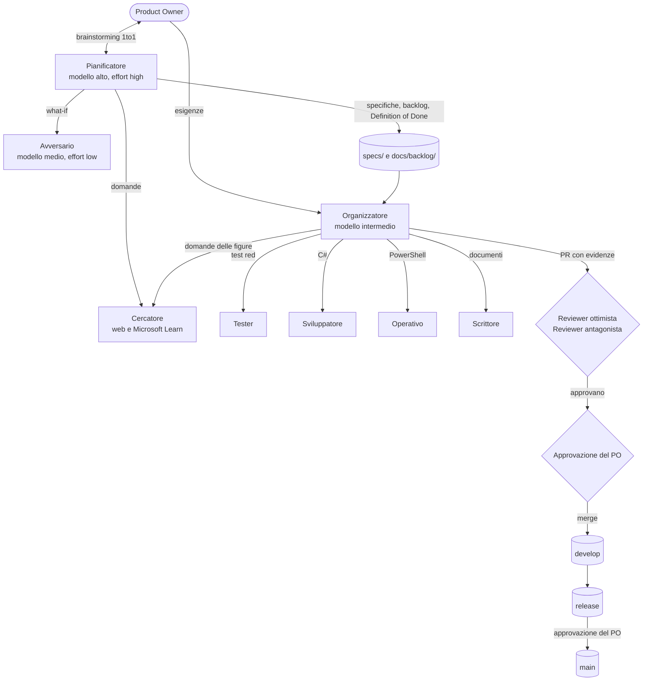

# 05 — Team di agenti per lo sviluppo spec-driven

Questo documento descrive un team di agenti orchestrato per sviluppare un progetto software con GitHub Copilot in VS Code.
Il team usa i modelli configurati con chiavi proprie (BYOK): modelli costosi per analisi e pianificazione, modelli economici per l'implementazione.
I file del team sono in [`examples/agents/`](../examples/agents/README.md). Il documento [06](06-BYOK-GitHub-Copilot.md) spiega il BYOK; il documento [07](07-LiteLLM-Introduzione.md) presenta il gateway LiteLLM.

## Indice

1. [Scelte del Product Owner](#1-scelte-del-product-owner)
2. [Le figure del team](#2-le-figure-del-team)
3. [Architettura](#3-architettura)
4. [Modelli e costi](#4-modelli-e-costi)
5. [Vincoli tecnici di VS Code](#5-vincoli-tecnici-di-vs-code)
6. [Installazione del team in un repository](#6-installazione-del-team-in-un-repository)
7. [Uso del team](#7-uso-del-team)
8. [Definition of Done](#8-definition-of-done)
9. [GitFlow, protezione dei rami e regola di qualità](#9-gitflow-protezione-dei-rami-e-regola-di-qualità)
10. [Sicurezza](#10-sicurezza)
11. [Punti da provare](#11-punti-da-provare)

## 1. Scelte del Product Owner

| Scelta | Valore | Decisione |
|---|---|---|
| Forma tecnica | *Custom agents* di VS Code (file `.agent.md`) con subagent | [D-033](Decisions.md#d-033) |
| Harness | Copilot; Local come riserva | [D-033](Decisions.md#d-033) |
| Posizione | Template in `examples/agents/` di questo repository | [D-033](Decisions.md#d-033) |
| Modelli | Misto per ruolo: Anthropic, OpenAI, OpenRouter | [D-037](Decisions.md#d-037) |
| Backlog | GitHub Spec Kit per le specifiche, file Markdown per Epic, Feature, Task | [D-035](Decisions.md#d-035) |
| Brainstorming | Il PO apre direttamente il Pianificatore | [D-035](Decisions.md#d-035) |
| Merge in `develop` | Organizzatore, dopo le due review **e l'approvazione del PO** (code owner): nessun merge automatico | [D-043](Decisions.md#d-043) |
| Branching | GitFlow completo, con hotfix e back-merge | [D-035](Decisions.md#d-035) |
| TDD | Solo il Tester modifica i test | [D-035](Decisions.md#d-035) |
| Regole di scrittura | Testo originale ispirato ad ASD-STE100, nel repository | [D-036](Decisions.md#d-036) |
| Completamento | Lo sviluppo è concluso solo con la Definition of Done completa | [D-038](Decisions.md#d-038) |
| Protezione dei rami | Tre ruleset, `CODEOWNERS`, identità separata per l'agente; variante per il piano Free | [D-039](Decisions.md#d-039), [D-043](Decisions.md#d-043), [D-045](Decisions.md#d-045) |
| Ricerche | Agente Cercatore: web e Microsoft Learn come fonte primaria per C# e PowerShell | [D-043](Decisions.md#d-043) |
| Versione di Spec Kit | Controllo a ogni pianificazione; aggiornamento solo con una ADR approvata dal PO | [D-044](Decisions.md#d-044) |
| Nome dei rami di Feature | `feature/<NNN>-<slug>`, creato da Spec Kit | [D-040](Decisions.md#d-040) |

## 2. Le figure del team

| Figura | Compito | Scrive | Non fa |
|---|---|---|---|
| **Organizzatore** | Parla con il PO, assegna i task, controlla i risultati, compila le evidenze della Definition of Done, apre le PR, unisce le Feature in `develop` dopo l'approvazione del PO | Stato del backlog, evidenze, log | Codice, test, decisioni di prodotto, merge in `main` |
| **Pianificatore** | Controllo della versione di Spec Kit; brainstorming 1to1 con il PO; scompone in Epic, Feature, Task con SOLID e TDD; scrive criteri di accettazione e Definition of Done; mantiene le regole di scrittura | `specs/`, `docs/backlog/`, `docs/team/writing-rules.md` | Decisioni al posto del PO |
| **Avversario** | Contraddice la scelta del PO: what-if con al massimo 2 alternative | Niente (solo risposta) | Raccomandazioni, modifiche ai file |
| **Cercatore** | Ricerche su internet e nella documentazione ufficiale; Microsoft Learn è la fonte primaria per C#, .NET e PowerShell | Niente (solo risposta con le fonti) | Modifiche ai file, comandi, decisioni |
| **Tester** | Test automatici prima del codice: NUnit per C#, Pester per PowerShell; test d'integrazione della Release | `tests/` | Codice di produzione |
| **Sviluppatore** | Implementa in C# i task; snippet C# per lo Scrittore | Codice C# | Modifiche ai test |
| **Operativo** | Automazioni e task operativi in PowerShell; snippet PowerShell per lo Scrittore | Script PowerShell | Modifiche ai test, comandi distruttivi |
| **Scrittore** | Log di sviluppo, riferimento di librerie e API, manuale utente, manuale per sviluppatori | `docs/` | Codice, snippet |
| **Reviewer ottimista** | Review dell'*happy path*: efficienza, chiarezza, semplicità, manutenibilità; controllo della Definition of Done | Niente (solo rilievi) | Modifiche ai file |
| **Reviewer antagonista** | Review contro l'*happy path*: eccezioni non gestite, resilienza, anomalie; controllo della Definition of Done | Niente (solo rilievi) | Modifiche ai file |

Ogni figura è un file in [`examples/agents/.github/agents/`](../examples/agents/README.md). Il file contiene il modello, gli strumenti permessi e le istruzioni ([S-007](Sources.md#s-007), [S-072](Sources.md#s-072)).

## 3. Architettura



- Il PO parla con due agenti: **Organizzatore** e **Pianificatore**. Le altre figure sono subagent nascosti dal selettore degli agenti (`user-invocable: false`).
- L'Organizzatore chiama Tester, Sviluppatore, Operativo, Scrittore, i due Reviewer e il Cercatore. Il Pianificatore chiama l'Avversario e il Cercatore.
- Solo il Cercatore usa internet. Il Cercatore non modifica file e non esegue comandi.
- Le figure comunicano con i file del repository: specifiche, backlog, test, codice, log. Chi chiama un subagent scrive un compito completo: il subagent lavora in un contesto separato ([S-165](Sources.md#s-165)).

**Copilot come harness.** VS Code e l'harness Copilot eseguono il ciclo dell'agente: leggono il file `.agent.md`, offrono gli strumenti (`read`, `edit`, `execute`…), applicano i permessi. Il modello scelto riceve il prompt tramite l'API del suo provider, con la chiave del PO ([06 §1](06-BYOK-GitHub-Copilot.md#1-che-cosè-il-byok)).

## 4. Modelli e costi

Criterio: il costo del modello segue la quantità di ragionamento del compito. Il Pianificatore ragiona su tutto il progetto; le figure operative lavorano su task atomici.

| Figura | Provider | Modello | Effort | Prezzo input / output (USD per 1M token) |
|---|---|---|---|---|
| Pianificatore | Anthropic | `claude-fable-5-2` | `high` | 8 / 40 |
| Organizzatore | Anthropic | `claude-sonnet-5-5` | default | 2 / 10 |
| Avversario | OpenAI | `gpt-6.1-sol` | `low` | 2 / 10 |
| Sviluppatore, Operativo | OpenAI | `gpt-6-luna` | default | 0,10 / 0,50 |
| Tester | OpenRouter | `z-ai/glm-5.3` | default | 0,0699 / 1,40 |
| Scrittore, Cercatore | Anthropic | `claude-haiku-5-5` | default | 0,10 / 0,50 fino a 100K token di prompt; poi 0,50 / 2,50 |
| Reviewer ottimista | OpenRouter | `deepseek/deepseek-v4.1-flash` | default | 0,0507 / 0,2028 |
| Reviewer antagonista | OpenRouter | `qwen/qwen3.5-397b-a17b`, provider `novita` → `venice` → `gmicloud` | default | 0,39 / 2,34 (varia per provider) |

Fonti dei prezzi: [S-040](Sources.md#s-040), [S-102](Sources.md#s-102) e listino OpenRouter, verificati con [P-12](Review-Perplexity.md#p-12--modelli-e-prezzi-per-il-team-di-agenti) il 2026-11-14. I prezzi cambiano: controlla il listino prima di usare il team.

- I due Reviewer usano due modelli diversi: due punti di vista e due «famiglie» di errori.
- L'Avversario usa un provider diverso dal Pianificatore, con effort `low`: il ragionamento limitato evita più di 2 alternative.
- `gpt-5.4-mini` non è più la scelta: è della generazione precedente e costa più di `gpt-6-luna`. `gpt-5.3-codex` è deprecato ([D-037](Decisions.md#d-037)).
- `qwen/qwen3-coder` ha un punteggio basso nelle chiamate agli strumenti (46,2% su τ²-Bench): il Reviewer antagonista usa `qwen/qwen3.5-397b-a17b` (79,1%) con i provider che hanno meno errori di tool call ([P-12](Review-Perplexity.md#p-12--modelli-e-prezzi-per-il-team-di-agenti)).
- Anthropic presenta `claude-haiku-5-5` per classificazione, estrazione e instradamento, non per il coding: per questo resta allo Scrittore e al Cercatore, che leggono e riassumono.
- I file di esempio in `examples/vscode/` e `examples/litellm/` contengono il modello del Reviewer antagonista. Aggiungi gli altri modelli del team dal Language Models editor ([06 §4](06-BYOK-GitHub-Copilot.md#4-provider-e-custom-endpoint)).

## 5. Vincoli tecnici di VS Code

La documentazione descrive molti limiti dei subagent **solo** per l'harness Local. Per l'harness Copilot alcuni comportamenti non sono documentati: il template funziona nei due casi ([P-11](Review-Perplexity.md#p-11--custom-agents-subagent-e-harness-di-vs-code)).

| Argomento | Cosa dice la documentazione | Effetto sul team |
|---|---|---|
| Domande all'utente da un subagent | Limite documentato per Local; non documentato per Copilot ([S-165](Sources.md#s-165)) | Il PO apre il Pianificatore direttamente per il brainstorming |
| Cronologia della conversazione | Un subagent Local non la riceve; non documentato per Copilot | L'Organizzatore usa un modulo di consegna completo per ogni task |
| Subagent che chiamano subagent | Local: spento senza un'impostazione dedicata. Runtime Copilot: attivo di default (profondità 6) (P-11) | Lo Scrittore chiede gli snippet tramite l'Organizzatore: vale nei due harness |
| Modello del subagent | Ordine: modello nella chiamata, poi campo `model` dell'agente, poi modello della sessione. Con la sessione su **Auto** il subagent eredita Auto (P-11) | Non usare Auto con il team: scegli un modello BYOK per la sessione |
| Controllo del costo | Un subagent con modello più costoso del modello principale non parte: documentato solo per Local, senza un'eccezione documentata per il BYOK | Punto da provare (§11) |
| `model-policy` | Il campo non arriva al runtime Copilot (P-11) | Il campo resta nei file, ma non contare su `required` |
| Istruzioni del repository | Un subagent custom non le riceve senza `include-custom-instructions: true` (P-11) | Ogni file `.agent.md` contiene i link alle regole del team |
| Limite dei subagent per coordinatore | Il campo `agents` esiste solo in Local ([S-072](Sources.md#s-072)) | Le istruzioni nominano le figure permesse: non è un controllo di sicurezza |
| *Handoff* | Solo Local. L'harness Local è deprecato e termina a febbraio 2027 (VS Code 1.146) ([S-068](Sources.md#s-068)) | Il team usa i subagent dell'harness Copilot |
| ID del modello | Usa l'ID che il completamento dell'editor propone; nel runtime la forma è `PROVIDER-NAME/MODEL-ID` (P-11) | Punto da provare (§11) |

**Impostazioni richieste per l'harness Copilot**

| Impostazione | Valore | Default | Fonte |
|---|---|---|---|
| `chat.agentHost.byokModels.enabled` | `true` | `false` (sperimentale); riavvia l'Agent Host | [S-071](Sources.md#s-071), P-11 |
| `github.copilot.chat.cli.customAgents.enabled` | `true` | `false` | P-11 ⚠️ |

**Server MCP per il Cercatore.** Il file `.agent.md` nomina gli strumenti di un server MCP con `<nome del server>/*`; gli strumenti sono disponibili solo se il server è nella sessione ([S-072](Sources.md#s-072)). Il template contiene `.vscode/mcp.json` con il server `microsoft-learn` (`https://learn.microsoft.com/api/mcp`). In Copilot CLI il server si installa con `/plugin install microsoftdocs/mcp` ([S-188](Sources.md#s-188)). ⚠️ Da provare: il nome del server e la sua presenza nelle sessioni dell'harness Copilot.

**Reasoning effort con un modello BYOK.** Il campo `reasoning-effort` del file `.agent.md` ha effetto solo se il modello dichiara `supportsReasoningEffort` (e, se serve, `reasoningEffortFormat`) in `chatLanguageModels.json` ([S-071](Sources.md#s-071), [06 §5](06-BYOK-GitHub-Copilot.md#5-il-file-chatlanguagemodelsjson)).

**Differenze per l'harness Local (riserva).** Nei file `.agent.md`:

- togli `target: github-copilot` o usa `target: vscode`;
- scrivi `model` come `<nome del modello> (<vendor>)`;
- aggiungi `agents: [...]` all'Organizzatore e al Pianificatore per limitare i subagent permessi;
- lo strumento per i subagent è `agent/runSubagent` ([S-072](Sources.md#s-072), [S-165](Sources.md#s-165)).

## 6. Installazione del team in un repository

**Requisiti:** VS Code con GitHub Copilot ([01](01-Installazione.md)), modelli BYOK di Anthropic, OpenAI e OpenRouter ([02 §3](02-Configurazione-Copilot.md#3-configurazione-nativa-verso-i-provider)), `git`, `gh`, .NET SDK 10, PowerShell 7.4 o successivo, GitHub Spec Kit 1.4.0 ([02 Appendice A](02-Configurazione-Copilot.md#appendice-a--github-spec-kit-con-copilot)).

- [ ] Crea i rami `main` e `develop` nel repository del progetto.
- [ ] Crea un ramo `feature/000-team-agenti` da `develop`.
- [ ] Inizializza Spec Kit nella cartella del progetto e installa l'estensione `git` ([P-13](Review-Perplexity.md#p-13--gitflow-spec-kit-e-tdd-con-nunit-e-pester)):

```bash
specify init --here --force --integration copilot
specify extension add git
```

- [ ] Copia il contenuto di `examples/agents/` nella radice del repository. La copia sostituisce `git-config.yml` dell'estensione `git`: da quel momento Spec Kit crea rami `feature/<NNN>-<slug>`.

```bash
cp -R examples/agents/. /percorso/del/progetto/
```

```powershell
Copy-Item -Recurse -Force examples\agents\* C:\percorso\del\progetto\
Copy-Item -Recurse -Force examples\agents\.github C:\percorso\del\progetto\
Copy-Item -Recurse -Force examples\agents\.specify C:\percorso\del\progetto\
Copy-Item -Recurse -Force examples\agents\.vscode C:\percorso\del\progetto\
Copy-Item -Force examples\agents\.gitignore C:\percorso\del\progetto\
```

- [ ] Se il progetto ha già un `.gitignore`, aggiungi la riga `.team/` invece di copiare il file.
- [ ] Sostituisci `@release-approver` in `.github/CODEOWNERS` con l'utente GitHub del PO.
- [ ] Attiva le due impostazioni dell'harness Copilot (§5).
- [ ] Leggi `.vscode/mcp.json` e avvia il server MCP `microsoft-learn` per il Cercatore ([03 §3](03-Security-Best-Practices.md#3-github-copilot-in-vs-code)).
- [ ] Copia `docs/team/templates/decisions.md` in `docs/backlog/decisions.md` e scrivi nella ADR-001 la versione di Spec Kit (`specify version`).
- [ ] Apri il progetto in VS Code. Per ogni file in `.github/agents/` controlla il campo `model`: cancella l'ID e accetta l'ID che il completamento propone per il tuo modello BYOK ⚠️.
- [ ] Applica la baseline di sicurezza ([03 §7](03-Security-Best-Practices.md#7-baseline-di-configurazione)).
- [ ] Apri la PR verso `develop` e uniscila. Porta `ci.yml` e `CODEOWNERS` anche su `main`.
- [ ] Dopo la prima esecuzione verde di `ci.yml`, applica i ruleset (§9). ⚠️ `ci.yml` richiede una soluzione .NET nella radice del repository e un test Pester in `tests/`: il passo S-916 del [runbook](runbook/RUNBOOK.md) crea una soluzione minima.

**Esito atteso:** il selettore degli agenti mostra **Organizzatore** e **Pianificatore**. Le altre figure non compaiono nel selettore.

## 7. Uso del team

La procedura con comandi, parametri ed evidenze è la fase F9 del [runbook](runbook/RUNBOOK.md).

### 7.1 Pianificazione

- [ ] Seleziona l'agente **Pianificatore** e descrivi l'esigenza.
- [ ] Il Pianificatore controlla la versione di Spec Kit. Se esiste una versione più recente ti chiede se aggiornare: con il tuo sì scrive una ADR che sostituisce la ADR della versione precedente, e tu esegui il comando di aggiornamento ([D-044](Decisions.md#d-044)).
- [ ] Rispondi alle domande. Per le scelte importanti il Pianificatore presenta il what-if dell'Avversario.
- [ ] Di' al Pianificatore quando le scelte sono complete. Il Pianificatore pianifica una Feature alla volta: crea il ramo `feature/<NNN>-<slug>` da `develop`, scrive `specs/`, `docs/backlog/` e aggiorna `docs/team/writing-rules.md` su quel ramo. La pianificazione arriva in `develop` con la PR della Feature.
- [ ] Leggi il backlog. Controlla i criteri di accettazione dei Task e la Definition of Done di ogni `epic.md` e `feature.md`. Approva o chiedi modifiche.

### 7.2 Sviluppo di una Feature

- [ ] Seleziona l'agente **Organizzatore** e chiedi di sviluppare la Feature (es. `E01-F01`).
- [ ] Per ogni task l'Organizzatore chiama, in ordine: Tester (*red*), Sviluppatore o Operativo (*green* e *refactor*), Scrittore.
- [ ] L'Organizzatore apre la PR verso `develop`, compila le evidenze della Definition of Done e chiama i due Reviewer.
- [ ] Se i due Reviewer approvano, l'Organizzatore ti presenta la PR con le evidenze. Leggi la PR e approvala su GitHub: senza la tua approvazione GitHub rifiuta il merge.
- [ ] Dopo la tua approvazione l'Organizzatore unisce la PR, registra DoD-F8 e DoD-F9 e ti presenta il riepilogo.

### 7.3 Release

- [ ] Chiedi all'Organizzatore di preparare la Release. L'Organizzatore crea `release/<versione>` da `develop`.
- [ ] Il Tester scrive ed esegue i test d'integrazione.
- [ ] I due Reviewer esaminano la PR verso `main` e la Definition of Done dell'Epic.
- [ ] Leggi il riepilogo, approva la PR in modo esplicito ed esegui tu il merge in `main`.
- [ ] L'Organizzatore apre la PR di riallineamento verso `develop`.

## 8. Definition of Done

**Regola.** Lo sviluppo di una Feature o di un'Epic è concluso solo quando la sua *Definition of Done* è completa: ogni voce è soddisfatta e ha un'evidenza ([D-038](Decisions.md#d-038)).

La Scrum Guide definisce la Definition of Done come la descrizione formale dello stato che il prodotto deve avere per rispettare le misure di qualità richieste; un lavoro che non la rispetta non si rilascia ([S-170](Sources.md#s-170)). Il template applica lo stesso principio a Feature ed Epic.

| | Criteri di accettazione | Definition of Done |
|---|---|---|
| Domanda | «Questo Task fa quello che deve fare?» | «Questa Feature (o Epic) è finita?» |
| Livello | Task | Feature, Epic |
| Contenuto | Diverso per ogni Task | Uguale per tutte le Feature (o per tutte le Epic) |
| Forma | «Dato…, quando…, allora…» con il campo **Verifica** | Tabella: voce, soddisfatta, evidenza |

I criteri di accettazione da soli non bastano: descrivono il comportamento, non lo stato di qualità. Il team li rende verificabili (un comportamento, un valore esatto, un test) e li usa come **prima voce** della Definition of Done.

**Dove si applica la regola**

| Punto | Figura | Azione |
|---|---|---|
| `epic.md`, `feature.md` | Pianificatore | Scrive in testa l'obiettivo di completamento e la tabella con tutte le voci standard |
| Prima delle review | Organizzatore | Compila la colonna **Evidenza** con comandi ed esiti reali |
| Review | Reviewer ottimista e antagonista | Controllano le voci che esistono prima delle review (da DoD-F1 a DoD-F6; da DoD-E1 a DoD-E5): `soddisfatta`, `non soddisfatta` o `senza evidenza`; non approvano con una voce aperta |
| Merge | Organizzatore (in `develop`), PO (in `main`) | Unisce solo con le voci richieste per il merge: da DoD-F1 a DoD-F7 per `develop`, da DoD-E1 a DoD-E6 per `main` |
| Stato `done` | Organizzatore | Lo assegna solo con tutte le voci soddisfatte, comprese quelle che esistono dopo il merge (DoD-F8, DoD-F9; DoD-E7, DoD-E8) |

Le voci standard (da DoD-F1 a DoD-F9 per una Feature, da DoD-E1 a DoD-E8 per un'Epic) sono in [backlog.md](../examples/agents/docs/team/backlog.md). I modelli dei file sono in [templates/](../examples/agents/docs/team/templates/feature.md). Solo il PO può togliere una voce.

## 9. GitFlow, protezione dei rami e regola di qualità

Il template usa GitFlow ([S-167](Sources.md#s-167)): `feature/*` → `develop` → `release/*` → `main`, più `hotfix/*`. Le regole complete sono in [gitflow.md](../examples/agents/docs/team/gitflow.md).

> Questo repository (WPC2026) usa GitHub Flow. GitFlow vale per il repository che riceve il template.

### 9.1 Protezione dei rami

Le istruzioni di un agente non sono un controllo: GitHub deve rifiutare le operazioni non permesse ([D-039](Decisions.md#d-039)).

| Elemento | File del template | Funzione | Fonte |
|---|---|---|---|
| Ruleset `main-develop` | `.github/rulesets/main-develop.json` | PR obbligatoria, controlli di stato, nessun force-push, nessuna eliminazione, nessun bypass | [S-171](Sources.md#s-171), [S-172](Sources.md#s-172) |
| Ruleset `main-release-approval` | `.github/rulesets/main-release-approval.json` | 1 approvazione di un *code owner* per `main` | [S-172](Sources.md#s-172) |
| Ruleset `develop-approval` | `.github/rulesets/develop-approval.json` | 1 approvazione di un *code owner* per `develop`, nessun bypass | [S-172](Sources.md#s-172) |
| `CODEOWNERS` | `.github/CODEOWNERS` | Solo il PO: un ruleset non può nominare un utente | [S-173](Sources.md#s-173) |
| CI | `.github/workflows/ci.yml` | Produce i controlli `build`, `test-dotnet`, `test-powershell` | [S-176](Sources.md#s-176) |
| Script | `scripts/Set-Rulesets.ps1` | Crea o aggiorna i ruleset con la REST API | [S-174](Sources.md#s-174) |

- `gh pr merge --admin` usa i privilegi di amministratore per unire una PR che non rispetta i requisiti ([S-175](Sources.md#s-175)). Per questo l'agente non usa il token del PO.
- **Identità separata.** L'Organizzatore usa una GitHub App o un account di servizio con i soli permessi *Contents: write* e *Pull requests: write*, senza *Administration*, senza *Workflows* e fuori dalla lista di bypass ([S-177](Sources.md#s-177)). Il PO è l'unico code owner.
- **Controlli di stato e workflow.** `ci.yml` gira dal ramo della PR: chi può modificare il workflow o i test può rendere verdi i controlli. Due difese: l'identità dell'agente non ha il permesso *Workflows*, e ogni PR verso `develop` richiede l'approvazione del PO. Il PO ha rinunciato al merge automatico per questo motivo ([D-043](Decisions.md#d-043)).
- Il caso svolto [`examples/speckit-ruleset/`](../examples/speckit-ruleset/README.md) contiene la specifica, il piano e i test che verificano il rifiuto di `--admin`.
- ⚠️ Niente di questo è stato provato su GitHub.

### 9.2 Piani GitHub e configurazione Free

I ruleset e i *code owner* dipendono dal piano ([S-171](Sources.md#s-171), [S-189](Sources.md#s-189), [D-045](Decisions.md#d-045)).

| Caso | Ruleset | Code owner | Team di emergenza | Configurazione |
|---|---|---|---|---|
| Free, account personale, repository **pubblico** | Sì | Sì | No | `Set-Rulesets.ps1 -WithoutEmergencyTeam` |
| Free, organizzazione, repository **pubblico** | Sì | Sì | Sì ⚠️ | Completa |
| Free, repository **privato** | No | No | — | Nessuna protezione di GitHub |
| Pro, account personale, repository privato | Sì | Sì | No | `Set-Rulesets.ps1 -WithoutEmergencyTeam` |
| Team o Enterprise Cloud, repository privato | Sì | Sì | Sì | Completa |

Limiti del piano Free rispetto a Pro e Team:

- nei repository privati GitHub non applica ruleset, rami protetti, *code owner* e revisori obbligatori: le regole del team restano solo istruzioni;
- un account personale non ha team: non c'è un sostituto di emergenza, e i revisori per team non sono disponibili ([S-172](Sources.md#s-172));
- 2.000 minuti di GitHub Actions al mese per i repository privati, contro 3.000 di Pro e Team.

Con il piano Free usa un repository **pubblico**: le protezioni funzionano. Il codice è visibile a tutti: non usarlo per codice riservato.

### 9.3 Regola di qualità di `main`

Obiettivo del PO: gli artefatti prodotti da `main` non contengono eccezioni non gestite e non si fermano per un'anomalia prevedibile.

Nessuna pratica garantisce che un processo non termini mai: l'evento `AppDomain.UnhandledException` notifica l'errore, non lo annulla ([S-179](Sources.md#s-179), P-13). Il team applica quattro controlli:

1. il Pianificatore scrive un criterio di accettazione per ogni input non valido e ogni errore previsto;
2. il Tester scrive un test per ognuno di questi criteri (voce DoD-F4) e i test d'integrazione della Release (voce DoD-E3);
3. chi implementa valida gli input e cattura solo le eccezioni da cui il codice può riprendersi ([S-178](Sources.md#s-178)); un gestore globale registra l'errore prima della terminazione ([S-179](Sources.md#s-179));
4. il Reviewer antagonista controlla le evidenze della voce DoD-E4 e assegna severità `alta` a ogni eccezione non gestita in una PR verso `main`; il suo esito entra nella voce DoD-E6.

## 10. Sicurezza

- **Privilegio minimo.** Ogni figura ha solo gli strumenti necessari: i Reviewer e l'Avversario leggono soltanto; il Pianificatore usa il terminale solo per Spec Kit e per il ramo della pianificazione; solo l'Organizzatore usa `gh` per le PR ([03 §3](03-Security-Best-Practices.md#3-github-copilot-in-vs-code)).
- **Segreti.** Le istruzioni di ogni figura vietano di leggere `.env`, chiavi e token. Mantieni attiva la sandbox dell'agente ([03 §7](03-Security-Best-Practices.md#7-baseline-di-configurazione)).
- **Codice verso i provider.** Con il BYOK il codice del progetto va ai provider dei modelli. Tre figure usano OpenRouter (Tester e i due Reviewer): configura i *guardrail* dell'account (provider permessi, nessuna conservazione dei dati) prima di usare il team su codice riservato ([S-115](Sources.md#s-115), [S-151](Sources.md#s-151)). `allow_fallbacks` vale solo nella singola richiesta (P-12).
- **Merge.** L'Organizzatore unisce solo in `develop`, e solo dopo l'approvazione del PO. I ruleset e l'identità separata impediscono ogni merge in `develop` e in `main` senza l'approvazione del PO (§9.1).
- **Prompt injection.** Un file del repository o una pagina web possono contenere istruzioni per l'agente. Solo il Cercatore ha lo strumento `web`, e non ha `edit` né `execute`: un'istruzione letta in una pagina non può diventare un comando o una modifica. Chi riceve la sua risposta la tratta come un dato. Le ricerche non devono contenere codice o nomi riservati ([D-043](Decisions.md#d-043), [04](04-Security-Review-OWASP-ISO27001.md)).
- **Server MCP.** `.vscode/mcp.json` del template aggiunge il server remoto `microsoft-learn`. Leggi il file prima di concedere la fiducia alla cartella ([03 §3](03-Security-Best-Practices.md#3-github-copilot-in-vs-code)).

## 11. Punti da provare

- [ ] ⚠️ Versione di Spec Kit (`specify version`) e comando `specify extension add git`: P-13 indica la 1.4.0, la rilettura diretta non lo conferma.
- [ ] ⚠️ Formato dell'ID nel campo `model` per un modello BYOK nell'harness Copilot.
- [ ] ⚠️ `chat.agentHost.byokModels.enabled`: i subagent usano il modello del loro file? Il provider OpenRouter funziona nell'Agent Host?
- [ ] ⚠️ `github.copilot.chat.cli.customAgents.enabled`: nome e default dell'impostazione nella tua versione di VS Code.
- [ ] ⚠️ Server MCP `microsoft-learn`: nome del server, strumenti `microsoft-learn/*` nel Cercatore, presenza nelle sessioni dell'harness Copilot.
- [ ] ⚠️ Bypass di un team in un'organizzazione con piano Free.
- [ ] ⚠️ Controllo del costo dei subagent con modelli BYOK.
- [ ] ⚠️ `reasoning-effort` con `supportsReasoningEffort` (`high` per il Pianificatore, `low` per l'Avversario).
- [ ] ⚠️ `modelOptions.provider` in `chatLanguageModels.native.json`: VS Code manda il campo a OpenRouter?
- [ ] ⚠️ Chiamate agli strumenti dei tre modelli OpenRouter (lettura dei file; per il Tester anche scrittura ed esecuzione).
- [ ] ⚠️ Ruleset, `CODEOWNERS`, `ci.yml` e `Set-Rulesets.ps1` in un repository di laboratorio; valore di `integration_id`.
- [ ] ⚠️ `gh` con l'identità separata nel terminale dell'agente; rifiuto di `gh pr merge --admin`.
