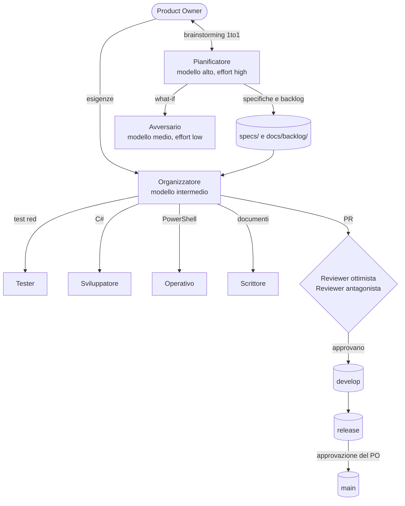

# 05 — Team di agenti per lo sviluppo spec-driven

Questo documento descrive un team di agenti orchestrato per sviluppare un progetto software con GitHub Copilot in VS Code.
Il team usa i modelli configurati con chiavi proprie (BYOK) nel documento [02-Configurazione-Copilot.md](02-Configurazione-Copilot.md): modelli costosi per analisi e pianificazione, modelli economici per l'implementazione.
I file del team sono in [`examples/agents/`](../examples/agents/README.md).

## Indice

1. [Scelte del Product Owner](#1-scelte-del-product-owner)
2. [Le figure del team](#2-le-figure-del-team)
3. [Architettura](#3-architettura)
4. [Modelli e costi](#4-modelli-e-costi)
5. [Vincoli tecnici di VS Code](#5-vincoli-tecnici-di-vs-code)
6. [Installazione del team in un repository](#6-installazione-del-team-in-un-repository)
7. [Uso del team](#7-uso-del-team)
8. [GitFlow e regole di qualità](#8-gitflow-e-regole-di-qualità)
9. [Sicurezza](#9-sicurezza)
10. [Punti da provare](#10-punti-da-provare)

## 1. Scelte del Product Owner

| Scelta | Valore | Decisione |
|---|---|---|
| Forma tecnica | *Custom agents* di VS Code (file `.agent.md`) con subagent | [D-033](Decisions.md#d-033) |
| Harness | Copilot; Local come riserva | [D-033](Decisions.md#d-033) |
| Posizione | Template in `examples/agents/` di questo repository | [D-033](Decisions.md#d-033) |
| Modelli | Misto per ruolo: Anthropic, OpenAI, OpenRouter | [D-034](Decisions.md#d-034) |
| Backlog | GitHub Spec Kit per le specifiche, file Markdown per Epic, Feature, Task | [D-035](Decisions.md#d-035) |
| Brainstorming | Il PO apre direttamente il Pianificatore | [D-035](Decisions.md#d-035) |
| Merge in `develop` | Organizzatore, dopo le due review e i test verdi | [D-035](Decisions.md#d-035) |
| Branching | GitFlow completo, con hotfix e back-merge | [D-035](Decisions.md#d-035) |
| TDD | Solo il Tester modifica i test | [D-035](Decisions.md#d-035) |
| Regole di scrittura | Testo originale ispirato ad ASD-STE100, nel repository | [D-036](Decisions.md#d-036) |

## 2. Le figure del team

| Figura | Compito | Scrive | Non fa |
|---|---|---|---|
| **Organizzatore** | Parla con il PO, assegna i task, controlla i risultati, apre le PR, unisce le Feature in `develop` | Stato del backlog, log | Codice, test, decisioni di prodotto, merge in `main` |
| **Pianificatore** | Brainstorming 1to1 con il PO; scompone in Epic, Feature, Task con SOLID e TDD; mantiene le regole di scrittura | `specs/`, `docs/backlog/`, `docs/team/writing-rules.md` | Decisioni al posto del PO |
| **Avversario** | Contraddice la scelta del PO: what-if con al massimo 2 alternative | Niente (solo risposta) | Raccomandazioni, modifiche ai file |
| **Tester** | Test automatici prima del codice: NUnit per C#, Pester per PowerShell; test d'integrazione della Release | `tests/` | Codice di produzione |
| **Sviluppatore** | Implementa in C# i task; snippet C# per lo Scrittore | Codice C# | Modifiche ai test |
| **Operativo** | Automazioni e task operativi in PowerShell; snippet PowerShell per lo Scrittore | Script PowerShell | Modifiche ai test, comandi distruttivi |
| **Scrittore** | Log di sviluppo, riferimento di librerie e API, manuale utente, manuale per sviluppatori | `docs/` | Codice, snippet |
| **Reviewer ottimista** | Review dell'*happy path*: efficienza, chiarezza, semplicità, manutenibilità | Niente (solo rilievi) | Modifiche ai file |
| **Reviewer antagonista** | Review contro l'*happy path*: eccezioni non gestite, resilienza, anomalie | Niente (solo rilievi) | Modifiche ai file |

Ogni figura è un file in [`examples/agents/.github/agents/`](../examples/agents/README.md). Il file contiene il modello, gli strumenti permessi e le istruzioni ([S-007](Sources.md#s-007), [S-072](Sources.md#s-072)).

## 3. Architettura



- Il PO parla con due agenti: **Organizzatore** e **Pianificatore**. Le altre figure sono subagent nascosti dal selettore degli agenti (`user-invocable: false`).
- L'Organizzatore chiama Tester, Sviluppatore, Operativo, Scrittore e i due Reviewer. Il Pianificatore chiama solo l'Avversario.
- Le figure comunicano con i file del repository: specifiche, backlog, test, codice, log. Un subagent non vede la conversazione di chi lo chiama ([S-165](Sources.md#s-165)).

## 4. Modelli e costi

Criterio: il costo del modello segue la quantità di ragionamento del compito. Il Pianificatore ragiona su tutto il progetto; le figure operative lavorano su task atomici.

| Figura | Provider | Modello | Effort | Prezzo input / output (USD per 1M token) |
|---|---|---|---|---|
| Pianificatore | Anthropic | `claude-fable-5-2` | `high` | 8 / 40 ([S-040](Sources.md#s-040)) |
| Organizzatore | Anthropic | `claude-sonnet-5-5` | default | 2 / 10 ([S-040](Sources.md#s-040)) |
| Avversario | OpenAI | `gpt-6.1-sol` | `low` | ⚠️ da verificare ([S-102](Sources.md#s-102)) |
| Sviluppatore, Operativo | OpenAI | `gpt-5.4-mini` | default | ⚠️ da verificare ([S-102](Sources.md#s-102)) |
| Tester, Scrittore | Anthropic | `claude-haiku-5-5` | default | da 0,10 / 0,50 ([S-040](Sources.md#s-040)) |
| Reviewer ottimista | OpenRouter | `deepseek/deepseek-v4.1-flash` | default | ⚠️ da verificare ([S-166](Sources.md#s-166)) |
| Reviewer antagonista | OpenRouter | `qwen/qwen3-coder` | default | ⚠️ da verificare ([S-166](Sources.md#s-166)) |

- I due Reviewer usano due modelli diversi: due punti di vista e due «famiglie» di errori.
- L'Avversario usa un provider diverso dal Pianificatore, con effort `low`: il ragionamento limitato evita più di 2 alternative.
- OpenAI non ha più modelli con il nome «Codex» correnti: le figure di codice usano i modelli generali indicati per il coding ([S-102](Sources.md#s-102)).
- Gli ID e i prezzi con ⚠️ vengono da pagine non ufficiali o senza prezzo: il prompt [P-12](Review-Perplexity.md#p-12--modelli-e-prezzi-per-il-team-di-agenti) li verifica.

## 5. Vincoli tecnici di VS Code

| Vincolo | Effetto sul team | Fonte |
|---|---|---|
| Un subagent non può fare domande all'utente | Il PO apre il Pianificatore direttamente per il brainstorming | [S-165](Sources.md#s-165) |
| Un subagent non riceve la conversazione principale | L'Organizzatore usa un modulo di consegna completo per ogni task | [S-165](Sources.md#s-165) |
| Un subagent con modello più costoso del modello principale non parte; un subagent BYOK mantiene il suo modello | Tutte le figure usano modelli BYOK | [S-165](Sources.md#s-165) |
| I subagent non chiamano altri subagent, senza un'impostazione dedicata | Lo Scrittore chiede gli snippet tramite l'Organizzatore | [S-165](Sources.md#s-165) |
| Gli *handoff* e il campo `agents` esistono solo nell'harness Local, che termina a febbraio 2027 | Il team usa i subagent dell'harness Copilot | [S-072](Sources.md#s-072), [S-068](Sources.md#s-068) |
| Nell'harness Copilot il BYOK è sperimentale | Punto da provare; riserva: harness Local | [S-068](Sources.md#s-068) |

**Differenze per l'harness Local (riserva).** Nei file `.agent.md`:

- togli `target: github-copilot` o usa `target: vscode`;
- scrivi `model` come `<nome del modello> (<vendor>)`;
- aggiungi `agents: [...]` all'Organizzatore e al Pianificatore per limitare i subagent permessi;
- lo strumento per i subagent è `agent/runSubagent` ([S-072](Sources.md#s-072), [S-165](Sources.md#s-165)).

## 6. Installazione del team in un repository

**Requisiti:** VS Code con GitHub Copilot ([01](01-Installazione.md)), modelli BYOK di Anthropic, OpenAI e OpenRouter ([02 §3](02-Configurazione-Copilot.md#3-configurazione-nativa-verso-i-provider)), `git`, `gh`, .NET SDK, PowerShell 7, GitHub Spec Kit ([02 Appendice A](02-Configurazione-Copilot.md#appendice-a--github-spec-kit-con-copilot)).

- [ ] Crea i rami `main` e `develop` nel repository del progetto e proteggili con un ruleset ([gitflow.md](../examples/agents/docs/team/gitflow.md)).
- [ ] Crea un ramo `feature/E00-F00-team-agenti` da `develop`.
- [ ] Copia il contenuto di `examples/agents/` nella radice del repository:

```bash
cp -R examples/agents/. /percorso/del/progetto/
```

```powershell
Copy-Item -Recurse -Force examples\agents\* C:\percorso\del\progetto\
Copy-Item -Recurse -Force examples\agents\.github C:\percorso\del\progetto\
Copy-Item -Force examples\agents\.gitignore C:\percorso\del\progetto\
```

- [ ] Se il progetto ha già un `.gitignore`, aggiungi la riga `.team/` invece di copiare il file.
- [ ] Inizializza Spec Kit nel progetto con l'integrazione Copilot ([02 Appendice A](02-Configurazione-Copilot.md#appendice-a--github-spec-kit-con-copilot)). ⚠️ Opzione per una cartella esistente: da verificare ([P-13](Review-Perplexity.md#p-13--gitflow-spec-kit-e-tdd-con-nunit-e-pester)).
- [ ] Apri il progetto in VS Code. Per ogni file in `.github/agents/` controlla il campo `model`: cancella l'ID e accetta l'ID che il completamento propone per il tuo modello BYOK ⚠️.
- [ ] Applica la baseline di sicurezza ([03 §7](03-Security-Best-Practices.md#7-baseline-di-configurazione)).
- [ ] Apri la PR verso `develop` e uniscila.

**Esito atteso:** il selettore degli agenti mostra **Organizzatore** e **Pianificatore**. Le altre figure non compaiono nel selettore.

## 7. Uso del team

### 7.1 Pianificazione

- [ ] Seleziona l'agente **Pianificatore** e descrivi l'esigenza.
- [ ] Rispondi alle domande. Per le scelte importanti il Pianificatore presenta il what-if dell'Avversario.
- [ ] Di' al Pianificatore quando le scelte sono complete. Il Pianificatore scrive `specs/`, `docs/backlog/` e aggiorna `docs/team/writing-rules.md`.
- [ ] Leggi il backlog e approvalo, o chiedi modifiche.

### 7.2 Sviluppo di una Feature

- [ ] Seleziona l'agente **Organizzatore** e chiedi di sviluppare la Feature (es. `E01-F01`).
- [ ] L'Organizzatore crea il ramo `feature/*` e per ogni task chiama, in ordine: Tester (*red*), Sviluppatore o Operativo (*green* e *refactor*), Scrittore.
- [ ] L'Organizzatore apre la PR verso `develop` e chiama i due Reviewer.
- [ ] Se i due Reviewer approvano e i test sono verdi, l'Organizzatore unisce la PR e ti presenta il riepilogo.

### 7.3 Release

- [ ] Chiedi all'Organizzatore di preparare la Release. L'Organizzatore crea `release/<versione>` da `develop`.
- [ ] Il Tester scrive ed esegue i test d'integrazione.
- [ ] I due Reviewer esaminano la PR verso `main`.
- [ ] Leggi il riepilogo, approva in modo esplicito ed esegui tu il merge in `main`.
- [ ] L'Organizzatore apre la PR di riallineamento verso `develop`.

## 8. GitFlow e regole di qualità

Il template usa GitFlow ([S-167](Sources.md#s-167)): `feature/*` → `develop` → `release/*` → `main`, più `hotfix/*`. Le regole complete sono in [gitflow.md](../examples/agents/docs/team/gitflow.md).

> Questo repository (WPC2026) usa GitHub Flow. GitFlow vale per il repository che riceve il template.

Regola di qualità di `main`: gli artefatti prodotti da `main` non contengono eccezioni non gestite e non si fermano per un'anomalia prevedibile. Tre controlli la applicano:

1. il Pianificatore scrive la gestione degli errori nei criteri di accettazione di ogni task di codice;
2. il Tester scrive test per input non validi ed errori attesi, e i test d'integrazione della Release;
3. il Reviewer antagonista assegna severità `alta` a ogni eccezione non gestita in una PR verso `main`.

## 9. Sicurezza

- **Privilegio minimo.** Ogni figura ha solo gli strumenti necessari: i Reviewer e l'Avversario leggono soltanto; solo l'Organizzatore usa `git` e `gh` per le PR ([03 §3](03-Security-Best-Practices.md#3-github-copilot-in-vs-code)).
- **Segreti.** Le istruzioni di ogni figura vietano di leggere `.env`, chiavi e token. Mantieni attiva la sandbox dell'agente ([03 §7](03-Security-Best-Practices.md#7-baseline-di-configurazione)).
- **Codice verso i provider.** Con il BYOK il codice del progetto va ai provider dei modelli. I due Reviewer mandano i diff a provider scelti da OpenRouter: configura i *guardrail* di OpenRouter (provider permessi, nessuna conservazione dei dati) prima di usare il team su codice riservato ([S-115](Sources.md#s-115), [S-151](Sources.md#s-151)).
- **Merge automatico.** L'Organizzatore unisce solo in `develop`. Il ruleset di GitHub deve impedire il merge in `main` senza l'approvazione del PO: le istruzioni di un agente non sono un controllo di sicurezza.
- **Prompt injection.** Un file del repository o una pagina web possono contenere istruzioni per l'agente. Lascia lo strumento `web` solo al Pianificatore ([04](04-Security-Review-OWASP-ISO27001.md)).

## 10. Punti da provare

- [ ] ⚠️ Formato dell'ID nel campo `model` per un modello BYOK nell'harness Copilot.
- [ ] ⚠️ BYOK sperimentale nell'harness Copilot: i subagent usano il modello del loro file?
- [ ] ⚠️ `reasoning-effort` applicato a un modello BYOK (`high` per il Pianificatore, `low` per l'Avversario).
- [ ] ⚠️ ID e prezzi dei modelli OpenAI e OpenRouter della tabella in §4.
- [ ] ⚠️ Nomi dei rami creati da Spec Kit rispetto a `feature/*` di GitFlow.
- [ ] ⚠️ Chiamate agli strumenti dei due modelli OpenRouter (sola lettura dei file).
