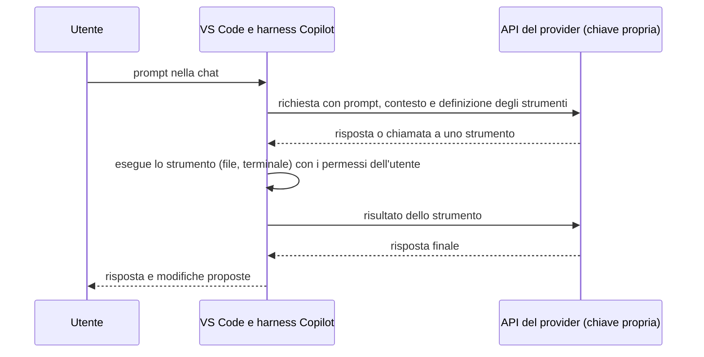

# 06 — BYOK in GitHub Copilot

Questo documento descrive in dettaglio il concetto di *Bring Your Own Key* (BYOK) in GitHub Copilot.
La procedura di configurazione è nel documento [02](02-Configurazione-Copilot.md). L'uso del BYOK con il team di agenti è nel documento [05](05-Team-Agenti.md).

## Indice

1. [Che cos'è il BYOK](#1-che-cosè-il-byok)
2. [I due meccanismi: BYOK locale e BYOK enterprise](#2-i-due-meccanismi-byok-locale-e-byok-enterprise)
3. [Cosa usa il modello BYOK e cosa no](#3-cosa-usa-il-modello-byok-e-cosa-no)
4. [Provider e Custom Endpoint](#4-provider-e-custom-endpoint)
5. [Il file `chatLanguageModels.json`](#5-il-file-chatlanguagemodelsjson)
6. [Chiavi API](#6-chiavi-api)
7. [BYOK e harness](#7-byok-e-harness)
8. [Policy, piani e fatturazione](#8-policy-piani-e-fatturazione)
9. [Limiti e rischi](#9-limiti-e-rischi)
10. [Il BYOK nel team di agenti](#10-il-byok-nel-team-di-agenti)
11. [Lista di controllo](#11-lista-di-controllo)

## 1. Che cos'è il BYOK

Con il BYOK usi GitHub Copilot con un modello che scegli tu: un modello di un provider esterno o un modello sul tuo computer ([S-015](Sources.md#s-015)).
In VS Code il BYOK collega la chat a un provider con la tua chiave API o il tuo endpoint; l'esperienza della chat e gli strumenti restano quelli di VS Code ([S-071](Sources.md#s-071)).

Due parti lavorano insieme:

| Parte | Chi la fornisce | Cosa fa |
|---|---|---|
| **Harness** | VS Code e GitHub Copilot | Esegue il ciclo dell'agente: prepara il prompt, offre gli strumenti (lettura, modifica, terminale), applica i permessi, mostra il risultato |
| **Modello** | Il provider che scegli | Riceve il prompt tramite la sua API e restituisce il testo o le chiamate agli strumenti |

Senza BYOK il modello passa dal servizio GitHub Copilot. Con il BYOK la richiesta di inferenza va all'API del provider, con la tua chiave.



## 2. I due meccanismi: BYOK locale e BYOK enterprise

GitHub distingue due meccanismi separati ([S-015](Sources.md#s-015)).

| | BYOK locale | BYOK enterprise (public preview) |
|---|---|---|
| Chi configura | Il singolo utente, nel suo client | Il proprietario dell'enterprise; l'organizzazione, se la policy *Enable custom models* lo permette |
| Dove sta la chiave | Sul client: la chiave resta lato client | Sul server GitHub |
| Chi usa il modello | Solo l'utente che lo ha configurato | Gli utenti con piano Copilot Business o Enterprise, dal selettore dei modelli |
| Percorso della richiesta | Dal client al provider | Dalla Copilot API al provider |
| Client | VS Code, JetBrains, Xcode, Copilot CLI, GitHub Copilot app, Copilot SDK | Copilot Chat, Copilot CLI, IDE |
| Requisiti | Non dipende dalla Copilot API: adatto anche ad ambienti isolati | Licenza Copilot e accesso a internet |

Questo repository usa il **BYOK locale**. Il BYOK enterprise è un'alternativa al gateway per le organizzazioni ([02 §4.6](02-Configurazione-Copilot.md#46-alternative-a-litellm)).

## 3. Cosa usa il modello BYOK e cosa no

| Funzione | Usa il modello BYOK | Nota | Fonte |
|---|---|---|---|
| Chat e agenti | Sì | Il modello deve supportare il *tool calling* per comparire in modalità agente | [S-071](Sources.md#s-071) |
| Subagent e *custom agents* | Sì | Campo `model` del file `.agent.md` | [S-072](Sources.md#s-072) |
| Compiti di utilità (titoli, sommari, messaggi di commit, descrizioni di PR, *intent detection*) | Sì, se configurati | Impostazioni `chat.utilityModel` e `chat.utilitySmallModel` | [S-071](Sources.md#s-071) |
| Sessioni dell'harness Copilot | Sì, sperimentale | Impostazione `chat.agentHost.byokModels.enabled` | [S-071](Sources.md#s-071) |
| Suggerimenti inline (completamento del codice) | **No** | Restano sul servizio GitHub Copilot | [S-071](Sources.md#s-071) |
| Ricerca semantica e funzioni basate su *embedding* | **No** | — | [S-071](Sources.md#s-071) |
| Voice Mode | **No** | Usa una sua impostazione per la chiave | [S-071](Sources.md#s-071) |

Conseguenza: il BYOK non rende Copilot indipendente da GitHub per tutte le funzioni. Senza accesso GitHub mancano i suggerimenti inline e i modelli di utilità built-in.

## 4. Provider e Custom Endpoint

Tre modi per aggiungere un modello ([S-071](Sources.md#s-071)):

1. **Provider built-in.** La documentazione nomina Azure, Anthropic, Gemini, OpenAI «e altri»; OpenRouter è tra i provider built-in ([S-070](Sources.md#s-070)). Il provider Ollama built-in è deprecato: usa l'estensione ufficiale.
2. **Estensioni.** Un'estensione aggiunge un provider, per esempio Hugging Face ([S-048](Sources.md#s-048)).
3. **Custom Endpoint.** Un endpoint compatibile, per esempio un gateway LiteLLM ([07](07-LiteLLM-Introduzione.md)).

Il Custom Endpoint accetta tre tipi di API nel campo `apiType`:

| `apiType` | Formato | Uso tipico |
|---|---|---|
| `chat-completions` (default) | OpenAI Chat Completions | Endpoint compatibili OpenAI, OpenRouter, gateway |
| `responses` | OpenAI Responses | Modelli OpenAI recenti |
| `messages` | Anthropic Messages | Modelli Claude con *thinking* e strumenti ([D-019](Decisions.md#d-019)) |

`apiType` si imposta sul provider o sul modello: il valore del modello ha la precedenza.

## 5. Il file `chatLanguageModels.json`

Il Language Models editor scrive la configurazione in `chatLanguageModels.json`. Esempi: [`examples/vscode/`](../examples/vscode/chatLanguageModels.native.json).

**Campi del provider:** `vendor`, `name`, `models`; opzionali `apiKey`, `apiType`, `url`.

**Campi del modello** ([S-071](Sources.md#s-071)):

| Campo | Significato |
|---|---|
| `id` | Identificativo inviato all'API |
| `name` | Nome nel selettore dei modelli |
| `url` | URL completo dell'endpoint |
| `toolCalling`, `vision` | Capacità del modello |
| `maxInputTokens`, `maxOutputTokens` | Limiti; la somma non supera la finestra di contesto |
| `supportsReasoningEffort`, `reasoningEffortFormat` | Abilitano il controllo dell'*effort* di ragionamento e ne indicano il formato |
| `modelOptions` | Parametri della richiesta, per esempio `temperature` |
| `requestHeaders` | Header HTTP aggiuntivi; gli header riservati sono ignorati |
| `statefulResponses` | Con `false` il client manda tutta la conversazione a ogni richiesta (server senza stato) |

```jsonc
// Esempio: modello di un gateway locale con controllo dell'effort. La chiave arriva da un input, non dal file.
{
  "vendor": "customendpoint",
  "name": "Gateway locale",
  "apiKey": "${input:gatewayKey}",
  "models": [
    {
      "id": "claude-sonnet",
      "name": "Gateway · Claude Sonnet",
      "url": "http://localhost:4000/v1/messages",
      "apiType": "messages",
      "toolCalling": true,
      "vision": true,
      "maxInputTokens": 180000,
      "maxOutputTokens": 16000,
      "supportsReasoningEffort": true
    }
  ]
}
```

⚠️ L'esempio mostra i campi: i valori dei limiti e il comportamento di `supportsReasoningEffort` vanno provati con il tuo modello.

## 6. Chiavi API

- Nel BYOK locale le chiavi sono gestite solo dal client e non sono condivise con altri utenti ([S-015](Sources.md#s-015)).
- Non scrivere la chiave in chiaro nel file: usa una variabile di input, per esempio `"apiKey": "${input:myApiKey}"` ([S-071](Sources.md#s-071)).
- Ogni postazione ha le chiavi di ogni provider. Un gateway riduce le chiavi sul client a una sola ([02 §4.1](02-Configurazione-Copilot.md#41-quando-usare-un-gateway)).
- Non mettere chiavi nel repository, nei file `.agent.md` o nelle evidenze ([03](03-Security-Best-Practices.md)).

## 7. BYOK e harness

| Harness | BYOK | Accesso GitHub | Stato |
|---|---|---|---|
| Local | Sì | Non richiesto: il BYOK funziona senza accesso GitHub e senza piano Copilot | Deprecato; rimozione a febbraio 2027 ([S-068](Sources.md#s-068)) |
| Copilot | Sì, con `chat.agentHost.byokModels.enabled` | Vedi la documentazione degli account della finestra Agents | BYOK sperimentale ([S-071](Sources.md#s-071)) |

- Senza accesso GitHub imposta `chat.utilityModel` e `chat.utilitySmallModel` su un modello BYOK: i modelli di utilità built-in non sono disponibili.
- Un modello locale (per esempio con Ollama) lavora senza rete. Le funzioni che dipendono dal servizio GitHub Copilot non lavorano senza rete.
- I *custom agents* nell'harness Copilot richiedono un'altra impostazione ([05 §5](05-Team-Agenti.md#5-vincoli-tecnici-di-vs-code)).

## 8. Policy, piani e fatturazione

- **Piani individuali.** Gli utenti con un piano individuale aggiungono i modelli BYOK senza una policy ([S-071](Sources.md#s-071)).
- **Copilot Business ed Enterprise.** La policy *Bring Your Own Language Model Key in VS Code* controlla il BYOK locale negli IDE. Le fonti non sono coerenti sul default: vedi [02 §2.5](02-Configurazione-Copilot.md#25-policy-per-copilot-business-ed-enterprise) e [D-013](Decisions.md#d-013).
- **Fatturazione.** Il BYOK locale non consuma crediti Copilot: il provider fattura le chiamate ([S-018](Sources.md#s-018)). ⚠️ La pagina di VS Code sui modelli non descrive la fatturazione delle richieste BYOK.
- **Costi.** Con il BYOK paghi ogni token: scegli il modello in base al compito ([05 §4](05-Team-Agenti.md#4-modelli-e-costi)).

## 9. Limiti e rischi

| Limite o rischio | Effetto | Azione |
|---|---|---|
| Un modello senza *tool calling* non compare in modalità agente | L'agente non lo può usare | Controlla `toolCalling` e la scheda del modello |
| Il modello non compare subito | — | Riavvia VS Code ([S-071](Sources.md#s-071)) |
| Custom Endpoint in WSL, SSH, Dev Container | Il modello può non essere selezionabile | Issue aperta ([S-077](Sources.md#s-077)) |
| Il codice va al provider scelto | Valgono le condizioni del provider su conservazione e uso dei dati | Leggi le condizioni; con OpenRouter imposta provider permessi e nessuna conservazione ([S-115](Sources.md#s-115)) |
| Filtri e protezioni del servizio GitHub Copilot | ⚠️ La documentazione letta non dice quali filtri restano attivi con il BYOK | Non contare su filtri del servizio; applica la baseline ([03 §7](03-Security-Best-Practices.md#7-baseline-di-configurazione)) |
| *Content exclusion* | ⚠️ Comportamento con il BYOK da verificare ([03](03-Security-Best-Practices.md)) | Non usare la content exclusion come unica protezione |
| Qualità diversa tra modelli | Un modello economico può sbagliare le chiamate agli strumenti | Prova il modello sul compito reale ([05 §11](05-Team-Agenti.md#11-punti-da-provare)) |

## 10. Il BYOK nel team di agenti

Il team del documento [05](05-Team-Agenti.md) usa il BYOK per dare a ogni figura un modello diverso:

1. il PO configura i modelli di Anthropic, OpenAI e OpenRouter nel Language Models editor;
2. ogni file `.agent.md` indica il suo modello nel campo `model`;
3. l'harness Copilot esegue l'agente e manda le richieste al provider del modello;
4. il costo segue il compito: modello alto per il Pianificatore, modelli economici per le figure operative ([D-037](Decisions.md#d-037)).

Con un gateway LiteLLM il punto 1 cambia: VS Code conosce un solo endpoint e una sola chiave, e i nomi dei modelli sono alias del gateway ([07](07-LiteLLM-Introduzione.md)).

## 11. Lista di controllo

- [ ] Il piano o la policy permette il BYOK locale.
- [ ] Ogni modello ha `toolCalling: true` se un agente lo usa.
- [ ] Nessuna chiave è scritta in chiaro in un file.
- [ ] I modelli di utilità sono configurati, se lavori senza accesso GitHub.
- [ ] `chat.agentHost.byokModels.enabled` è attivo, se usi l'harness Copilot.
- [ ] Hai letto le condizioni sui dati di ogni provider.
- [ ] Sai quali funzioni restano sul servizio GitHub Copilot (suggerimenti inline, ricerca semantica).
