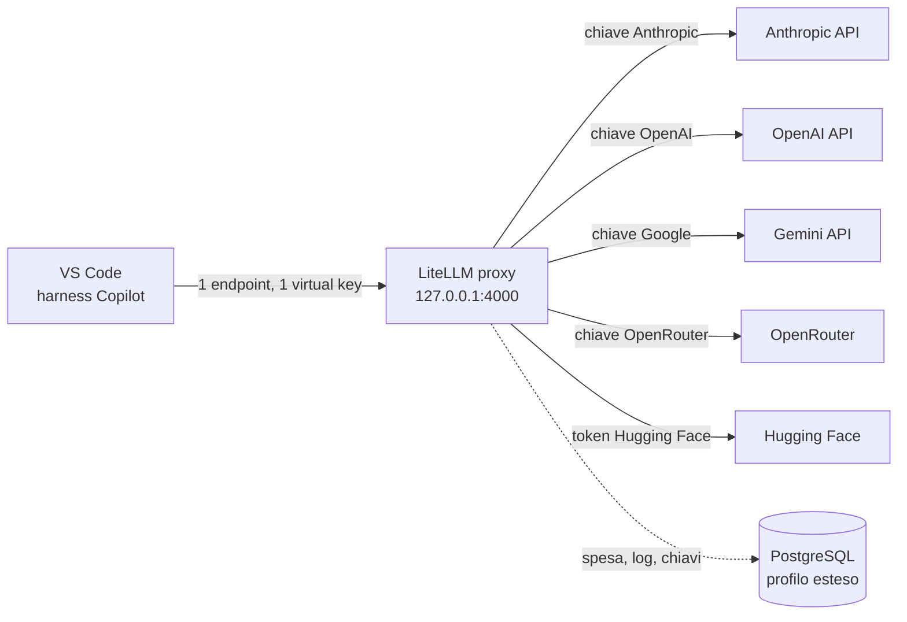

# 07 — Introduzione a LiteLLM e alle feature del rilascio stable

Questo documento presenta LiteLLM e le feature disponibili nel rilascio stable usato in questo repository: **1.108.2**, linea LTS 1.108.
L'installazione è nel documento [01](01-Installazione.md). La configurazione con GitHub Copilot è in [02 §4](02-Configurazione-Copilot.md#4-github-copilot-con-litellm-come-gateway). La sicurezza è in [03](03-Security-Best-Practices.md).

## Indice

1. [Che cos'è LiteLLM](#1-che-cosè-litellm)
2. [LiteLLM tra VS Code e i provider](#2-litellm-tra-vs-code-e-i-provider)
3. [Rilasci: stable, LTS e tag](#3-rilasci-stable-lts-e-tag)
4. [Feature del proxy](#4-feature-del-proxy)
5. [Feature Enterprise](#5-feature-enterprise)
6. [Feature usate negli esempi di questo repository](#6-feature-usate-negli-esempi-di-questo-repository)
7. [Rischi](#7-rischi)
8. [Quando usare LiteLLM](#8-quando-usare-litellm)

## 1. Che cos'è LiteLLM

LiteLLM è una libreria open source che offre una sola interfaccia, nel formato OpenAI, per chiamare più di 100 modelli LLM ([S-182](Sources.md#s-182)). Si usa in due modi:

| Modo | Che cos'è | Per chi |
|---|---|---|
| **Python SDK** | Libreria per chiamare i modelli dal codice: `completion()`, `embedding()`, router con nuovi tentativi e fallback | Sviluppatori che scrivono un'applicazione |
| **Proxy Server** (*LLM Gateway*, *AI Gateway*) | Servizio da ospitare in proprio, compatibile con l'API OpenAI | Team di piattaforma che controllano l'accesso ai modelli in un'organizzazione |

Questo repository usa il **proxy**: i client compatibili OpenAI lo usano senza modifiche al codice. VS Code lo vede come un Custom Endpoint ([06 §4](06-BYOK-GitHub-Copilot.md#4-provider-e-custom-endpoint)).

## 2. LiteLLM tra VS Code e i provider

- VS Code manda il nome di un alias (`model_name`). Il proxy lo traduce nel modello del provider e nel suo formato ([S-022](Sources.md#s-022)).
- Le chiavi dei provider stanno solo sul gateway. Il client ha una chiave del gateway.
- Il proxy espone i tre formati che VS Code usa: Chat Completions, Responses e Messages ([S-028](Sources.md#s-028), [S-029](Sources.md#s-029)).

## 3. Rilasci: stable, LTS e tag

| Concetto | Significato | Fonte |
|---|---|---|
| Versione stable | Una *release candidate* che ha superato i controlli e una seconda serie di prove manuali. Forma `1.x.x` | [S-185](Sources.md#s-185) |
| Nomi dalla 1.84.0 | Versioni in forma standard: senza i suffissi `-stable` e `-nightly`; una versione *minor* per il rilascio settimanale, una *patch* per le correzioni | [S-186](Sources.md#s-186) |
| Giorno di rilascio | Dal 2 novembre 2026 release candidate e stable escono il martedì | [S-187](Sources.md#s-187) |
| Linea LTS | Prova di un mese, dalla settimana del 2 novembre 2026. Prima linea: **1.108**. Le patch LTS portano correzioni alla traduzione dei formati e al calcolo dei costi, e nuovi endpoint | [S-184](Sources.md#s-184) |
| Supporto delle versioni | La regola delle quattro linee stable più recenti è sospesa durante la prova LTS | [S-184](Sources.md#s-184) |

**Tag delle immagini Docker**

| Tag | Comportamento | Uso in questo repository |
|---|---|---|
| `1.108.2` (o `v1.108.2`) | Versione fissa | **Sì** ([D-018](Decisions.md#d-018)) |
| `lts` | Segue l'ultima patch LTS | No: è un tag mobile |
| `latest` | Segue l'ultima stable | No: è un tag mobile |
| `main-stable` | Vecchio tag mobile, deprecato | No |

Raccomandazione del vendor per la produzione: fissa l'ultima versione stable `1.x.x` ([S-185](Sources.md#s-185)). I tag mobili sono stati compromessi nell'incidente di ottobre 2026 ([S-104](Sources.md#s-104)).

**La versione 1.108.2.** È una patch sopra la 1.108.1, senza nuove migrazioni del database e senza nuovi provider. Contiene correzioni, tra cui: livelli di servizio di Bedrock Converse, PDF in base64 verso Claude, instradamento con tag e con *prompt cache*, righe di spesa durante il riavvio di PostgreSQL, `response_format: json_object` sulle rotte `openai/responses/*` ([S-119](Sources.md#s-119)).

> ⚠️ Dopo la prova LTS la politica di supporto può cambiare: la pagina non dice cosa succede alla fine del mese. Controlla [S-184](Sources.md#s-184) prima del talk.

## 4. Feature del proxy

La documentazione di LiteLLM non è divisa per versione. Questa tabella elenca le feature descritte nella documentazione corrente il 2026-11-14, con la versione stable 1.108.2 come riferimento.

| Feature | Cosa fa | Dove si configura | Fonte |
|---|---|---|---|
| API unificata | Un endpoint compatibile OpenAI per i modelli di più provider | `model_list` in `config.yaml` | [S-182](Sources.md#s-182), [S-022](Sources.md#s-022) |
| Alias dei modelli | Nome stabile (`model_name`) separato dal modello del provider | `model_list` | [S-022](Sources.md#s-022) |
| Formati `/v1/chat/completions`, `/v1/responses`, `/v1/messages` | Traduce tra i formati OpenAI e Anthropic | Rotta scelta dal client | [S-028](Sources.md#s-028), [S-029](Sources.md#s-029) |
| *Virtual keys* | Chiavi del gateway per utente o team, con budget e limiti di frequenza | Admin UI o API; richiede il database | [S-031](Sources.md#s-031), [S-182](Sources.md#s-182) |
| Tracciamento della spesa | Spesa per chiave, team e utente, su tutti i provider | Database | [S-182](Sources.md#s-182) |
| Bilanciamento e fallback | Distribuisce le richieste tra più *deployment* e passa a un altro in caso di errore | `router_settings`, `fallbacks` | [S-182](Sources.md#s-182) |
| *Guardrail* | Filtri sul contenuto, mascheramento di dati personali, controlli di sicurezza | `guardrails` in `config.yaml` | [S-182](Sources.md#s-182) |
| Cache | Riusa le risposte | `cache` in `litellm_settings` | [S-182](Sources.md#s-182) |
| Log e osservabilità | Log centralizzati; integrazioni con Langfuse, MLflow, Helicone | `callbacks` | [S-182](Sources.md#s-182) |
| Admin UI | Interfaccia web per chiavi, modelli, spesa | `/ui` | [S-148](Sources.md#s-148) |
| MCP Gateway | Espone strumenti MCP con controllo di accesso per chiave | Admin UI o `config.yaml` | [S-182](Sources.md#s-182) |
| Agent Gateway | Registra e chiama agenti A2A | Admin UI | [S-182](Sources.md#s-182) |
| *Health check* | Controlla lo stato del proxy e dei modelli | `/health/*` | [S-117](Sources.md#s-117) |
| Thinking e reasoning | Porta il contenuto di ragionamento dei modelli | Parametri del modello | [S-110](Sources.md#s-110) |

⚠️ I nomi delle sezioni di `config.yaml` nella colonna «Dove si configura» sono un orientamento: controlla la sintassi esatta in [S-022](Sources.md#s-022) prima di usarli.

## 5. Feature Enterprise

Alcune feature richiedono una licenza Enterprise ([S-183](Sources.md#s-183)).

| Area | Feature Enterprise |
|---|---|
| Accesso | SSO per l'Admin UI; autenticazione JWT |
| Sicurezza | Integrazione con *secret manager* (AWS, Google, Azure, HashiCorp Vault); liste di indirizzi IP permessi; rotazione delle chiavi; limiti di dimensione delle richieste; controllo delle rotte pubbliche e private |
| Audit | Log di audit con periodo di conservazione |
| Log e privacy | Log per team; disattivazione dei log per un team |
| Aspetto | Pagina Swagger personalizzata |

⚠️ Per altre voci (metriche Prometheus, controllo dei guardrail per chiave, esportazione della spesa) la pagina non dice in modo chiaro se serve la licenza. Controlla la pagina prima di progettare su queste feature.

Conseguenza per questo repository: la baseline raccomanda l'SSO per l'Admin UI ([02 §4.1](02-Configurazione-Copilot.md#41-quando-usare-un-gateway)), ma l'SSO è una feature Enterprise. Senza licenza proteggi l'Admin UI con il bind su `127.0.0.1` e la procedura del primo amministratore ([S-148](Sources.md#s-148)).

## 6. Feature usate negli esempi di questo repository

| Feature | File | Profilo |
|---|---|---|
| Alias dei modelli per 5 provider | [`examples/litellm/config.yaml`](../examples/litellm/config.yaml) | minimo ed esteso |
| Chiavi dei provider da variabili d'ambiente (`os.environ/…`) | `config.yaml`, `.env` | minimo ed esteso |
| Parametri del provider OpenRouter (`extra_body.provider`) | `config.yaml` | minimo ed esteso |
| Formato `/v1/messages` per Claude | [`chatLanguageModels.litellm.json`](../examples/vscode/chatLanguageModels.litellm.json) | minimo ed esteso |
| *Virtual keys*, budget, spesa, Admin UI | `compose.extended.yaml` con PostgreSQL | esteso ([02 §4.4](02-Configurazione-Copilot.md#44-profilo-esteso-virtual-keys-per-utente)) |
| *Health check* | Runbook | minimo ed esteso |

Gli esempi **non** usano: guardrail, cache, bilanciamento tra deployment, MCP Gateway, Agent Gateway, integrazioni di osservabilità.

## 7. Rischi

Un gateway concentra le chiavi di tutti i provider: una compromissione ha un impatto più grande di una chiave su un client. Nel 2026 LiteLLM ha avuto due incidenti di supply chain e vulnerabilità critiche del proxy ([S-104](Sources.md#s-104), [S-105](Sources.md#s-105), [S-106](Sources.md#s-106)).

Applica sempre l'hardening minimo di [02 §4.1](02-Configurazione-Copilot.md#41-quando-usare-un-gateway) e le pratiche di [03](03-Security-Best-Practices.md): versione fissa, bind su `127.0.0.1`, solo *virtual keys* agli sviluppatori.

## 8. Quando usare LiteLLM

| Contesto | Scelta |
|---|---|
| Un solo sviluppatore, pochi provider | BYOK nativo ([06](06-BYOK-GitHub-Copilot.md)) |
| Team con chiavi condivise, budget, elenco dei modelli permessi, log centrali | Gateway LiteLLM con hardening |
| Organizzazione con Copilot Business o Enterprise | Valuta prima il BYOK enterprise di GitHub ([06 §2](06-BYOK-GitHub-Copilot.md#2-i-due-meccanismi-byok-locale-e-byok-enterprise)) |

Il criterio completo è nella decisione [D-017](Decisions.md#d-017).
