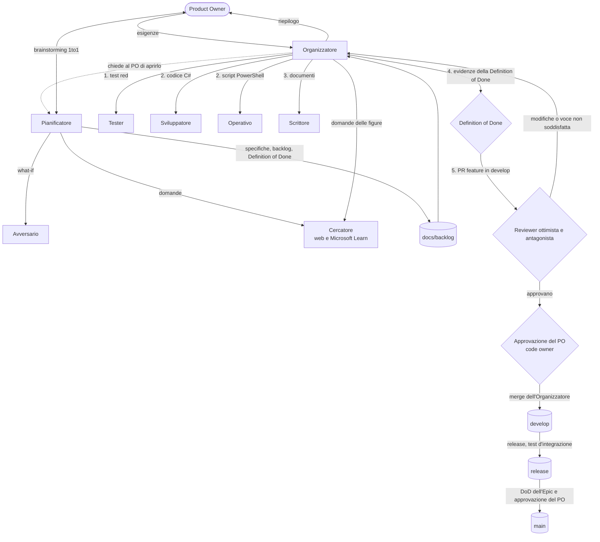

# Ciclo di lavoro del team

## Figure e modelli

| Figura | Chi la chiama | Modello | Livello |
|---|---|---|---|
| Organizzatore | PO | `claude-sonnet-5-5` | intermedio |
| Pianificatore | PO (su indicazione dell'Organizzatore) | `claude-fable-5-2`, effort `high` | alto |
| Avversario | Pianificatore | `gpt-6.1-sol`, effort `low` | medio, ragionamento limitato |
| Cercatore | Pianificatore, Organizzatore | `claude-haiku-5-5` | basso |
| Tester | Organizzatore | `z-ai/glm-5.3` (OpenRouter) | medio/basso |
| Sviluppatore | Organizzatore | `gpt-6-luna` | basso |
| Operativo | Organizzatore | `gpt-6-luna` | basso |
| Scrittore | Organizzatore | `claude-haiku-5-5` | basso |
| Reviewer ottimista | Organizzatore | `deepseek/deepseek-v4.1-flash` (OpenRouter) | basso |
| Reviewer antagonista | Organizzatore | `qwen/qwen3.5-397b-a17b` (OpenRouter, provider `novita` → `venice` → `gmicloud`) | medio/basso |

Il modello di ogni figura è nel campo `model` del suo file in `.github/agents/`.

## Flusso

## Definition of Done

Lo sviluppo di una Feature o di un'Epic è concluso solo quando la sua Definition of Done è completa ([backlog.md](backlog.md)).

1. Il Pianificatore scrive la Definition of Done in ogni `feature.md` ed `epic.md`.
2. L'Organizzatore compila le evidenze prima di chiedere le review.
3. Ogni Reviewer controlla le voci e non approva se una voce non è soddisfatta o non ha un'evidenza.
4. L'Organizzatore unisce la PR in `develop` solo con le voci da DoD-F1 a DoD-F7 soddisfatte: DoD-F7 comprende l'approvazione del PO su GitHub. Dopo il merge registra DoD-F8 e DoD-F9 e solo allora cambia lo stato in `done`.

## Ricerche

Solo il Cercatore usa internet. Usa Microsoft Learn (server MCP `microsoft-learn`) come fonte primaria per C#, .NET e PowerShell. Non modifica file e non esegue comandi. Le altre figure chiedono una ricerca al Pianificatore o all'Organizzatore.

> ⚠️ **Avviso — rischio indiretto del Cercatore.** Il Cercatore non modifica file e non esegue comandi, ma la sua risposta arriva a figure che lo fanno. Un esempio di codice o un testo preso da una pagina web può quindi arrivare, tramite l'Organizzatore o il Pianificatore, a chi modifica file ed esegue test. Il rischio è accettato dal PO con queste difese: il Cercatore non riporta comandi di download o di installazione; chi riceve un esempio lo confronta con il task e non lo esegue così com'è; la sandbox e l'approvazione manuale dei comandi restano attive; il PO legge il diff prima di approvare la PR.

> ⚠️ **Avviso — server MCP in due file.** Il server `microsoft-learn` è dichiarato due volte, perché i due formati non sono intercambiabili: `.mcp.json` nella radice (chiave `mcpServers`) per l'harness Copilot, con l'impostazione sperimentale `chat.mcp.workspaceRootConfig.enabled`; `.vscode/mcp.json` (chiave `servers`) per l'harness Local. Se cambi il server, cambia **tutti e due** i file. Il nome del server deve restare `microsoft-learn`: il Cercatore lo usa nel campo `tools` (`microsoft-learn/*`).

## Ciclo TDD di un task di codice

1. **Red** — il Tester scrive i test; i test falliscono.
2. **Green** — lo Sviluppatore o l'Operativo scrive il codice minimo; i test passano.
3. **Refactor** — chi implementa migliora il codice con i test verdi.
4. Solo il Tester modifica i test. Chi implementa segnala un test sbagliato all'Organizzatore.

## Punti in cui decide il PO

- Tutte le scelte del brainstorming con il Pianificatore.
- L'aggiornamento di Spec Kit, all'inizio di una pianificazione.
- La rimozione di una voce dalla Definition of Done.
- L'approvazione di ogni PR verso `develop` (il PO è il *code owner*).
- L'approvazione e il merge della PR `release/*` → `main` e `hotfix/*` → `main`.
- Ogni domanda che una figura restituisce perché il task non è chiaro.

## File di lavoro

La cartella `.team/` contiene file temporanei (per esempio i diff per i Reviewer). È esclusa da git.
