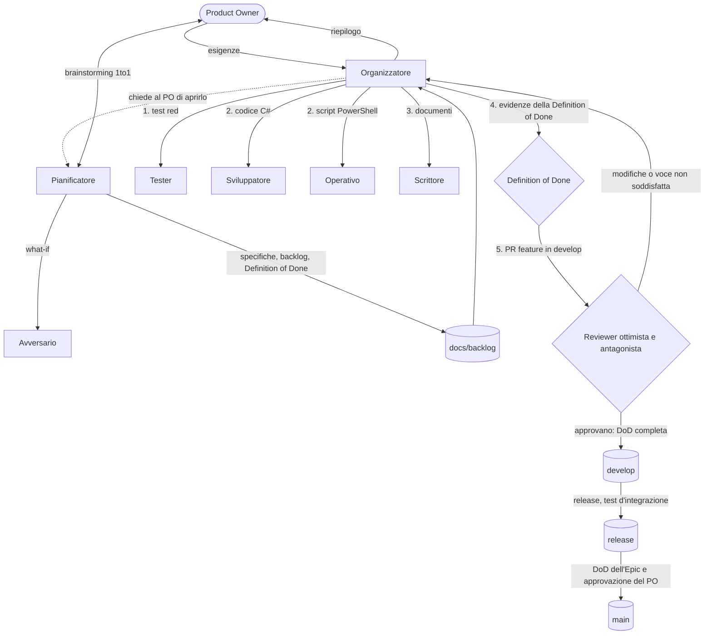

# Ciclo di lavoro del team

## Figure e modelli

| Figura | Chi la chiama | Modello | Livello |
|---|---|---|---|
| Organizzatore | PO | `claude-sonnet-5-5` | intermedio |
| Pianificatore | PO (su indicazione dell'Organizzatore) | `claude-fable-5-2`, effort `high` | alto |
| Avversario | Pianificatore | `gpt-6.1-sol`, effort `low` | medio, ragionamento limitato |
| Tester | Organizzatore | `z-ai/glm-5.3` (OpenRouter) | medio/basso |
| Sviluppatore | Organizzatore | `gpt-6-luna` | basso |
| Operativo | Organizzatore | `gpt-6-luna` | basso |
| Scrittore | Organizzatore | `claude-haiku-5-5` | basso |
| Reviewer ottimista | Organizzatore | `deepseek/deepseek-v4.1-flash` (OpenRouter) | basso |
| Reviewer antagonista | Organizzatore | `qwen/qwen3.5-397b-a17b` (OpenRouter, provider `novita` → `venice` → `gmicloud`) | medio/basso |

Il modello di ogni figura è nel campo `model` del suo file in `.github/agents/`.

## Flusso

## Definition of Done

Lo sviluppo di una Feature o di un'Epic è concluso solo quando la sua Definition of Done è completa ([backlog.md](backlog.md)).

1. Il Pianificatore scrive la Definition of Done in ogni `feature.md` ed `epic.md`.
2. L'Organizzatore compila le evidenze prima di chiedere le review.
3. Ogni Reviewer controlla le voci e non approva se una voce non è soddisfatta o non ha un'evidenza.
4. L'Organizzatore unisce la PR in `develop` solo con le voci da DoD-F1 a DoD-F7 soddisfatte. Dopo il merge registra DoD-F8 e DoD-F9 e solo allora cambia lo stato in `done`.

## Ciclo TDD di un task di codice

1. **Red** — il Tester scrive i test; i test falliscono.
2. **Green** — lo Sviluppatore o l'Operativo scrive il codice minimo; i test passano.
3. **Refactor** — chi implementa migliora il codice con i test verdi.
4. Solo il Tester modifica i test. Chi implementa segnala un test sbagliato all'Organizzatore.

## Punti in cui decide il PO

- Tutte le scelte del brainstorming con il Pianificatore.
- La rimozione di una voce dalla Definition of Done.
- L'approvazione e il merge della PR `release/*` → `main` e `hotfix/*` → `main`.
- Ogni domanda che una figura restituisce perché il task non è chiaro.

## File di lavoro

La cartella `.team/` contiene file temporanei (per esempio i diff per i Reviewer). È esclusa da git.
