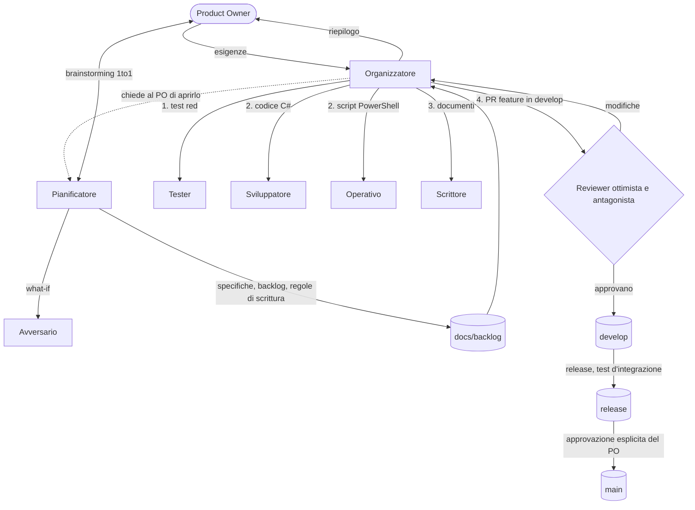

# Ciclo di lavoro del team

## Figure e modelli

| Figura | Chi la chiama | Modello | Livello |
|---|---|---|---|
| Organizzatore | PO | `claude-sonnet-5-5` | intermedio |
| Pianificatore | PO (su indicazione dell'Organizzatore) | `claude-fable-5-2`, effort `high` | alto |
| Avversario | Pianificatore | `gpt-6.1-sol`, effort `low` | medio, ragionamento limitato |
| Tester | Organizzatore | `claude-haiku-5-5` | medio/basso |
| Sviluppatore | Organizzatore | `gpt-5.4-mini` | medio/basso |
| Operativo | Organizzatore | `gpt-5.4-mini` | medio/basso |
| Scrittore | Organizzatore | `claude-haiku-5-5` | medio/basso |
| Reviewer ottimista | Organizzatore | `deepseek/deepseek-v4.1-flash` (OpenRouter) | medio/basso |
| Reviewer antagonista | Organizzatore | `qwen/qwen3-coder` (OpenRouter) | medio/basso |

Il modello di ogni figura è nel campo `model` del suo file in `.github/agents/`.

## Flusso

## Ciclo TDD di un task di codice

1. **Red** — il Tester scrive i test; i test falliscono.
2. **Green** — lo Sviluppatore o l'Operativo scrive il codice minimo; i test passano.
3. **Refactor** — chi implementa migliora il codice con i test verdi.
4. Solo il Tester modifica i test. Chi implementa segnala un test sbagliato all'Organizzatore.

## Punti in cui decide il PO

- Tutte le scelte del brainstorming con il Pianificatore.
- L'approvazione della PR `release/*` → `main` e `hotfix/*` → `main`.
- Ogni domanda che una figura restituisce perché il task non è chiaro.

## File di lavoro

La cartella `.team/` contiene file temporanei (per esempio i diff per i Reviewer). È esclusa da git.
